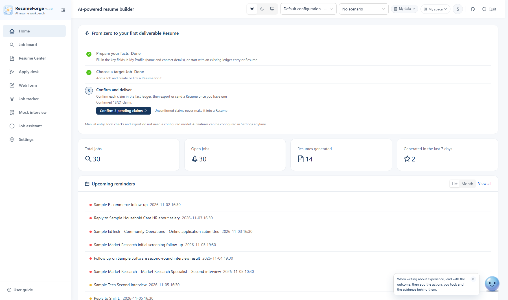
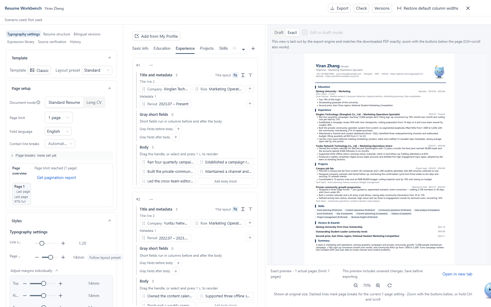
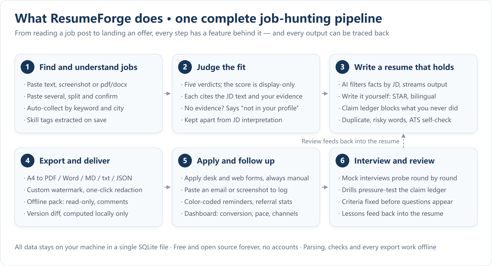
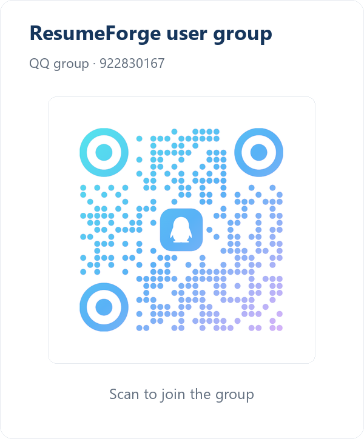

<div align="center">


# ResumeForge

[](https://github.com/magicapple123/ResumeForge/actions/workflows/ci.yml)
[](https://github.com/magicapple123/ResumeForge/releases)
[](LICENSE)
[](https://github.com/magicapple123/ResumeForge/stargazers)
[](https://github.com/magicapple123/ResumeForge/releases)
[](docs/user-guide.md)
[](docs/user-guide.md)
[](.github/workflows/ci.yml)

**A local-first AI resume workbench: no account, no sign-in, and all data stays on your machine.**

<h3>
<a href="https://magicapple123.github.io/ResumeForge-official/demo.html">Live demo (no install)</a>
 · 
<a href="https://magicapple123.github.io/ResumeForge-official/docs.html">User guide</a>
 · 
<a href="https://magicapple123.github.io/ResumeForge-official/">Website</a>
</h3>

<p align="center"><a href="README.zh-CN.md">简体中文</a> · <b>English</b></p>

Version: `2.0.0` · [Releases](https://github.com/magicapple123/ResumeForge/releases) · [Full user guide](docs/user-guide.md) · [Architecture](docs/architecture.md)

<p>
<a href="#-community-and-feedback"><b>QQ group: <code>922830167</code></b></a>
<br>
<sub>Use the group for installation and usage questions, feature requests and bug reports. <b>The installers are also mirrored in the group files</b> for when GitHub downloads are slow or interrupted. <a href="#-community-and-feedback">Group QR code</a></sub>
</p>

</div>

> The live demo is a **read-only build**: the interface is the real one, the data is fictional and the AI output is a pre-recorded replay. To generate, export and apply for real, follow [Installation](#-installation) and run the app locally: on first launch, `start.cmd` on Windows or `start.command` on macOS prepares the environment automatically. The installer or archive for your platform can also be downloaded from the [website](https://magicapple123.github.io/ResumeForge-official/) (Windows installer / macOS dmg / portable archive for both platforms), without going through GitHub.

---

## A look at the interface

All screenshots are taken from the **shipped desktop build**; the content is the **fictional sample data** bundled with it and contains no real user material.

**Home**: a progress checklist, Job and Resume counts and upcoming reminders color-coded by urgency — the current workload on a single screen.

<p align="center">
  
</p>

**Resume workbench**: typography settings and page overview on the left (page limit, pagination report), Resume content in the middle and the A4 preview on the right in exact mode, rendering the exported PDF itself; any parameter change updates all three.

<p align="center">
  
</p>

The remaining screens (Job Square, apply desk, Web form, mock interview, Fact ledger), together with preview zoom, layout diagnosis and the export panel, are reachable from the sidebar after [Installation](#-installation). More screenshots are in the [gallery on the website](https://magicapple123.github.io/ResumeForge-official/en/#gallery).

## What ResumeForge does

An end-to-end pipeline from screening a job posting to interview review; the output of each stage can be revised and fed back into earlier stages.

<p align="center">
  
</p>

It addresses a specific problem: **job-search material is fragmented.** JDs live in browser bookmarks, the resume exists as several “final” files, application progress is kept in notes, interview questions are forgotten afterwards, and after multiple revisions it is hard to tell which version went to which company.

A second problem matters more: **generative models polish wording and also fabricate.** The greatest risk in a resume tool is not poor typography but writing content that never happened, which surfaces at the first follow-up question. ResumeForge therefore separates **facts** from **wording** and manages them independently: school, company and project names in generated output are compared entry by entry against the Profile library, and any mismatch raises an **anti-fabrication warning**; if the body still contains unfilled 【待补】 (“to fill”) markers, the export is blocked with the exact positions listed.

## ✨ Features

<details>
<summary><b>All features at a glance (77 items, click to expand)</b></summary>

<p>Every feature name below links to its section in the official docs; the sections that were missing have been written in this pass.</p>

<br>

| Area | Description |
| --- | --- |
| [📋 Job management](https://magicapple123.github.io/ResumeForge-official/en/docs.html#jobs-manual) | Paste a posting and it is parsed into a draft; **paste several at once and each is split out and confirmed one by one**; skill tags and their sources are labeled automatically |
| [🗂 Candidate jobs](https://magicapple123.github.io/ResumeForge-official/en/docs.html#jobs-pool) | Park postings you have not vetted yet, then import them into Jobs in one click (the assistant can import them for you too) |
| [📥 Drag and drop](https://magicapple123.github.io/ResumeForge-official/en/docs.html#jobs-drag) | Job parsing, attachments, photos and dataset backups can all be dragged in from your file manager; drop anywhere in the window and the extension routes it: `.zip` imports a dataset, `.csv` imports a job sheet, `.json` starts a hand-written Resume |
| [🖱 Batch status changes](https://magicapple123.github.io/ResumeForge-official/en/docs.html#jobs-batch) | Right-click a row in Job Square and choose “Batch select” to enter multi-select, then use the batch toolbar to **set the status** of the ticked Jobs in one go, or delete them |
| [💡 JD breakdown](https://magicapple123.github.io/ResumeForge-official/en/docs.html#match-reading) | Generates a structured summary of the requirements, the supporting quotes from the original posting, and general preparation advice |
| [🎯 Match analysis](https://magicapple123.github.io/ResumeForge-official/en/docs.html#match-five) | Compares your Profile against the JD line by line and returns five verdict types plus an applying recommendation, with quotes and evidence; the verdicts **carry no percentage**, and admission looks only at the verdict |
| [📊 Reference score](https://magicapple123.github.io/ResumeForge-official/en/docs.html#match-score) | A 0–100 score with 5 sub-scores, **display-only and never part of admission**, always shown with a disclaimer |
| [📈 Batch match analysis](https://magicapple123.github.io/ResumeForge-official/en/docs.html#match-batch) | In Job Square, switch to selection mode, tick several Jobs and choose “AI analyse fit”: each Job is analysed **one by one** against your Profile and listed from the highest reference score down; run it now or in the background, and results are saved to Analysis history for later |
| [🤖 AI Job comparison](https://magicapple123.github.io/ResumeForge-official/en/docs.html#match-compare) | Tick 2–12 Jobs in Job Square and the AI first checks each match, then ranks them side by side and explains why; it runs in the background and saves the result to Analysis history |
| [👤 Profile library](https://magicapple123.github.io/ResumeForge-official/en/docs.html#profile-sections) | Thirteen Sections (Basic information / Education / Experience / Projects / Skills / Campus activities / Honors & awards / Summary / Academic achievements / Research Projects / Intellectual Property / Certifications & Qualifications / Language proficiency) unified into one Profile library: **only the Sections in the Current Plan appear**, empty Sections show an empty state; Basic information and Summary are single entries, everything else can be added, removed and drag-reordered; click a heading to **collapse** it (collapsed Fields with values still reach the AI and the paper), and only **Hidden** excludes it, keeps the value and can be restored. You can add Custom Sections (open-source contributions, say) and add Custom Fields to any Section, including the 13 built-in ones: when adding, choose a **Paper placement** (Title line / Metadata / Gray fields before body / Body / Gray fields after body / not on paper; short fields default to gray-after-body, multi-line fields to body) and **Material only** (feeds AI generation and Web form, never printed); a Custom Section prints as its own block and can be laid out the same way. **Every Section can be shown or hidden on the Profile page individually** (hidden = removed from the Current Plan, excluded from generation, export and Web form; Basic information cannot be hidden), and “Hidden Sections” at the top restores them one at a time; Fields are now a responsive multi-column grid rather than one field per row |
| [🗂 Plans and the Current Plan](https://magicapple123.github.io/ResumeForge-official/en/docs.html#profile-plans) | A Plan records only “a name plus which Sections take part” and **copies no Profile data** — any edit inside a Plan is immediately visible in every Plan; the “Current Plan” dropdown and “Manage Plans” sit in the Profile page header, and switching only affects what later creations, generations and Web form runs read: saved Resumes and drafts in progress are untouched. “Profile settings” in the page header opens the same panel, whose **Plan / Sections and fields** tabs manage Plans, Sections and Fields; the per-card gear and “Manage Plans” remain. Generation, creation and Web form all read through the Current Plan, and a Plan can only **remove** material, never add to what may be sent; the default Plan always exists and cannot be deleted, so deleting the current one falls back to it with a notice. **A new Plan starts with every Section hidden** except Basic information; when created outside the editor you are switched to it and can reveal Sections one by one; Custom Sections carry a “Custom” badge next to their heading on the Profile page |
| [🧭 Legacy Profile upgrade notes](https://magicapple123.github.io/ResumeForge-official/en/docs.html#upgrade-legacy) | Upgrading a 1.0 Profile library to 2.0 archives the whole package under `backend/data/legacy-archive/` and starts 2.0 on an empty database; 1.0 releases only warned and never moved data |
| [🌐 Career scenarios](https://magicapple123.github.io/ResumeForge-official/en/docs.html#profile-scenario) | The “Career scenario” menu in the app header combines career stage, target industry and function, employment status and purpose (with built-in shortcuts such as career change, research applications and returning to work, plus your own). **Switching only changes the guidance and suggestions in this window — never your Profile, Jobs, existing Resumes, applying settings or background tasks**; when generating you must explicitly turn on “Use for this generation” (off by default, and employment status is not sent by default), and the server freezes a snapshot of the scenario used for that run |
| [📝 Web form profile](https://magicapple123.github.io/ResumeForge-official/en/docs.html#webform-data) | The **unified Web form supplement** inside My Profile, sitting next to the Resume material: ID and certificates, family, student status, health and availability; Education, Experience, Projects, Academic achievements, Certifications & Qualifications, portfolio and social accounts can all hold several entries. **Text recognition**: paste a whole screen of fields from a Web form (or hand over a screenshot or a PDF/Word file) and anything that maps to an existing field is filled in; fields outside the catalogue are listed as pending items and only added once you tick them, and **recognition results are proofread before they are written, and can be cancelled while running**. Web form filling reads Resume basics and the Web form supplement together; **Resume generation does not read the Web form profile**. Attachment notes are text only — files must be uploaded by hand |
| [🪪 Web form-only material](https://magicapple123.github.io/ResumeForge-official/en/docs.html#webform-data) | The old “Web form-only material” — country and region, ID, date of birth, political affiliation, native place, family details — is folded into the unified Web form profile; old values are still readable and are **used for filling only, never printed in an export** |
| [🖼 Resume photos](https://magicapple123.github.io/ResumeForge-official/en/docs.html#profile-photo) | Up to 8 photos; click a thumbnail to pick which one is used; **they stay on your machine and are never sent to a model** |
| [🧾 Fact ledger](https://magicapple123.github.io/ResumeForge-official/en/docs.html#claims-status) | Every claim records the fact, the wording, how strongly you own it and its boundary; **only “confirmed” entries take part in generation**, and unconfirmed ones are explicitly avoided |
| [📦 Material library](https://magicapple123.github.io/ResumeForge-official/en/docs.html#materials) | Certificates, portfolio items, links and notes in one place, with attachments, and a card view for details; the assistant can read and cite them |
| [📁 File copy store](https://magicapple123.github.io/ResumeForge-official/en/docs.html#materials-copies) | The “File copies” tab in the Material library shows a copy of every file you stored (images and PDFs preview inline, anything else opens in its system app in one click); copies live in the application data directory and are rebuilt automatically when you switch datasets or migrate; the assistant can list them |
| [🖼 Screenshot and document recognition](https://magicapple123.github.io/ResumeForge-official/en/docs.html#recognition-input) | Job and Profile recognition accept screenshots and pdf / docx (paste an image with Ctrl+V, up to 4 files, ≤2 MB each and ≤5 MB in total) and extract the text locally; **results are listed as a checklist for proofreading and only written after you confirm, and recognition can be cancelled at any point** |
| [🤖 AI-tailored Resume](https://magicapple123.github.io/ResumeForge-official/en/docs.html#generate) | Streams a Resume generated from facts filtered by the JD; you choose the enhancement strength, length (1–3 A4 pages), font size and Template (6 built in); **the font can be the bundled Source Han Sans (about 32 MB, downloaded on demand in Settings) or any font you uploaded before, and only affects preview / HTML / PDF** (Word and Markdown do not follow it); **Section order is adjustable** (in the preview, and PDF / Word / Markdown exports follow); **the contact block can force a line break before any field** (each field stays whole, so long URLs are never truncated) |
| [✍️ Write the Resume yourself](https://magicapple123.github.io/ResumeForge-official/en/docs.html#write-editor) | Pre-fill from your Profile and then edit freely, with the JD's responsibilities and requirements kept alongside for reference; **the tabs and visible Fields follow the Current Plan of My Profile** (frozen at creation), and Custom Sections use the same three-zone card editor as system Sections (title and metadata / gray text before and after the body / body); every Field is an independent draggable block that can sit on the Title line / Metadata / Gray fields before body / Body / Gray fields after body / Hidden; Custom Fields land by Paper placement just like default Fields instead of being written into a carrier as “label: value”; **the “New Resume” dialog now shares the workbench editor** (three-zone cards plus Field placement, with the initial content projected from the Current Plan); Language proficiency is a separate tab; **the “Fill from My Profile” menu at the top of the middle column groups sources and only fills empty Fields**, never overwriting what you typed; open a Field and click again to collapse it, hide or delete Fields and Entries from the context menu, and a Field you reveal returns to where it was; “Resume structure” has a single collapse toggle (it reads “Collapse all” when expanded and “Expand all” when collapsed) and a “Order” panel for moving Sections up and down; new Resumes and AI generation follow the My Profile order by default, which you can adjust by hand or sync in one click, and a general creation can clear everything; the “+” at the end of the tab strip creates a Section **for this Resume only** (it does not appear in the Profile library), and a Custom Section can be deleted from its tab with Ctrl+Z to undo |
| [✍️ Resume writing aids](https://magicapple123.github.io/ResumeForge-official/en/docs.html#write-transforms) | **STAR quantification**, a **phrasing generator**, **multi-style polishing**, **translation between Chinese and English** and **version diffing** (computed locally); in “Adjust resume content” select a passage, right-click “AI polish”, and **only that passage changes** (you see the result before it is written) |
| [⚡ Revise with AI](https://magicapple123.github.io/ResumeForge-official/en/docs.html#generate-revise) | “Revise / regenerate with AI” at the bottom of the preview: give instructions and **only what you asked about changes** (the rest is preserved word for word); leave it empty and the whole Resume is regenerated (same facts, new wording); Job suggestions can be **accepted one by one** and update the current Resume directly |
| [🎓 Research Resume](https://magicapple123.github.io/ResumeForge-official/en/docs.html#write-academic) | Four columns in the middle of the workbench — Academic achievements / Research Projects / Intellectual Property / Certifications & Qualifications — with title, author order and your own position, publication status (**under review is not the same as published**; six values including under review and preprint), DOI or link, and issuer / date / status for credentials; empty rows write nothing. “Document mode” under “Layout” switches between **Standard Resume and Long CV** (standard is 1–3 pages, Long CV allows up to 10, and switching back clamps and warns); the generation dialog can set it explicitly too (it never switches on its own); page breaks can be set per Section or per Entry (see the pagination row) |
| [🌐 General Resume](https://magicapple123.github.io/ResumeForge-official/en/docs.html#generate-general) | “Generate with AI” in the Resume Center header, or a hand-written “New resume”, produces a cross-industry Resume **aimed at no particular Job**: the whole Profile is used, nothing is filtered by direction, experience in every direction is kept, and you can have as many as you like; generation can pick Standard Resume or Long CV. A new Resume's tabs, tab names and each Section's **visible Fields** follow the **Current Plan** (Custom Sections show the name you gave them, Fields hidden in the Profile do not appear, Sections missing from the Current Plan have no inputs, and Sections that already hold body text always stay), and are frozen into that Resume at creation — later Plan changes only affect Resumes created afterwards; changes to the Profile or a Plan switch refresh it automatically |
| [🗂 Expression library](https://magicapple123.github.io/ResumeForge-official/en/docs.html#write-assets) | Save wording you like (results / methods / outcomes / summaries) and search it by keyword, type, language and Job tag; insert one into another Resume in one click (it becomes a new object) and keep editing afterwards |
| [🔗 Source verification and fact locks](https://magicapple123.github.io/ResumeForge-official/en/docs.html#claims-source) | “Source verification” in the left column: select a piece of content and see which Profile entry it came from, which revision it was linked at, and whether the source has since changed; **if it is not linked, it says so — it never guesses from textual similarity**. You can create or break a source link for the selected content, add a manual source, inspect the impact surface and revisions, and after a source changes **adopt the latest source back into the body** (conditional write on revision, with conflict prompts); fact locks pin name / organisation / dates / numbers / responsibility boundaries, and an AI rewrite that tries to move them is rejected with **a value-by-value list of what would change** — the locks constrain the AI only, never your own edits |
| [🛡 Anti-fabrication check](https://magicapple123.github.io/ResumeForge-official/en/docs.html#generate-fabrication) | The school, company and project names in generated output are compared against your Profile library and any mismatch raises a warning |
| [🛡 Quality and compliance checks](https://magicapple123.github.io/ResumeForge-official/en/docs.html#quality) | Duplicate detection, sensitive words, exaggeration risk, deep-dive risk, compliance and ATS checks, all local and all wired to the Fact ledger |
| [🧭 Generation notes](https://magicapple123.github.io/ResumeForge-official/en/docs.html#generate-notes) | A collapsible “why this Resume looks like this” in the preview: Job signals, what the generation was composed of and why things were left out; material that did **not** make it in is listed as a **neutral checklist** grouped by Section (kept apart from “possible fabrication” warnings), and each group offers **“Let AI write this part”**; generation reads the GitHub profile and personal site from your Profile and prints them on the Resume |
| [📚 Resume history](https://magicapple123.github.io/ResumeForge-official/en/docs.html#generate-center) | Every generated and hand-written Resume is kept; favorite it, filter by source, add a Note and export it again |
| [🔗 Job links](https://magicapple123.github.io/ResumeForge-official/en/docs.html#jobs-related) | One Job can link several Resumes, and you can jump between the Job and the Resume in both directions |
| [🧰 Workbench](https://magicapple123.github.io/ResumeForge-official/en/docs.html#skills) | Two pages, “Skills” and “Layout”: fill in the parameters (line height / page margins / accent color and so on) and the Resume is compressed onto one page, or let the assistant do it. Custom-template authoring and HTML import are retired; old templates still render as they are |
| [🎨 Try and compare](https://magicapple123.github.io/ResumeForge-official/en/docs.html#templates-trial) | “Try and compare” in the workbench template gallery: compare two Templates side by side **using my content**, with real page counts and overflow; the layout override can “keep the current layout override” or “adopt the Template default” (which clears font size, line spacing, colors, page margins and local typography and asks for confirmation first, with one undo before saving); leaving the trial does not touch the Plan, and only adopting writes to history |
| [🧭 Resume structure](https://magicapple123.github.io/ResumeForge-official/en/docs.html#write-outline) | “Resume structure” in the left column (formerly “Document outline”) groups content by page / column → Section → Entry → placement (Title line / Metadata / Gray fields before body / Body / Gray fields after body / Hidden): drag to reorder, drag a Field into another placement group to change where it prints, copy it, **hide** it (excluded from the real export), or lock its content or its typography; it supports **structure search** (filter and highlight, keyboard navigation) and hovering a Field on the paper locates it directly, and Fields and bullet points can be hidden or copied individually. While you drag, the tree and the preview on the right **follow in real time** (also when a narrow window tucks the editor into a drawer, where the change still counts as unsaved work), and a single history step is recorded only when you let go |
| [🖥 Professional view](https://magicapple123.github.io/ResumeForge-official/en/docs.html#layout-pro) | Preview toolbar: whole page / fit width / 100% zoom, page navigation, guides and a grayscale proof; the action bar's “Commands”, or Cmd/Ctrl+Shift+P, opens the command palette, and a workspace preset only toggles panel visibility; “Crop photo” only changes the framing (**the original is untouched** and can be restored), and all three exports use the same derived crop; **without a crop the photo is shown at its own aspect ratio** and is never forced into a square or stretched |
| [🔠 Local typography](https://magicapple123.github.io/ResumeForge-official/en/docs.html#write-field-layout) | The “Styles” group in the left column sets **global font size, tracking and line spacing, page margins and the appearance colors**; anything you have not overridden follows the Template and is labeled with where it comes from, and can be reset to inherited item by item (type a value or step it, Shift-click for five steps); per-Field and per-role local typography lives in the middle column under **right-click → “Adjust typography”**: the scope is inferred from the selected Field, and color, line spacing, indent, bullets, alignment and tracking can be changed in place, date and metadata Fields also offer a “Date position” (date on the right / date right after the title, with the draft and the exact PDF agreeing); the text tools above the body input offer **bold** and **links** (clickable in HTML, rendered as the visible text “text (URL)” in PDF and Word) while the italic entry is gone; the three bullet outlets are unified as “· / – / none”; the “Entry field typography” panel sets, per Section or per Entry, the 1–3 columns, alignment, column gap, order and full-row span of the gray fields before and after the body, columns are equal-width by default, and with two or more you can **set each column's width** (as a percentage that must add up to 100 before it applies) and **each gap**; HTML / PDF / Word / Markdown all share the same packing result |
| [📄 Pagination control](https://magicapple123.github.io/ResumeForge-official/en/docs.html#layout-paging) | “Typography settings → Pagination” in the left column: **Sections** can be set to “start on a new page / keep together”, and **Entries** selected in “Resume structure” can be set the same way, saved with the Resume and honoured identically by HTML / PDF / Word. **The page overview and “Get pagination report”** measure page count, last-page usage, overflow and manual breaks through the same pipeline as the real PDF; the page cells are laid out at equal width and “Page limit reached” appears once the limit is used up; the draft preview never fakes pagination and never draws fake page breaks |
| [🎛 Layout optimization](https://magicapple123.github.io/ResumeForge-official/en/docs.html#write-optimize) | “Optimize under constraints” below the layout diagnosis card in the preview: set the constraints first (do not change font size / minimum page margins / target 1–2 pages), then get up to 3 **different** candidates (which parameters changed, how much overflow was removed, the readability cost); applying writes the values back into the sliders; when nothing is feasible it says why and **never shrinks the font size silently**; there are also **content reduction candidates** (merge duplicate entries, deduplicate bullet points, trim low-relevance material) which you confirm item by item |
| [✅ Workbench checks](https://magicapple123.github.io/ResumeForge-official/en/docs.html#write-check) | “Check Resume” in the action bar examines content, typography and the exported artifact together, sorts problems into “must fix / worth checking / typography suggestion”, points at the location and the way to fix it, and can be re-run afterwards |
| [🏷 Save-conflict choice](https://magicapple123.github.io/ResumeForge-official/en/docs.html#write-conflict) | When you save in the Resume workbench and the same Resume was changed in another window, you are asked to “use the latest”, “compare the differences” or “save a copy”; **your changes never silently overwrite someone else's** |
| [↪ Undo and redo](https://magicapple123.github.io/ResumeForge-official/en/docs.html#write-history) | “History” in the left column: every content, typography and structure action can be undone or redone (consecutive typing collapses into one step); **each step spells out what changed** (Sections added, removed or reordered / Entries added, removed or hidden / Fields added, moved or removed / how many passages changed / typography parameters), with name, Entry count and page count on hover, and clicking a step returns you to it; a bad edit is one click away from being undone, and **⌘/Ctrl+Z and ⇧⌘/Ctrl+Z work too** |
| [🗃 Named versions and Job variants](https://magicapple123.github.io/ResumeForge-official/en/docs.html#write-versions) | “Versions” at the top of the workbench: store the current content and typography as an **immutable snapshot** (create, with an optional name that is generated when left blank / freeze a marker / compare the default and the previous version Field by Field as “old → new” / restore); restoring produces **a new current version** while past versions and records already applied with stay as they are. Job variants are edited independently (create from the current Resume or from a career scenario, then “Create variant”), can **selectively sync** the content paths you tick without overwriting other Job tailoring, and can hold **their own typography** and be exported straight from the variant |
| [🌐 Bilingual versions and glossary](https://magicapple123.github.io/ResumeForge-official/en/docs.html#write-bilingual) | “Bilingual versions” in the workbench: field-by-field Chinese/English comparison, translation candidates generated per Field and **accepted item by item** (only the language variant you pick is written, and the current Resume is never overwritten); a dataset-level glossary pins fixed translations (people, companies, skills and so on), and deleting an entry moves it to the trash where it can be restored. Candidates are generated in batches, so **a large Resume no longer times out mid-run**, and “Translation preview” opens a read-only preview that leaves the master document untouched and creates no dirty values |
| [📦 Export shape](https://magicapple123.github.io/ResumeForge-official/en/docs.html#export-forms) | The export dialog starts by choosing a **delivery pack** or **individual files**: a delivery pack wraps the chosen formats into one zip (optionally archiving the originals and a hash manifest), while individual files let you multi-select formats and **export them one by one** with a progress indicator showing how many are done, and when one fails it tells you how many already succeeded. Both share the same typography result and export configuration |
| [📄 Multi-format export](https://magicapple123.github.io/ResumeForge-official/en/docs.html#export-formats) | PDF **downloads directly** (rendered on the server); Word / HTML / Markdown / txt / JSON all export; HTML / PDF / Word and Markdown with typography are **rendered from one and the same layout result on the server** — same fields, same order — and JSON emits the new document structure (including each item's paper placement and typography); watermarks and **one-click redaction** are supported. The preview toolbar can switch to **“Exact”**, which shows exactly the PDF the export engine lays out, point for point identical to the file you download; after configuring a watermark or redaction you can **preview the real artifact** before exporting. Past the page limit it **never shrinks the font size**: it truncates at the limit and says so |
| [📦 Delivery pack export](https://magicapple123.github.io/ResumeForge-official/en/docs.html#export-archive) | “Export delivery pack” on the Resume detail: formats and naming rules, watermark / redaction, **a preview of the real artifact configuration**, savable as an export configuration; exports a zip plus a manifest (hashed item by item) and can archive the **delivery originals** (hashes and the font / render versions used, which you can inspect and delete) |
| [💾 Save location](https://magicapple123.github.io/ResumeForge-official/en/docs.html#privacy-save) | Settings → the “Data & export” tab → the “Save location” card: by default exports only go to the browser's download directory, and once you pick a folder with the native picker, exports from the local front end **also land a copy there**; remote or cross-site exports are refused |
| [📦 Offline share pack](https://magicapple123.github.io/ResumeForge-official/en/docs.html#share) | Packs a redacted HTML / PDF plus a read-only snapshot and a comment-return file, and can be “read-only” or “commentable”; a commentable pack supports **annotations on objects**: import the returned `annotations.json` and mark each annotation resolved or ignored, and annotations whose object changed must be re-linked (annotations never enter any applying artifact) |
| [🚀 Automatic apply desk](https://magicapple123.github.io/ResumeForge-official/en/docs.html#apply) | Collect automatically by keyword and city (site filters are carried over wholesale and it runs in the background); confirmed Jobs queue up and drive your local browser to apply, and **only Jobs whose source is inside a recruiting site are accepted** |
| [📝 Web form](https://magicapple123.github.io/ResumeForge-official/en/docs.html#webform) | Fills corporate application forms in a **separate dedicated browser**: type a URL to open it in a new tab and manage the URL history without clobbering pages you already have open; each page can be switched between batch and point-and-fill. It reads the whole page and checks each value before filling, or confirms a suggestion next to the input you click; fields the rules cannot recognise can be handed to the AI, which **only receives page text and field names, never your Profile values**. The browser model is shared with the apply desk but runs in its own window; fill records contain real values and stay local. **It fills, it never submits**, and passwords and verification codes are never filled automatically; **it only writes into text-like controls** — dropdowns, radio buttons, checkboxes and date pickers are left alone and honestly listed as “needs your click”; a separate **relaxed mode** can try label and context matching and click dropdown and popover options (see the next row). When filling finishes it shows the **success rate** (fields filled / readable fields on the page) and can export **redacted diagnostics that contain no Resume values**, which makes it easy to report a field it could not recognise |
| [🟢 Relaxed mode](https://magicapple123.github.io/ResumeForge-official/en/docs.html#webform-relaxed) | The Web form's **optional exception, off by default**: once you explicitly switch it on, it tries to match unrecognised text inputs (including Custom Fields) by label and context and clicks dropdown and popover options itself (**strict option matching plus read-back verification**); in relaxed text matching, low-confidence candidates backed only by weak context are left unticked for you to confirm, and repeated experience entries are only filled when the record count and the page order can be paired. Consent and declaration checkboxes still need item-by-item confirmation; date pickers and file uploads are never touched. The Job assistant has no tool to switch it on — do it on the page or in Settings. Relaxed matching can pick wrong, so proofread after filling; a multi-value popover only acts when every value matches |
| [🧠 Learnt while filling](https://magicapple123.github.io/ResumeForge-official/en/docs.html#webform-learned) | When you hit a field **ResumeForge does not know**, **both entry points** can record it: batch mode shows one summary prompt when it finishes (**everything ticked, everything “General” by default**, and you can untick individual items), and point-and-fill puts a “Remember this” next to **every box**, so you can **record it on the spot** — **even a box it recognised but has no value for** (fill it in place without jumping to another page). Once remembered, the same field is **pre-filled automatically** next time. Each entry picks a scope: **General** (true wherever you apply) / **Scenario** (tied to an applying channel) / **This time** (recorded but never auto-filled, for one-off values such as a referral code). Source and scope can be edited or removed in the Web form profile at any time, and **values the AI recognised are labeled “AI recognised”** because it is likelier than the rules to misread a field. **Custom Fields outside the catalogue** (a supervisor's name, a lab, say) can take part in Web form filling too: normal mode accepts only a unique exact match, and relaxed mode matches by label or context and flags low confidence; when something is ambiguous or fails a safety veto it does not guess, so proofread after filling. **There is exactly one destination, the Web form profile**: Resume fields are never learnt (the code that could modify them does not exist), and passwords, verification codes and other people's details are intercepted and cannot be learnt. Everything stays local and **is never read during Resume generation** |
| [🎯 Job tracker](https://magicapple123.github.io/ResumeForge-official/en/docs.html#tracker) | One record per company walks from “applied → screening → assessment → interview → offer”; paste an email or a screenshot to recognise progress, and preview it before it is written |
| [🗓 Calendar reminders](https://magicapple123.github.io/ResumeForge-official/en/docs.html#reminder) | Set reminders for applications, interviews, referrals and so on, **color-coded by urgency** (overdue / within 24 hours / within 3 days / later), with a list and a month view |
| [🤝 Referral management](https://magicapple123.github.io/ResumeForge-official/en/docs.html#referral) | Record the referrer, the referral code and note images, follow up by status and compute a **referral conversion rate** |
| [📈 Job search analytics](https://magicapple123.github.io/ResumeForge-official/en/docs.html#analytics) | Four themes — conversion and blockers, timing and pace, channels and destinations, Resume and health; **every chart is its own block with its own title and its own definition**, and trends cover the last 1 / 3 / 6 months |
| [⭐ Favorites](https://magicapple123.github.io/ResumeForge-official/en/docs.html#jobs-favorites) | Browse favorited Jobs and Resumes on pages, jump to a detail view or remove the favorite |
| [🎤 Mock interview](https://magicapple123.github.io/ResumeForge-official/en/docs.html#interview) | Set the Job, the difficulty and the interviewer's style, then answer round by round while the interviewer comments and probes; the session closes with per-dimension scores and improvement advice; **you can keep probing below the report, or stop** (probing does not consume official rounds); material can be picked from records or imported as files (the Job side takes PDF / TXT, the Resume side takes screenshots, and a parse failure says why) |
| [🎯 Personalized question bank](https://magicapple123.github.io/ResumeForge-official/en/docs.html#bank-questions) | Generates three kinds of question per Job — **basics / project deep dive / questions for HR** — with a reference answer available for any single question; real interview questions can be used to reverse-engineer edits to the Resume |
| [🔎 Interview deep dive](https://magicapple123.github.io/ResumeForge-official/en/docs.html#drill) | Stress-tests the Fact ledger entry by entry, with **the criteria fixed before you ever see the question**; instead of a score it reports “verified / partly verified / unverified / contradictory” |
| [🧠 Interview notes base](https://magicapple123.github.io/ResumeForge-official/en/docs.html#bank-exp) | Captures real interview experience (company / Job / questions / retrospective) and makes it searchable, with cards that open the full text |
| [📖 Knowledge base](https://magicapple123.github.io/ResumeForge-official/en/docs.html#materials) | Written material such as interview summaries, Resume tips and search strategy, with category tags and Markdown previews; the assistant can search, add and edit it |
| [💬 AI Job assistant](https://magicapple123.github.io/ResumeForge-official/en/docs.html#assistant) | Streaming chat that can be linked to a Job / Resume / Profile and to web search; it can look up reminders, referrals, interview notes and analytics and **only writes data when you explicitly ask**; before answering it is given the local time and weekday (late at night it suggests going to bed); its tool set covers applying-failure diagnosis, typography queries, and recording interview notes and referrals; open it from the Toutou bubble on any page; the sidebar and the floating chat keep separate histories, and the floating one only exposes web search and reasoning effort |
| [🔓 Assistant relaxed mode](https://magicapple123.github.io/ResumeForge-official/en/docs.html#assistant-relaxed) | Settings → the “Assistant & AI behaviour” tab → the “Assistant relaxed mode” card: off by default; once on and **announced in advance**, the assistant may read the full Profile (including sensitive fields such as name and phone number, Web form values and past conversations), while credentials such as API keys are never sent in any mode |
| [🧩 Skills](https://magicapple123.github.io/ResumeForge-official/en/docs.html#skills) | Create, import and edit skills (a prompt plus knowledge files); once enabled they constrain how the assistant answers |
| [🗒 Conversation management](https://magicapple123.github.io/ResumeForge-official/en/docs.html#assistant-sessions) | Rename, pin, favorite, group and archive conversations, and export them as Markdown or save them to the Material library |
| [📌 Toutou clipboard](https://magicapple123.github.io/ResumeForge-official/en/docs.html#assistant-clipboard) | **Double-click the Toutou bubble** to open it: store snippets you paste repeatedly and copy them in one click; they only live in your local browser and are never uploaded (a single click still opens the assistant) |
| [🏠 Home](https://magicapple123.github.io/ResumeForge-official/en/docs.html#home) | Quick entries in the order you use them, across 7 destinations; the upcoming-reminders card embeds a compact month calendar |
| [🖱 Interface details](https://magicapple123.github.io/ResumeForge-official/en/docs.html#shortcuts) | Row actions collapse into “More actions”; lists and cards **open their detail view on a single click** (Enter works too); dates are picked from a calendar; **modules you do not use can be switched off in Settings → “Appearance & interaction” → “Interface and navigation”** (only the entry is hidden, no data is deleted, and Home and Settings always remain) |
| [🔍 Global search](https://magicapple123.github.io/ResumeForge-official/en/docs.html#search) | One box that searches Jobs, Resumes, referrals, reminders, interview notes, the Fact ledger, the Material library and Skills at once |
| [📤 Outbound preview and usage](https://magicapple123.github.io/ResumeForge-official/en/docs.html#privacy-outbound) | Settings page: before you send Profile material to a model or another service, see **what is about to go out** (target service, categories of material, attachments, excluded fields, whether page text is fetched and the text itself); “Model usage” lists calls and tokens per task / model — **an unknown token count is never shown as 0**, and no cost is estimated without a configured price. The preview text exists in memory only and is never written to disk; usage can be broken down per task / model / dataset with **end reasons and retries**, and cost is only estimated when a unit price is configured |
| [✅ Batch select and delete](https://magicapple123.github.io/ResumeForge-official/en/docs.html#shortcuts-batch) | Resume Center, assistant conversation history, past interviews, deep-dive history, calendar reminders, question bank history and Web form fill records all support **batch selection**: “Batch select” → tick → “Delete selected” with one confirmation (everything goes to the trash and can be restored) |
| [🔄 Check and update](https://magicapple123.github.io/ResumeForge-official/en/docs.html#upgrade-check) | Settings can check for a new version and create, export and import datasets; a dataset backup **includes the model API key by default** (you can untick it; on Windows it is carried DPAPI-encrypted); **on Windows double-click `start.cmd` / `stop.cmd` / `update.cmd`, on macOS double-click `start.command` / `stop.command` / `update.command`** — all zero-dependency one-click scripts — and `uninstall.cmd` cleans up the local environment |
| [♻️ Trash](https://magicapple123.github.io/ResumeForge-official/en/docs.html#trash) | 22 kinds of content go to the trash first and can be restored or destroyed in bulk; only a second confirmation really destroys anything. Since 2026-10 the four kinds “Plans / Custom Sections / Custom Fields / Profile entries” are included |
| [🔑 Your key, your call](https://magicapple123.github.io/ResumeForge-official/en/docs.html#model-presets) | 16 built-in service presets (DeepSeek / Claude / Doubao / OpenAI / Ollama …) with model discovery, advanced parameters and a switchable API protocol |

</details>

## 📦 Installation

**The release build is the recommended option**: no repository clone and no Python or Node.js to install. All packages are on the [Release page](https://github.com/magicapple123/ResumeForge/releases), each with a matching `.sha256`; they can also be downloaded from the [website](https://magicapple123.github.io/ResumeForge-official/) if GitHub is slow.

Supported: **Windows 10/11 (x64)** and **macOS 13+ (Intel, and Apple Silicon via Rosetta 2)**. No Linux release build yet.

### Choosing a build

| Build | Form | Use case |
| --- | --- | --- |
| `ResumeForge-Setup-<version>.exe` | Windows installer: installs and adds a shortcut | Most Windows users |
| `ResumeForge-<version>-x64.dmg` / `-arm64.dmg` | macOS installer: drag “简历通” into Applications | Most macOS users |
| `ResumeForge-<version>-windows.zip` / `-macos.zip` | Portable archive: unzip and run, writes nothing outside its folder | No installation; easy to carry on a USB drive |
| `ResumeForge-<version>-all.zip` | Both portable archives in one file | One Windows and one macOS machine |
| Source (`git clone`) | Run it yourself; needs Python and Node.js | Reading or modifying the source |

> The installers are **unsigned and not notarised**: if Windows reports an unknown publisher or macOS cannot verify the developer, **right-click → Open** allows it. The cause and how to verify a download are covered in the [FAQ](#-faq).

### Let an AI assistant install it

If you would rather not pick a package yourself, hand the prompt below to **Codex, Claude Code, DeepSeek or another AI assistant that can run commands**: it detects the OS, picks the matching build, verifies it and starts the app. An archive you have already downloaded works too — give the assistant its path. 展开后整段复制，粘贴给助手即可。

<details>
<summary><b>Copy this prompt (click to expand)</b></summary>

<br>

```text
Install ResumeForge on this machine. It is a local-first resume tool.

Repository: https://github.com/magicapple123/ResumeForge
Releases: https://github.com/magicapple123/ResumeForge/releases/latest

Work through the steps below and report the result of each one:
1. Identify the OS and architecture (Windows 10/11 x64; macOS 13+ on Intel or Apple Silicon) and pick the matching build:
   Windows → ResumeForge-Setup-<version>.exe (installer) or ResumeForge-<version>-windows.zip (portable)
   macOS → ResumeForge-<version>-x64.dmg / -arm64.dmg (installer) or -macos.zip (portable)
2. Download it and verify it against the matching .sha256 from the same page; stop and tell me if they differ.
3. Install it in the default location, or unpack the portable archive to a sensible directory (tell me the path).
4. Start it: the installer from the Start menu / Applications; the portable build via start.cmd (Windows) or start.command (macOS).
5. Confirm that http://127.0.0.1:8005 loads in the browser, then report the install path, version and checksum result.

Note: the packages are unsigned, so Windows may warn about an unknown publisher and macOS may say it cannot verify the developer; right-click → Open allows it. Do not disable security software or change system security settings for this.
```

</details>

### Starting the app

| Install form | Start | Stop |
| --- | --- | --- |
| Windows installer (`.exe`) | Start menu → “ResumeForge” | Closing the window sends it to the tray; choose “Exit” from the tray menu to quit completely |
| macOS installer (`.dmg`) | Applications → “ResumeForge” | Same: closing the window leaves it in the menu bar — quit from there |
| Portable archive / source | Double-click `start.cmd` (Windows) / `start.command` (macOS) | Double-click `stop.cmd` / `stop.command` |

**The desktop installers** open a native window with the back end built in: no shell commands and no address to remember.

**Portable archives and source checkouts** create the virtual environment and install dependencies on first run, then open the back-end address in your browser (a release build already contains the compiled front end in `frontend/dist`, served same-origin, so Node is not needed at runtime):

```text
http://127.0.0.1:8005
```

After that, use the start / stop scripts; **Exit** in the page header stops both processes.

### Running from source

```powershell
git clone https://github.com/magicapple123/ResumeForge.git
cd ResumeForge
```

Requirements (Python 3.11 – 3.13, Node.js ≥ 20.19; the launcher installs them if missing), handling a blocked first launch on macOS, changing ports and uninstalling are documented in the [user guide](docs/user-guide.md) under “Startup and platforms” and “Uninstall”; the development loop, tests and smoke commands are in the [maintenance handbook](docs/maintenance.md).

### Configure a model (optional)

Open **Settings → “AI models”** in the sidebar, choose a built-in preset (which fills in the endpoint and model name) or “Custom model (OpenAI-compatible)”, enter the API key and click “Test connection”. The 16 built-in presets cover DeepSeek, Claude (native Anthropic protocol), Doubao, Kimi, Qwen, Zhipu, MiniMax, SiliconFlow, OpenRouter, OpenAI, Gemini, Grok, Groq, Mistral, Ollama and LM Studio.

> **A model is optional**: Job parsing, Profile parsing, the five match verdicts, version diffing in the writing aids, quality and compliance checks and every export format are **local rules** and work offline. Only generation actions (AI-tailored Resume, JD breakdown, mock interview, Job assistant, interview deep dive) require a model; with a local model such as Ollama or LM Studio, even generation stays on your machine.

For the full field reference, privacy boundaries, upgrades and rollback, and AI troubleshooting, see the [official user docs](https://magicapple123.github.io/ResumeForge-official/docs.html).

## 🔐 Data, privacy and boundaries

The app handles ID and phone numbers, company names and Resume text, so the boundaries are stated first:

- **Everything stays on your machine by default.** Resumes, Jobs, the Fact ledger, settings, attachments and photos all live in the local data directory (the main database is `backend/data/resume_forge.db`; the desktop build uses `%APPDATA%\ResumeForge\data`); exporting, rendering and PDF generation also happen locally, with no third party involved.
- **Requests only leave when you configure a target and trigger the action yourself.** The target is a model provider whose endpoint and key you entered, and the content is limited to the minimum this generation needs; **photos are never sent to a model**.
- **No recruiting-site password, cookie, token or verification code is stored.** Applying and Web form connect over CDP to a browser you signed into yourself, and you complete any QR-code sign-in.
- **No hard-coded keys.** `.env`, the database, photos and export files are all ignored by `.gitignore`; on Windows the API key is stored DPAPI-encrypted.
- **One-click redaction when sharing**: an offline share pack contains only redacted HTML/PDF plus a read-only snapshot.
- **It listens on the loopback address only.** This is a single-user local deployment with no account system; exposing it to the internet is equivalent to publishing the local database.

If you believe you have found a security problem, please follow [SECURITY.md](SECURITY.md).

## 🔄 Updating without losing data

Jobs, Profile, Resumes, assistant history and model configuration are stored in `backend/data/resume_forge.db`; server environment variables are stored in `backend/.env`. Both are ignored by Git, so `git pull` never overwrites them.

- **Backup**: **Settings → “Data & export” → Datasets → Export current dataset**. The package holds a full database snapshot of that dataset, its attachments, fonts and the global model configuration (**the model API key is included by default and you can untick it**) but no login state; on a new computer, “Import backup as new dataset” restores it — details in [docs/upgrading.md](docs/upgrading.md).
- **Migrate between versions, not across them**: format 5 and later carry the global model configuration, format 6 and later also carry fonts; older versions (≤1.0.2) refuse the package and ask you to upgrade. **The other direction is limited too: 2.0 will not import a 1.x backup package** — a database inside the package without `app_schema_epoch` is refused outright, with a pointer to open it in ResumeForge 1.0.2; packages exported by 2.0 itself import normally.
- **Delivery archive**: after the original Resume is deleted you can still find past deliveries by title, company, Job and source; what you download is a replayed snapshot and is not guaranteed to be byte-identical to the original file.
- **One-click update**: double-click `update.cmd` on Windows or `update.command` on macOS; only program files are replaced, and `data/`, `.env` and `runtime/` stay as they are.
- **An update within the same major version never touches the database**: migrations run on the next start and are backed up to `backend/data/backups/` beforehand. **1.x → 2.0 is the exception**: the old database is archived wholesale into `legacy-archive/<timestamp>/` and a new empty one is created, starting from blank (the archive keeps all the old data and can be opened with 1.0.2; **nothing is migrated across**). **Settings → “Updates & help” → Software updates** checks, downloads and shows progress; the update package is verified against its `.sha256`, and **success is determined by the version actually running**.

Do not use `git clean -fdx`, and do not delete the whole project directory and copy a new one over the top. The full procedure is in [docs/upgrading.md](docs/upgrading.md).

## ❓ FAQ

<details>
<summary><b>Do I need an internet connection?</b></summary>

No. Apart from the apply desk's collection and applying, the Web form — the only two paths that visit recruiting sites — and the AI generation you trigger yourself (including the assistant's web search), every feature works offline; with a local model such as Ollama or LM Studio, even AI generation never leaves your machine.

</details>

<details>
<summary><b>Which Jobs are supported? Technical roles only?</b></summary>

Every kind of Job. The sample data deliberately uses marketing operations, and the skill vocabulary has 10 categories and over 200 terms covering, besides programming / front end / back end / databases / cloud native, office and business tools, cross-industry professional skills (financial analysis, HR, user operations…), certifications and qualifications, and general abilities — so non-technical roles get skill tags just as well.

</details>

<details>
<summary><b>Can the AI fabricate content in my Resume?</b></summary>

Three safeguards apply: only entries marked “confirmed” in the Fact ledger participate as facts; unconfirmed claims are explicitly avoided; and the school, company and project names in the output are compared against your Profile library, with a warning on any mismatch. If the body still holds unfilled 【待补】 (“to fill”) placeholders, the export is blocked outright and the locations are named.

</details>

<details>
<summary><b>How is the match calculated, and why is it only a reference?</b></summary>

Because a score makes people believe it can predict the outcome of an application. The five verdicts explain the “why” and tell you directly what to change in the Resume; the 0–100 **reference score** is display-only, **never feeds into admission**, and carries a disclaimer.

</details>

<details>
<summary><b>How are multiple Jobs and Resumes organised?</b></summary>

One Job can link several Resumes, and a Resume shows the Job it targets; the Resume Center filters by source (AI-generated / written by you), by keyword and by “has a Job or not”, Favorites keeps the important ones together, and the trash catches accidental deletions.

</details>

<details>
<summary><b>Where is the data stored, and how do I move it to another computer?</b></summary>

All of it in the local data directory: the main database is `backend/data/resume_forge.db` (the desktop build uses `%APPDATA%\ResumeForge\data`), and attachments, photos, custom fonts and backups sit in the same directory, with no third party involved. To move, use “Settings → Data & export → Export current dataset”, then “Import backup as new dataset” on the new machine; details in [Updating without losing data](#-updating-without-losing-data).

</details>

<details>
<summary><b>Which operating systems are supported?</b></summary>

Officially there are launchers for Windows 10/11 and macOS 13+ (`start.cmd` / `start.command`) and installers (a Windows installer and a macOS dmg); Linux has no official support and is neither packaged nor accepted. Python and Node do not need to be installed: the first start prepares portable runtimes.

</details>

<details>
<summary><b>What should I do if security software blocks the download?</b></summary>

The package contains **no executable files**: it unpacks to source code, launcher scripts (`.cmd` / `.command` / `.ps1`) and documentation, with no `.exe` / `.msi` / `.dll`, so static scanning rarely flags it; Windows' “unknown publisher / SmartScreen” warning applies only to `.exe` / `.msi`, not to the archive itself.

What can genuinely be intercepted is **the first launch**: it downloads portable Python and Node from python.org / nodejs.org into the project's own `runtime/` (nothing is installed system-wide, and macOS needs no Homebrew) — and downloading then executing a runtime is a pattern heuristic scanning examines closely. The download runs over HTTPS and is **verified against the official SHA256** before anything is unpacked; if Python and Node are already installed, those are used as they are and nothing is downloaded twice.

To verify that a file has not been altered: every release ships a matching `.sha256` — on Windows use `Get-FileHash .\ResumeForge-<version>-windows.zip -Algorithm SHA256`, on macOS / Linux use `shasum -a 256 …`, and compare it with the value in the file.

**Disabling security software or adding an exclusion is not recommended.** If the hash matches and the file is still blocked, report the blocked file name and the log via [Issues](https://github.com/magicapple123/ResumeForge/issues) or the group; this indicates a problem that needs fixing.

</details>

<details>
<summary><b>Why is local-only operation required?</b></summary>

The app has no account system or permission model, and business data (including personal details such as ID and phone numbers) is not encrypted at rest. Multi-user access would require authentication, TLS and auditing first, which is outside the scope of this release.

</details>

## 💬 Community and feedback

- **QQ group `922830167`**: for usage questions, feature requests and bug reports.
  **The installers are also mirrored in the group files**, for when GitHub downloads are slow or interrupted.

<p align="center">
  
</p>

- **Bugs and feature requests**: file them through the [issue templates](.github/ISSUE_TEMPLATE) with the version number, your system and the steps to reproduce.
- **Security issues**: please use a private channel (see [SECURITY.md](SECURITY.md)) and do not disclose exploitable details in a public issue.

## ☕ Support the project

ResumeForge is **free and open source, permanently**, and donations do not affect any feature. If the project has been useful, voluntary support is welcome:

<details>
<summary><b>Support options (WeChat Pay / Alipay)</b></summary>

<br>

<p align="center">
  
</p>

<p align="center">
  <sub>Any amount is appreciated; a <b>Star</b> above is equally welcome.</sub>
</p>

</details>

## 📖 Documentation

End users should begin with the [user guide on the website](https://magicapple123.github.io/ResumeForge-official/docs.html) (well formatted and searchable); developers should refer to the source documentation in this repository:

| Document | Contents |
| ---- | ---- |
| [User guide](docs/user-guide.md) | Field reference, step-by-step instructions and privacy boundaries (the most complete document) |
| [Project map](docs/PROJECT_MAP.md) | Index from a feature to its implementation |
| [Architecture](docs/architecture.md) | Layering, data model, decision records, extension points |
| [Agent-native roadmap](docs/agent-native-roadmap.md) | Existing foundations, phased roadmap, open-source frameworks and safety boundaries |
| [Resume document model](docs/resume-document-model.md) | The v2 contract for Resume objects and fields, placement and layout planning, and the front-end contract |
| [Interview guide](docs/INTERVIEW_GUIDE.md) | Talking points and likely follow-up questions |
| [Maintenance handbook](docs/maintenance.md) | The six-step development loop, guards and red lines, manual start and smoke, known local pitfalls |
| [Copy style guide](docs/ui-copy-guide.md) | Canonical names and banned aliases; consult before changing UI copy |
| [UI quality spec](docs/ui-quality.md) | Design tokens, narrow-window interactions, keyboard and accessibility acceptance criteria |
| [Upgrade and rollback](docs/upgrading.md) | Version upgrades, archive updates, data backup and rollback |
| [AI troubleshooting](docs/ai-troubleshooting.md) | Model connection, timeouts, odd output and common errors |
| [Prompt tuning](docs/prompt-tuning.md) | The prompts used by each generation path and how to adjust them |
| [Verification playbook](docs/verification-playbook.md) | Evidence levels, counterproof and false-green detection: how to prove a change really took effect |
| [Collaboration SOP](docs/ai-collaboration-sop.md) | Task-brief skeleton, file ownership, hand-off and delivery-report structure |
| [Defect patterns](docs/defect-patterns.md) | 31 recurring defect patterns: how to spot them, why they are missed, and how to guard them |
| [Stale-build troubleshooting](docs/troubleshooting-stale-build.md) | The “my change did nothing” decision chain: process, artefact, cache, address family |
| [Task brief and report templates](docs/templates/) | Copy-ready skeletons for task briefs and delivery reports |
| [Changelog](CHANGELOG.md) | What changed in every version |
| [Contributing](CONTRIBUTING.md) | Development environment, commit conventions, testing requirements |

## 🤝 Contributing

Issues and pull requests are welcome. Before starting, read [CONTRIBUTING.md](CONTRIBUTING.md) and [AGENTS.md](AGENTS.md); the latter defines the repository's long-term maintenance rules, including conventions such as “one implementation per piece of logic” and “a new migration must update the tests”, which directly determine whether a pull request can be merged.

- For a bug fix, add a test that reproduces it first, then change the implementation;
- A user-visible behaviour change should update the README, `docs/user-guide.md`, the in-app user guide and `CHANGELOG.md` together;
- A new table or column requires an Alembic migration and a downgrade script, plus an assertion that “the set of tables is unchanged before and after”;
- Commit messages follow Conventional Commits (`feat:` / `fix:` / `docs:` …).

This project adopts the [Contributor Covenant](CODE_OF_CONDUCT.md) code of conduct.

## 📄 License

Licensed under the [Apache License 2.0](LICENSE), © 2026 magicapple123.

- You may use it commercially, modify it, distribute it closed-source or relicense it, as long as you keep the copyright and license notices, mark the changes in modified files, and ship a copy of the license when distributing.
- The software is provided “as is”, without warranty of any kind, express or implied.
- **The code license does not include a trademark license**: the name “ResumeForge”, the icon and the logo are not licensed with it — use your own name and marks when redistributing.
- Versions 1.0.2 and earlier were released under MIT, and that license remains valid and irrevocable for those versions; Apache-2.0 applies to later versions.
- The Windows installer is built and signed in CI through the [SignPath Foundation](https://signpath.org) free code signing program for open source projects, so once the certificate is issued Windows will show the publisher as **SignPath Foundation** rather than the repository owner. As of this writing the test-signing pipeline is wired up and the production certificate is still pending, so the packages currently on the releases page remain unsigned (see the download section above). What is signed, where a signing request comes from and who approves it are documented in the [code signing policy](https://magicapple123.github.io/ResumeForge-official/en/code-signing.html).

## ⭐ Star history

If this project has been useful, a Star supports continued maintenance.

[](https://star-history.com/#magicapple123/ResumeForge&Date)
