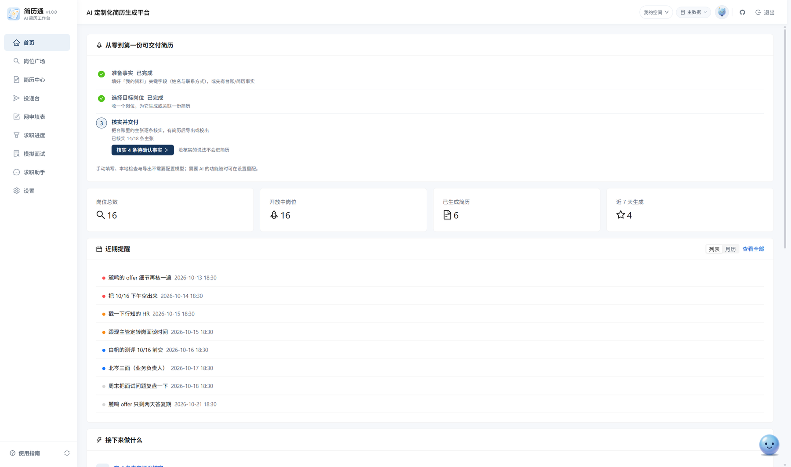
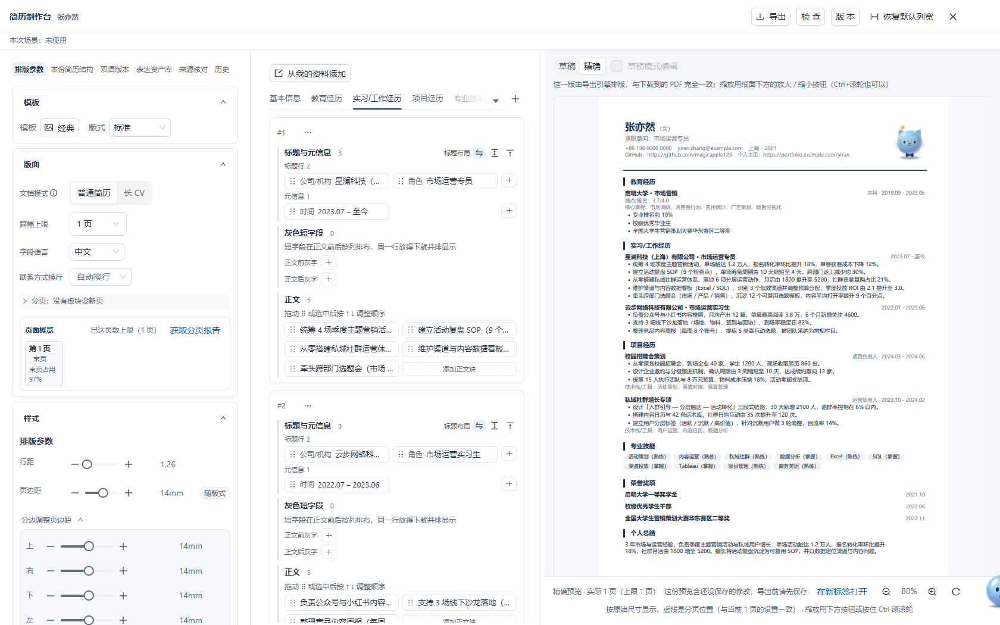
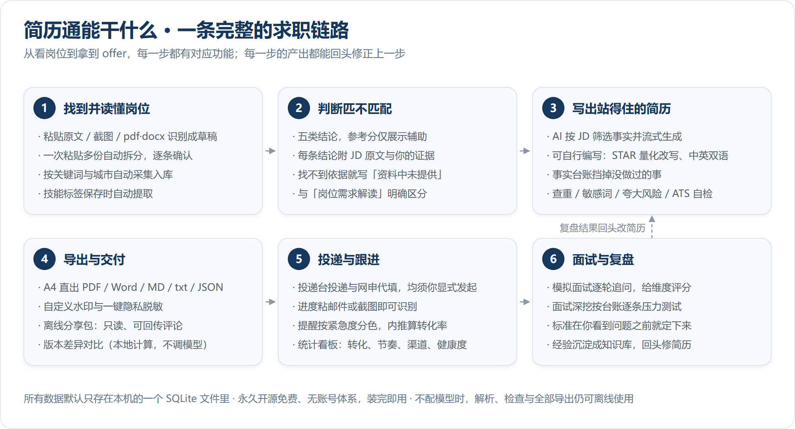

<div align="center">


# 简历通 ResumeForge

[](https://github.com/magicapple123/ResumeForge/actions/workflows/ci.yml)
[](https://github.com/magicapple123/ResumeForge/releases)
[](LICENSE)
[](https://github.com/magicapple123/ResumeForge/stargazers)
[](https://github.com/magicapple123/ResumeForge/releases)
[](docs/user-guide.md)
[](docs/user-guide.md)
[](.github/workflows/ci.yml)

**本地优先的 AI 简历工作台：无需注册与登录，数据仅保存在本机。**

<h3>
<a href="https://magicapple123.github.io/ResumeForge-official/demo.html">在线体验（免安装）</a>
 · 
<a href="https://magicapple123.github.io/ResumeForge-official/docs.html">使用文档</a>
 · 
<a href="https://magicapple123.github.io/ResumeForge-official/">官网</a>
</h3>

<p align="center"><b>简体中文</b> · <a href="README.md">English</a></p>

当前版本：`2.1.0` · [Release 页面](https://github.com/magicapple123/ResumeForge/releases) · [完整使用指南](docs/user-guide.md) · [架构设计](docs/architecture.md)

<p>
<a href="#-交流与反馈"><b>QQ 群：<code>922830167</code></b></a>
<br>
<sub>安装与使用问题、功能建议均可在群内反馈；<b>群文件同步提供安装包</b>，GitHub 下载缓慢或中断时可从群内获取。<a href="#-交流与反馈">群二维码</a></sub>
</p>

</div>

> 在线体验为**只读演示版**：界面来自真实构建，数据为虚构样本，AI 输出为预录回放。如需实际生成、导出与投递，请按[安装](#-安装)在本机部署：首次运行 Windows 双击 `start.cmd`、macOS 双击 `start.command`，会自动完成环境准备；也可从[官网](https://magicapple123.github.io/ResumeForge-official/)下载对应平台的安装包或压缩包（Windows 安装版 / macOS dmg / 双平台便携包），无需经过 GitHub。

---

## 界面速览

截图均取自**实际运行的桌面版**，内容为内置**虚构演示数据**，不含任何真实用户资料。

**首页**：进度清单、岗位与简历统计、按紧急度分色的近期提醒，单屏呈现当前应处理的事项。

<p align="center">
  
</p>

**简历制作台**：左栏为排版参数与页面概览（页数上限、分页报告），中栏编辑内容，右栏为简历预览（**精确模式**，直接渲染导出用的那份 PDF）；任一参数改动，三栏同步更新。

<p align="center">
  
</p>

其余界面（岗位广场、投递台、网申填表、模拟面试、事实台账）以及简历预览的缩放、版面诊断与导出面板，均可在完成[安装](#-安装)后从侧栏进入；更多截图见[官网界面画廊](https://magicapple123.github.io/ResumeForge-official/#gallery)。

## 简历通能干什么

覆盖从岗位筛选到面试复盘的完整链路，各环节产出均可回溯修改。

<p align="center">
  
</p>

它针对一个具体问题：**求职期间的资料是分散的**——JD 存于浏览器收藏夹，简历文件出现多个「最终版」，投递进度记在备忘录，面试问题事后遗忘，修改多版后难以对应投递记录。

更关键的是第二个问题：**生成模型会润色表述，也会编造事实。** 简历工具最大的风险不是排版，而是写入未曾发生的内容，在面试追问中暴露。因此 ResumeForge 将「事实」与「表述」分离管理：生成结果中的学校、公司、项目名会与资料库逐条比对，不一致时给出**防虚构警告**；正文仍含【待补】标记时，导出会被拦截并标注具体位置。

## ✨ 功能特性

<details>
<summary><b>全部功能一览（82 项，点击展开）</b></summary>

<p>下表每条功能名都可点击，跳到官方文档里对应的小节；文档没有讲到的功能，也已经在这次一并补齐。</p>

<br>

| 模块 | 说明 |
| --- | --- |
| [📋 岗位管理](https://magicapple123.github.io/ResumeForge-official/docs.html#jobs-manual) | 粘贴招聘信息自动解析成草稿；**一次粘贴多份会拆分并逐条确认**；技能标签与来源自动标注 |
| [🗂 备选岗位](https://magicapple123.github.io/ResumeForge-official/docs.html#jobs-pool) | 还没核对的招聘信息先存这里，之后一键导入正式岗位（助手也能代导） |
| [📥 拖拽导入](https://magicapple123.github.io/ResumeForge-official/docs.html#jobs-drag) | 岗位识别、附件、照片、数据集备份等都能从资源管理器直接拖进来；拖到窗口任意位置时按扩展名分流：`.zip` 导入数据集、`.csv` 导入岗位表、`.json` 新建手写简历 |
| [🖱 批量设置状态](https://magicapple123.github.io/ResumeForge-official/docs.html#jobs-batch) | 岗位广场条目上右键「批量选择」进入多选后，可用批量工具栏对勾选岗位**批量设置状态**或批量删除 |
| [💡 岗位需求解读](https://magicapple123.github.io/ResumeForge-official/docs.html#match-reading) | 依据招聘原文生成结构化需求总结、原文证据与通用准备建议 |
| [🎯 岗位匹配度分析](https://magicapple123.github.io/ResumeForge-official/docs.html#match-five) | 逐条对照 JD 给五类结论与投递建议，附原文与证据；五类结论**不带百分比**，投递准入只看结论 |
| [📊 匹配度参考分](https://magicapple123.github.io/ResumeForge-official/docs.html#match-score) | 0–100 参考分与 5 个分项，**仅作展示辅助、不参与投递准入**，带免责说明 |
| [📈 批量岗位适配度分析](https://magicapple123.github.io/ResumeForge-official/docs.html#match-batch) | 岗位广场进入「选择」模式勾选多个岗位后「AI 分析适配度」：结合个人资料**逐一分析**，按匹配度参考分从高到低展示；可选立即运行或后台运行，结果保存到「分析记录」供回看 |
| [🤖 AI 对比选岗](https://magicapple123.github.io/ResumeForge-official/docs.html#match-compare) | 在岗位广场勾选 2–12 个岗位，AI 先逐个核对匹配情况，再横向排出适合程度并解释原因；后台运行，结果保存到「分析记录」 |
| [👤 个人资料库](https://magicapple123.github.io/ResumeForge-official/docs.html#profile-sections) | 13 个板块（基本信息 / 教育经历 / 实习工作经历 / 项目经历 / 专业技能 / 校园经历 / 荣誉奖项 / 个人总结 / 学术成果 / 科研项目 / 知识产权 / 证书资质 / 语言能力）统一成资料库：**当前方案参与的分区才出现**，没数据的分区显示空态；基本信息与个人总结只有一条，其余可增删并拖动排序；单击标题可单独**收起**（收起字段有值照常进 AI 与纸面），**隐藏**才排除且值保留、可恢复。可自建板块（如开源贡献），也可在任意分区（含 13 个内置分区）新增自定义字段：添加时可选「纸面位置」（标题行 / 元信息 / 正文前灰字 / 正文 / 正文后灰字 / 不上纸面；短字段默认正文后灰字、多行默认正文）与「仅素材」（只进 AI 生成与网申、不上纸面）；自建板块上纸面时独立成栏、同样可按位置编排。**每个板块都能在资料页单独显示 / 隐藏**（隐藏 = 从当前方案移出，不参与生成、导出与网申；基本信息不可隐藏），顶部「已隐藏的板块」可逐项恢复；字段改为响应式多列、不再是每字段一行 |
| [🗂⁠资⁠料⁠方⁠案⁠与⁠当⁠前⁠方⁠案](https://magicapple123.github.io/ResumeForge-official/docs.html#profile-plans) | 方案只记录「名称 + 参与哪些板块」，**不复制资料**——任何方案内编辑立刻对所有方案可见；资料页标题区「当前方案」下拉 + 「管理方案」，切换只影响此后新建 / 生成 / 网申取数，已保存的简历与正在编辑的草稿不变。页头「资料设置」是同一个弹层的总入口，顶部 **方案 / 板块与字段** 两个页签统管方案、板块与字段；单卡齿轮与「管理方案」照常保留。生成 / 新建 / 网申三条链路都按当前方案取数，方案只**减少**、不增加可发送资料；默认方案恒存在且不可删除，删当前方案会自动回落到默认方案并提示。**新建方案默认隐藏全部板块**（基本信息除外），非编辑态创建后自动切到新方案、可逐项显示；自建板块在资料页标题旁带「自建」标记 |
| [🧭 旧资料升级说明](https://magicapple123.github.io/ResumeForge-official/docs.html#upgrade-legacy) | 1.0 的资料库升级到 2.0 时整包归档到 `backend/data/legacy-archive/`，2.0 使用空库；1.0 系列只提示、没有搬数据 |
| [🌐 职业场景](https://magicapple123.github.io/ResumeForge-official/docs.html#profile-scenario) | 页头「职业场景」可选职业阶段、目标行业/职能、就业状态、使用目的等组合（内置转行、科研申请、职业回归等快捷场景，也可自定义）。**切换只改本窗口的引导与建议，不改资料、岗位、已有简历、投递设置或后台任务**；生成简历时需显式开启「用于本次生成」（默认关闭，就业状态默认不发送），服务端冻结本次采用的场景快照 |
| [📝 网申资料](https://magicapple123.github.io/ResumeForge-official/docs.html#webform-data) | 「我的资料」中与简历资料横向切换的**统一网申补充板块**：证件、家庭、学籍、健康与到岗信息等；教育、实习和工作、项目、学术成果、证书、作品和社交账号等可新增多条。**可粘贴文本识别**：把网申页面整页栏目粘贴进来（也可给截图或 PDF/Word），能归到已有栏目的直接填好，目录外的新栏目先列成待确认项、逐条勾选才新增，**识别结果先校对再填入、识别中可取消**。网申填表合并读取简历基础信息与网申补充信息；**生成简历不读网申资料**。附件说明只存文字，文件须手动上传 |
| [🪪 网申专用资料](https://magicapple123.github.io/ResumeForge-official/docs.html#webform-data) | 原「网申专用资料」中的国家和地区、证件、出生日期、政治面貌、籍贯、家庭信息等已并入统一「网申资料」；旧值仍可读取，**只用于填表，不进简历导出** |
| [🖼 简历照片](https://magicapple123.github.io/ResumeForge-official/docs.html#profile-photo) | 最多存 8 张，单击缩略图切换使用哪张；**留在本机，不发送给模型** |
| [🧾 事实台账](https://magicapple123.github.io/ResumeForge-official/docs.html#claims-status) | 每条说法记下事实、表述、承担程度与边界；**只有「已确认」的参与生成**，未确认的显式避开 |
| [📦 资料箱](https://magicapple123.github.io/ResumeForge-official/docs.html#materials) | 证书、作品、链接与笔记集中管理，可带附件，单击卡片查看详情；助手可读取引用 |
| [📎 附件多格式](https://magicapple123.github.io/ResumeForge-official/docs.html#materials) | 资料箱 → 编辑 → **一个「添加附件」入口**收图片 / PDF / Word(docx) / txt / md / json / csv（`.doc` 提示先另存为 `.docx`）；图片「复制」得到图片可直接粘贴到聊天或文档，其它格式「复制」得到提取出的文字、「另存为」下载原文件；扫描件 PDF 提取不到文字时给警告，仍可只用来另存 |
| [📁 文件副本库](https://magicapple123.github.io/ResumeForge-official/docs.html#materials-copies) | 资料箱「文件副本」页签集中查看所有存入文件的副本（图片 / PDF 可直接预览，其它类型可一键调用系统程序打开）；副本统一存本机应用数据目录并随数据集切换 / 迁移自动重建；助手可查询副本清单 |
| [🖼 截图与文档识别](https://magicapple123.github.io/ResumeForge-official/docs.html#recognition-input) | 岗位与资料识别支持截图与 pdf / docx（Ctrl+V 贴图，最多 4 个、单个 ≤2 MB、合计 ≤5 MB），文字在本机提取；**识别结果先列成清单供校对，确认后才填入，识别中可随时取消** |
| [🤖 AI 定制简历](https://magicapple123.github.io/ResumeForge-official/docs.html#generate) | 按 JD 筛选事实流式生成；可选美化强度、篇幅（1–3 页 A4）、字号与模板（内置 6 种）；**字体可选内置思源黑体（约 32MB，在设置里按需下载）或历史上传过的字体，仅影响预览 / HTML / PDF**（Word、Markdown 不跟着变）；**板块顺序可调**（预览里调，PDF / Word / Markdown 导出同步生效）；**联系方式可指定字段前强制换行**（每个字段整体不拆行，长网址不会被截断） |
| [✍️ 自行编写简历](https://magicapple123.github.io/ResumeForge-official/docs.html#write-editor) | 从个人资料预填后自由修改，编辑时旁边保留岗位职责与要求供对照；**页签与可见字段跟随「我的资料」当前方案**（创建时冻结），自建板块与系统板块同一套三区卡编辑（标题与元信息 / 正文前后灰字 / 正文）；每个字段都是一个可拖动的独立内容，位置可选标题行 / 元信息 / 正文前灰字 / 正文 / 正文后灰字 / 隐藏；自定义字段与默认字段一样按纸面位置落位，不再以「标签：值」写进承载区；**「新建简历」弹窗已与制作台共用新编辑器**（三区卡 + 字段位置，初始内容整份来自当前方案投影）；语言能力是独立页签；**中栏顶部「从资料填入」菜单按来源去重、只补空字段**，不覆盖手写内容；字段展开后再次单击可收起，字段 / 条目的隐藏与删除在右键菜单，字段显示后回到隐藏前的位置；「本份简历结构」只有一个折叠开关（全展开时是「收起全部」，收起后变「展开全部」），并用「顺序」面板逐项上移 / 下移板块；新建简历与 AI 生成默认按「我的资料」顺序，可手动调或一键同步，通用新建支持清空所有内容；页签末尾「+」可新建**仅本份简历**的板块（资料库里不会多出来），自建板块可在页签右键删除、Ctrl+Z 撤销 |
| [✍️ 简历写作增强](https://magicapple123.github.io/ResumeForge-official/docs.html#write-transforms) | **STAR 量化改写**、**话术生成器**、**多风格润色**、**中英互译**、**版本差异对比**（本地计算）；在「手动调整简历内容」里选中一段文字右键「AI 润色」即可**只改那一段**（结果先给你看，确认才写入） |
| [⚡ AI 修改简历](https://magicapple123.github.io/ResumeForge-official/docs.html#generate-revise) | 简历预览底部「AI 修改 / 重新生成」：填修改要求则**只改提出的部分**（其余逐字保留），留空则整体重新生成（事实不变、表达重写）；岗位优化建议可**逐条采纳**并直接更新当前简历 |
| [🎓 科研简历](https://magicapple123.github.io/ResumeForge-official/docs.html#write-academic) | 制作台中栏「学术成果 / 科研项目 / 知识产权 / 证书资质」四栏：题目、作者顺序与本人标记、发表状态（**在投 ≠ 已发表**，含在投 / 预印本等六值）、DOI / 链接、证照颁发机构/日期/状态；空栏位不写入内容。「版面」组的「文档模式」可切**普通简历 / 长 CV**（普通 1–3 页、长 CV 上限 10 页，切回普通时超页自动夹紧并提示）；生成弹窗里也能显式选（不自动切换）；分页可按分区或条目设置（见「分页控制」行） |
| [🌐 通用简历](https://magicapple123.github.io/ResumeForge-official/docs.html#generate-general) | 简历中心页头「AI 生成」生成或「新建简历」手写**不针对任何岗位**的跨行业简历：完整使用资料、不按方向筛选，各方向经历都保留，可多份；生成时可选普通简历或长 CV。新建简历的页签、页签名与每个板块的**可见字段**跟随**当前方案**（自建板块显示你起的名字，资料里隐藏的字段不出现；当前方案没有的分区不显示输入框，已有正文分区始终保留），并在创建时冻结进这份简历——之后改方案只影响新建的简历；资料改动 / 切换方案后自动刷新 |
| [📄 外部简历](https://magicapple123.github.io/ResumeForge-official/docs.html#generate-center) | 简历中心 → 「外部简历」上传在别处生成的 PDF / Word / txt / Markdown 简历，存成**只读快照**：原文件可预览、可另存，提取文本可做文本级检查（占位符 / 量化 / 联系方式 / 篇幅 / 弱表述，有 JD 时补关键词覆盖），并可「用于面试」带进模拟面试材料；**不转成可编辑简历、不进制作台、不参与导出与自动投递**；可删除（进回收站）与恢复 |
| [🗂 表达资产库](https://magicapple123.github.io/ResumeForge-official/docs.html#write-assets) | 收藏好用的表达（成果 / 方法 / 结果 / 总结），按关键词、类型、语言与岗位标签检索；换简历时一键插入（生成新对象身份），插入后仍可继续改 |
| [🔗 来源核对与事实锁](https://magicapple123.github.io/ResumeForge-official/docs.html#claims-source) | 制作台左栏「来源核对」：选中一条内容，看它来自哪条资料、关联时是哪一版、来源是否已更新；**未关联就明说未关联（不按文字相似度猜）**。可按选中内容建立 / 解除来源关联、新建手工来源、查看影响面与修订，并在来源更新后**采纳最新来源写回正文**（带 revision 条件写与冲突提示）；事实锁锁定姓名 / 机构 / 时间 / 数字 / 职责边界，AI 改写想动它们会被拒并**逐条列出会改哪个值**——锁只约束 AI，你手动编辑不受限 |
| [🛡 防虚构校验](https://magicapple123.github.io/ResumeForge-official/docs.html#generate-fabrication) | 生成结果里的学校 / 公司 / 项目名自动与资料库比对，不一致时给出警告 |
| [🛡 质量与合规检查](https://magicapple123.github.io/ResumeForge-official/docs.html#quality) | 查重 / 敏感词 / 夸大风险 / 深挖风险 / 合规 / ATS 本地检测，与事实台账联动 |
| [🧭 生成说明](https://magicapple123.github.io/ResumeForge-official/docs.html#generate-notes) | 预览里折叠展示「为什么是这样一份简历」：岗位信号、候选组成与省略原因；「没写进这份简历」的资料内容以**中性清单**分组列出（与"疑似虚构"警告分开），每组可一键 **AI 补上这段**；生成会读取资料里的 GitHub 主页与个人主页写入简历 |
| [📚 简历历史](https://magicapple123.github.io/ResumeForge-official/docs.html#generate-center) | 生成与手写的简历都自动留存，可收藏、按来源筛选、加备注、重新导出 |
| [🔗 岗位关联](https://magicapple123.github.io/ResumeForge-official/docs.html#jobs-related) | 一个岗位可关联多份简历，岗位与简历之间双向可跳转 |
| [🧰 工作台](https://magicapple123.github.io/ResumeForge-official/docs.html#skills) | 「技能」与「版式」两页；版式只填参数（行高 / 页边距 / 强调色等）就能压进一页，也可以让助手代劳。自制模板与导入 HTML 入口已下线，旧模板仍按原样渲染 |
| [🎨 试用与对比](https://magicapple123.github.io/ResumeForge-official/docs.html#templates-trial) | 制作台模板图库「试用与对比」：用**我的内容**并排比较两套模板并显示真实页数与溢出；排版覆盖可选「保留当前排版覆盖」或「采用模板默认」（清空字号/行距/颜色/页边距与局部排版，需先经二次确认，保存前可撤销一次）；退出试用不改原方案，采纳才进历史 |
| [🧭 文档大纲](https://magicapple123.github.io/ResumeForge-official/docs.html#write-outline) | 制作台左栏「本份简历结构」（原「文档大纲」）按 页 / 栏 → 板块 → 条目 → 位置分组（标题行 / 元信息 / 正文前灰字 / 正文 / 正文后灰字 / 隐藏）列内容：可拖动排序、把字段拖到别的位置分组即改变纸面去向，可复制、**隐藏**（正式导出不含）、锁内容或锁排版；支持**结构搜索**（过滤高亮、键盘定位），在纸面上悬停字段即可定位到该处，字段与要点可单独隐藏或复制。拖动时结构树与右侧预览**实时跟随**（窄屏把编辑内容收进抽屉时同样生效，并计入保存修改），松手才记一步历史 |
| [🖥 专业视图](https://magicapple123.github.io/ResumeForge-official/docs.html#layout-pro) | 预览工具条：整页 / 适宽 / 100% 缩放、页导航、辅助线、灰度校样；动作条「命令」或 Cmd/Ctrl+Shift+P 打开命令面板，工作区预设只切面板可见性；「照片裁剪」只改取景（**原图不动**，可恢复原图），三种导出按同一份派生裁剪；**没裁剪时按原图比例展示**，不会被强制裁成方框或拉伸变形 |
| [🔠 局部排版](https://magicapple123.github.io/ResumeForge-official/docs.html#write-field-layout) | 制作台左栏「样式」组调**全局字体字号、字距行距、页边距与外观颜色**；没单独设过的属性跟随模板并标出来源，可逐项恢复继承（数值可直接输入或步进，Shift 单击五倍）；按字段 / 角色的局部排版在中栏字段上**右键 →「调整排版」**：作用范围按所选字段自动推断，可就地改颜色、行距、缩进、项目符号、对齐、字距，日期与元信息字段另有「日期位置」（日期靠右 / 日期紧随标题，草稿与精确 PDF 同口径）；正文输入框的文本工具区提供**加粗**与**链接**（HTML 可点击，PDF / Word 以「文字 (URL)」可见文本呈现），斜体入口已移除；项目符号三出口统一为「· / – / 不显示」；「条目字段排版」面板按板块或单条条目调整正文前后灰字段的 1–3 列、对齐方式、列间距、顺序与独占整行，多列默认等宽对齐，两列以上还可以**逐列设宽度**（百分比，合计 100 才能应用）与**逐间隔**，HTML / PDF / Word / Markdown 共用同一份装箱结果 |
| [📄 分页控制](https://magicapple123.github.io/ResumeForge-official/docs.html#layout-paging) | 制作台左栏「排版参数 → 分页」：**分区**可设「从新页开始 / 整块不跨页」，**条目**也能在「本份简历结构」选中后单独设「从新页开始 / 整块不跨页」，随简历保存，HTML / PDF / Word 同口径。**页面概览与「获取分页报告」**：按真实 PDF 同一条管线测量页数/末页占用/溢出与手动分页标记，两页格子等宽排布、页数用满时显示「已达页数上限」；草稿预览不显示真实分页、不画假分页线 |
| [🎛 版面优化](https://magicapple123.github.io/ResumeForge-official/docs.html#write-optimize) | 预览「版面诊断」卡下方「按条件优化版面」：先设约束（不动字号 / 最小页边距 / 目标 1–2 页），再给最多 3 个**有差异**候选（改了哪些参数 / 减少多少溢出 / 可读性影响），应用后数值写回滑杆；无可行方案时明确说原因，**不会静默缩小字号**；另有**内容精简差异候选**（合并重复条目 / 去重要点 / 精简低相关），逐项确认后应用 |
| [✅ 制作台检查](https://magicapple123.github.io/ResumeForge-official/docs.html#write-check) | 制作台动作条「检查简历」：内容 / 排版 / 导出产物三层一起查，问题分「必须解决 / 需核对 / 排版建议」，给位置与修复入口，修完可复检 |
| [🏷 保存冲突三选一](https://magicapple123.github.io/ResumeForge-official/docs.html#write-conflict) | 在「简历制作台」保存时，如果同一份简历已在别的窗口改过，会先让你选「用最新的」「比较差异」「另存副本」；**不会默默覆盖**别人的改动 |
| [↪ 撤销与恢复](https://magicapple123.github.io/ResumeForge-official/docs.html#write-history) | 制作台左栏「历史」：内容、排版、结构操作每一步都能撤销或恢复（连续输入合并成一步）；**每一步直接写清「改了什么」**（板块增删排序 / 条目增删隐藏 / 字段增删移动 / 段落文字改了几处 / 版式参数），姓名·条目数·页数挂在悬停提示上，单击某一步即可回到该步；改坏一处能直接退回去，**⌘/Ctrl+Z 与 ⇧⌘/Ctrl+Z 同样可用** |
| [🗃 命名版本与岗位变体](https://magicapple123.github.io/ResumeForge-official/docs.html#write-versions) | 制作台顶部「版本」：把当前内容与排版存成**不可变快照**（创建（名称可留空自动命名）/ 冻结标记 / 默认与上一版逐字段比较「旧值 → 新值」/ 恢复）；恢复会生成**新的当前版本**，历史版本与已投递记录不变。岗位变体独立编辑（创建入口二选一：从当前简历派生 / 从职业场景派生，点击「创建变体」），可按勾选的内容路径**选择性同步**，不覆盖其它岗位定制；变体可保存**独立排版**并按变体直接导出 |
| [🌐 双语版本与术语表](https://magicapple123.github.io/ResumeForge-official/docs.html#write-bilingual) | 制作台「双语版本」：中英字段对照、逐字段生成翻译候选并**逐项采纳**（只写入选中的语言变体，不覆盖当前简历）；数据集级术语表可锁定固定译法（人名、公司名、技能等），删除进回收站可恢复。翻译候选按批生成，长简历不会中途超时；「译文预览」提供只读预览（不改主稿、不产生脏值） |
| [📦 导出形式](https://magicapple123.github.io/ResumeForge-official/docs.html#export-forms) | 制作台导出弹窗顶部先选**交付包**或**单独文件**：交付包把所选格式打成一个 zip（可另存归档原件与哈希清单）；单独文件可多选格式**逐个导出**，进度显示已完成数量，某一项失败会说明已完成几个。两者共用同一份排版结果与导出配置 |
| [📄 多格式导出](https://magicapple123.github.io/ResumeForge-official/docs.html#export-formats) | PDF **可直接下载**（服务端渲染）；Word / HTML / Markdown / txt / JSON 均可导出；带版面的 HTML / PDF / Word / Markdown **由服务端同一份排版结果渲染**——同字段、同顺序，JSON 输出新版文档结构（含每条内容的纸面位置与版式）；支持水印与**一键脱敏**。预览工具栏可切**「精确」**——那显示的就是导出引擎排出的同一份 PDF，与下载到的文件逐点相同；配置水印 / 脱敏后可先**预览真实产物**再导出。超出页数上限时**不自动缩字号**，按上限截断并如实提示 |
| [📦 导出交付包](https://magicapple123.github.io/ResumeForge-official/docs.html#export-archive) | 简历详情「导出交付包」：格式与命名规则、水印 / 脱敏、**真实产物配置预览**，可保存为导出配置；成套导出 zip + manifest（逐项哈希），可选归档**交付原件**（哈希与字体 / 渲染版本清单，可查看与删除） |
| [💾 保存位置](https://magicapple123.github.io/ResumeForge-official/docs.html#privacy-save) | 设置 → 「数据与导出」页签「保存位置」卡片：默认只存到浏览器默认下载目录，通过本机原生选择器选定文件夹后，本机前端导出简历会**同时落盘一份**到那里；远程/跨站导出会被拒绝 |
| [📦 离线分享包](https://magicapple123.github.io/ResumeForge-official/docs.html#share) | 打包成脱敏 HTML / PDF + 只读快照 + 评论回传文件，可选「只读 / 可评论」；可评论的包支持**对象批注**：导入回传的 `annotations.json` 后逐条标记已解决 / 忽略，对象变了的批注需重新关联（批注不进任何投递产物） |
| [🚀 自动投递台](https://magicapple123.github.io/ResumeForge-official/docs.html#apply) | 按关键词 / 城市自动采集（站点筛选条件整条搬进来，后台跑）；确认过的岗位排队后驱动本机浏览器投递，**只接纳来源在招聘网站内的岗位** |
| [📮 我已提交与交付单](https://magicapple123.github.io/ResumeForge-official/docs.html#apply) | 投递记录详情里对**成功**的记录点「我已提交」：补一条「已投递」进度（已到更后阶段不会被降级）、挂一条 7 天后的跟进提醒、冻结一份投递快照，重复点不重复建行；同一抽屉的「交付单」把已有快照读成**可验收单据**——投的是哪版简历（标题 + 内容指纹）、投给谁、导出产物与页数、填了哪些字段（按 URL 精确匹配网申填充记录，匹配不上标「未知」）、事实台账疑点数、距提交还差哪些人工步骤；三态 **卡在人手上 > 有疑点 > 可验收**，「投出后简历又改过」只提示、不改三态 |
| [📝 网申填表](https://magicapple123.github.io/ResumeForge-official/docs.html#webform) | 用**独立专用浏览器**填写官网网申表单，输入网址可直接打开新标签页并管理网址记录，不覆盖已有网页；各页面可单独开关「点哪个填哪个」。整页读取后逐条核对再填充，或点输入框时在框旁确认建议；规则认不出的框可交给 AI 识别，**只发页面文字与字段名，不发资料值**。浏览器型号与投递台共用配置，但使用独立窗口；填充记录含真实值、只存本机。**只填不交**，密码与验证码永不自动填；**只往文本类控件里写值**——下拉、单选、复选、日期控件不代选，如实列成「需要你自己点选」；可另开**放宽模式**尝试文本标签/上下文匹配并代点下拉与弹层选项（见下一行）。填充完成展示**成功率**（成功填写数 / 页面可读框总数），可导出**不含简历值的脱敏诊断信息**，方便反馈认不出的字段 |
| [🟢 放宽模式](https://magicapple123.github.io/ResumeForge-official/docs.html#webform-relaxed) | 「网申填表」的**可选例外，默认关闭**：显式开启后，会尝试用字段标签/上下文匹配未识别的文本框（含自定义字段），并代点下拉与弹层选项（**严格选项匹配 + 回读验证**）；放宽文本匹配中只靠弱上下文的低置信度候选默认不勾、需要你确认，重复经历仅在记录数与页面顺序可配对时补齐。同意 / 声明类勾选仍需逐条确认；日期选择器与文件上传不代做。求职助手没有开关它的工具，要开请到页面或设置里开。放宽匹配可能选错，填完请核对；弹层多值须全部命中才动手 |
| [🧠 填表时学到的](https://magicapple123.github.io/ResumeForge-official/docs.html#webform-learned) | 填表时碰到**简历通里没有**的字段，**两个入口**都能记：批量模式填完弹一条汇总提示（**默认全勾、默认「通用」**，可取消其中几条）；「点哪个填哪个」模式里**每个框旁边**都有「记住这条」，**当场就能记**——**认得出但资料里没值的框也能记**（就地补上，不用跳去别的页面）。记住后下次遇到同一字段**自动预填**。每条可选档位：**通用**（换哪家公司都成立）/ **场景**（与投递渠道有关）/ **本次**（只记下来、下次不自动填，内推码这类一次性的值用它）。来源和档位在「网申资料」里随时可改可删——**AI 认出来的值单独标「AI 认的」**，因为它比规则更可能认错字段。**清单外的自定义字段**（如「导师姓名」「实验室」）也可参与网申填表：普通模式只接受唯一精确对应，开启放宽模式后可按标签/上下文匹配并标记低置信度；有歧义或安全否决时不猜，填后请核对。**落点只有「网申资料」**：简历资料字段永不会被学走（程序里没有能改简历资料的那段代码）；密码、验证码、他人信息走拦截，学不到。只存本机，**生成简历时不读** |
| [🎯 求职进度](https://magicapple123.github.io/ResumeForge-official/docs.html#tracker) | 一家公司一条记录走完「已投递 → 筛选中 → 测评 → 面试 → Offer」；粘邮件 / 截图识别进展，先预览再写入 |
| [🗓 日历提醒](https://magicapple123.github.io/ResumeForge-official/docs.html#reminder) | 投递、面试、内推等日程可设提醒，按**紧急度分色**（已逾期 / 24 小时内 / 3 天内 / 更远），支持列表与月历 |
| [🔔 跟进巡检](https://magicapple123.github.io/ResumeForge-official/docs.html#tracker) | 在 **设置 → 助手与 AI 行为 → 「任务卡」** 打开总开关（默认关闭）后，后台会检查「进行中且超过 7 天没有任何更新」的投递：超过 7 天、不超过 21 天生成一张**跟进清单卡**，超过 21 天生成一张**确认状态卡**（两桶互斥）；每张卡最多 5 家、同一类型同一周只生成一张；卡面只陈述「投出 N 天，期间没有记录到任何状态变化」，不替你判断对方是否回复；可逐家点「已联系 / 对方已回 / 不跟了」，**只记录决策、不改进度状态** |
| [🤝 内推管理](https://magicapple123.github.io/ResumeForge-official/docs.html#referral) | 记录内推人、内推码与备注图片，按状态跟进并统计**内推转化率** |
| [📈 求职数据看板](https://magicapple123.github.io/ResumeForge-official/docs.html#analytics) | 四个主题：转化与卡点、时间与节奏、渠道与去向、简历与健康度；**每张图各自成块、各有标题与口径**；趋势可选近 1 / 3 / 6 月 |
| [⭐ 收藏夹](https://magicapple123.github.io/ResumeForge-official/docs.html#jobs-favorites) | 分页集中查看收藏的岗位与简历，可跳详情或取消收藏 |
| [🎤 模拟面试](https://magicapple123.github.io/ResumeForge-official/docs.html#interview) | 设定岗位、难度与面试官风格后逐轮作答，会点评追问；结束给维度评分与改进建议；**报告下方可继续追问或停止追问**（追问不占正式轮次）；材料可从记录选或导入文件（岗位侧吃 PDF / TXT，简历侧吃截图，解析失败给明确原因）；另有独立实时语音通话界面，支持语音作答、面试官语音朗读与可选本地摄像头预览 |
| [🎯 个性化题库](https://magicapple123.github.io/ResumeForge-official/docs.html#bank-questions) | 按岗位生成**基础 / 项目深挖 / 反问 HR** 三类题，可单题出参考答案；真实面试题可反推改简历 |
| [🔎 面试深挖](https://magicapple123.github.io/ResumeForge-official/docs.html#drill) | 按台账逐条压力测试，**标准在你看到问题之前就定下**；用「已验证 / 部分验证 / 未验证 / 存在矛盾」代替分数 |
| [🧠 面经知识库](https://magicapple123.github.io/ResumeForge-official/docs.html#bank-exp) | 沉淀真实面试经验（公司 / 岗位 / 题目 / 复盘），可检索，单击卡片查看全文 |
| [📖 知识库](https://magicapple123.github.io/ResumeForge-official/docs.html#materials) | 面经总结、简历技巧、求职策略等成文内容，带分类标签与 Markdown 预览；助手可检索增改 |
| [💬 AI 求职助手](https://magicapple123.github.io/ResumeForge-official/docs.html#assistant) | 流式问答，可关联岗位 / 简历 / 资料与联网搜索；能查提醒、内推、面经、统计等，**只在明确要求时写数据**；回答前会拿到本地时间与星期（深夜提醒早点休息）；工具集覆盖投递失败诊断、查询版式、面经与内推录入；任意页面都可从「投投」悬浮球打开；侧栏与浮窗聊天记录分开保存，浮窗只展示联网和思考强度控制 |
| [🎛 求职偏好](https://magicapple123.github.io/ResumeForge-official/docs.html#assistant) | 设置 → 「助手与 AI 行为」→「求职偏好」：把反复交代的长期约束（岗位方向 / 城市 / 薪资底线 / 工作方式 / 用工形式 / 排除公司 / 排除行业 / 加班接受度 / 禁用词 / 篇幅 / 语气 / 可到岗时间 / 仅本次对话，共 13 类）记下来，不用每个新对话重说一遍。一条 = 一次确认的完整取值；助手说「已记住」不算数，必须由你在确认卡上点「以后都这样」或「只在这次对话」；每条可编辑、删除进回收站、撤销到上一版；**只约束助手行为，不会写进简历正文或事实台账** |
| [🔓 助手放宽模式](https://magicapple123.github.io/ResumeForge-official/docs.html#assistant-relaxed) | 设置 → 「助手与 AI 行为」页签「助手放宽模式」卡片：默认关；开启并**提前告知**后求职助手可读取完整资料（含姓名电话等敏感字段、网申填写值、历史对话），API 密钥等凭据任何模式下都不发送 |
| [🧩 技能](https://magicapple123.github.io/ResumeForge-official/docs.html#skills) | 新建、导入、编辑技能（提示词 + 知识文件），在对话里启用后约束该对话的作答风格 |
| [🗒 会话管理](https://magicapple123.github.io/ResumeForge-official/docs.html#assistant-sessions) | 会话可重命名 / 置顶 / 收藏 / 分组 / 归档，可导出 Markdown 或存进资料箱 |
| [📌 投投剪贴板](https://magicapple123.github.io/ResumeForge-official/docs.html#assistant-clipboard) | **双击投投悬浮球**打开：把要反复粘贴的资料存成片段，一键复制；只存本机浏览器，不上传（单击悬浮球仍是打开助手） |
| [🏠 首页](https://magicapple123.github.io/ResumeForge-official/docs.html#home) | 快捷入口按使用顺序组织成 7 个去处；近期提醒卡片内嵌紧凑月历 |
| [🖱 界面细节](https://magicapple123.github.io/ResumeForge-official/docs.html#shortcuts) | 行操作收进「更多操作」；列表与卡片**单击即可查看详情**（Enter 同样可开）；日期改为日历选择；**侧栏里用不到的模块可在 设置 → 「外观与交互」→「界面与导航」里关掉**（只收入口，不删数据；首页、设置等始终保留） |
| [🔍 全局搜索](https://magicapple123.github.io/ResumeForge-official/docs.html#search) | 一个框同时搜岗位、简历、内推、提醒、面经、台账、资料箱与技能 |
| [📤 外发预览与用量](https://magicapple123.github.io/ResumeForge-official/docs.html#privacy-outbound) | 设置页：把资料发给模型或其它服务前，先看「这次要发什么」（目标服务、资料类别、附件、已排除字段、是否抓取正文以及正文本身）；「模型用量」按任务 / 模型列调用数与 token——**未知 token 不显示成 0**、未配置单价不估算费用。预览正文只存在内存、不落盘；用量可按任务 / 模型 / 数据集看**结束原因与重试**，费用只在配置单价时估算 |
| [✅ 批量选择与批量删除](https://magicapple123.github.io/ResumeForge-official/docs.html#shortcuts-batch) | 简历中心、助手历史对话、历史面试、深挖历史、日历提醒、历史题库、网申填充记录等列表支持**批量选择**：「批量选择」→ 勾选 → 「删除所选」统一确认后删除（均进回收站可恢复） |
| [🔄 检查与更新](https://magicapple123.github.io/ResumeForge-official/docs.html#upgrade-check) | 设置页可检查新版本、新建 / 导出 / 导入数据集；数据集备份**默认包含大模型 API Key**（可取消勾选；Windows 上以 DPAPI 加密形态随包）；**Windows 双击 `start.cmd` / `stop.cmd` / `update.cmd`，macOS 双击 `start.command` / `stop.command` / `update.command`，Linux 在项目根目录执行 `bash start.sh` / `stop.sh` / `update.sh`**，都是零依赖一键启动，`uninstall.cmd` 可清理本机环境 |
| [♻️ 回收站](https://magicapple123.github.io/ResumeForge-official/docs.html#trash) | 23 类内容删除后先进回收站，可批量恢复或彻底删除；只有二次确认才真正销毁。2026-10 起新增「方案 / 自建板块 / 自建字段 / 资料条目」四类，2026-11 起新增「求职偏好」 |
| [🔑 你的 Key 你做主](https://magicapple123.github.io/ResumeForge-official/docs.html#model-presets) | 内置 22 个服务预设（DeepSeek / Claude / 豆包 / OpenAI / Ollama …），可取可用模型、调高级参数，并可切换接口协议 |

</details>

## 📦 安装

**推荐使用发行版**：无需克隆仓库，无需预装 Python 与 Node.js。所有安装包见 [Release 页面](https://github.com/magicapple123/ResumeForge/releases)，每个文件均附同名 `.sha256`；也可从[官网](https://magicapple123.github.io/ResumeForge-official/)直接下载，内容一致。

支持 **Windows 10/11（x64）**、**macOS 14+（Apple Silicon 原生；Intel Mac 可运行应用本身，但可选的本地语义检索模型需要 Apple Silicon）** 与 **Linux（x86_64 / aarch64，glibc ≥ 2.31，即 Ubuntu 22.04+ / Debian 12+ / Fedora 38+ 一类发行版）**。

### 发行包选择

| 发行包 | 形态 | 适用场景 |
| --- | --- | --- |
| `ResumeForge-Setup-<版本>.exe` | Windows 安装版：双击安装，自动建快捷方式 | 大多数 Windows 用户 |
| `ResumeForge-<版本>-x64.dmg` / `-arm64.dmg` | macOS 安装版：把「简历通」拖进「应用程序」 | 大多数 macOS 用户 |
| `ResumeForge-<版本>-windows.zip` / `-macos.zip` / `-linux.zip` | 便携包：解压即用，不写入系统目录 | 无需安装，便于 U 盘携带或迁移 |
| `ResumeForge-<版本>-linux-x64.AppImage` / `-linux-arm64.AppImage` | Linux 单文件便携应用：赋予可执行位后双击运行，不装系统包 | 大多数 Linux 用户 |
| `ResumeForge-<版本>-all.zip` | 三个平台的便携包合集 | 需在 Windows、macOS 与 Linux 各部署一份 |
| 源码（`git clone`） | 自行运行，需要 Python 与 Node.js | 需要阅读或修改源码 |

> 安装包**未签名、未公证**：Windows 提示「未知发布者」或 macOS 提示「无法验证开发者」时，**右键 →「打开」**即可放行；原因与文件校验方法见 [FAQ](#-faq)。

### 让 AI 助手代装

不想手动挑安装包时，可把下面这段提示词整段交给 **Codex、Claude Code、DeepSeek 等能执行命令的 AI 助手**：它会识别系统、选择对应的发行包、校验并启动。已下载好压缩包时，把文件路径一并告诉它即可。

<details>
<summary><b>复制这段提示词（点击展开）</b></summary>

<br>

```text
请在这台设备上安装 ResumeForge（简历通），一个本地运行的简历工具。

仓库：https://github.com/magicapple123/ResumeForge
发行包：https://github.com/magicapple123/ResumeForge/releases/latest

请按步骤执行，每一步完成后告诉我结果：
1. 确认操作系统与架构（Windows 10/11 x64；macOS 14+ 的 Apple Silicon 或 Intel；Intel Mac 可运行应用，但可选的本地语义检索模型不可用），据此选择发行包：
   Windows → ResumeForge-Setup-<版本>.exe（安装版）或 ResumeForge-<版本>-windows.zip（便携包）
   macOS → ResumeForge-<版本>-x64.dmg / -arm64.dmg（安装版）或 ResumeForge-<版本>-macos.zip（便携包）
2. 下载该文件，并用同页提供的 .sha256 校验；不一致立即停止并告诉我。
3. 安装到系统默认位置，或把便携包解压到合适目录（解压路径告诉我）。
4. 启动应用：安装版从开始菜单 /「应用程序」打开；便携包运行 start.cmd（Windows）或 start.command（macOS）。
5. 确认浏览器打开 http://127.0.0.1:8005 且页面正常加载，最后报告安装路径、版本号与校验结果。

注意：安装包未签名，Windows 可能提示「未知发布者」、macOS 可能提示「无法验证开发者」，需右键 →「打开」放行；不要为此关闭安全软件或修改系统安全设置。
```

</details>

### 启动方式

| 安装形态 | 启动 | 关闭 |
| --- | --- | --- |
| Windows 安装版（`.exe`） | 开始菜单 →「简历通」 | 关闭窗口会收进托盘；右键托盘图标选「退出」才彻底退出 |
| macOS 安装版（`.dmg`） | 「应用程序」→「简历通」 | 同上：关闭窗口后从菜单栏图标退出 |
| 便携包 / 源码包 | 双击 `start.cmd`（Windows）/ `start.command`（macOS） | 双击 `stop.cmd` / `stop.command` |

**桌面安装版**是原生窗口，内置后端，不需要命令行，也不用记地址。

**便携包与源码包**首次运行会自动创建虚拟环境、安装依赖，随后在浏览器打开后端地址（发行包已包含构建好的前端 `frontend/dist`，由后端同源提供，运行时不需要 Node）：

```text
http://127.0.0.1:8005
```

此后通过启动 / 停止脚本控制；页头的**退出**会同时停止前后端进程。

### 从源码运行

```powershell
git clone https://github.com/magicapple123/ResumeForge.git
cd ResumeForge
```

环境要求（Python 3.11 – 3.13、Node.js ≥ 20.19，缺失时由启动器自动准备）、macOS 首次打开被系统拦截的处理、端口修改与卸载，见[使用指南](docs/user-guide.md)的「启动与平台」「卸载」；开发循环、测试与冒烟命令见[维护手册](docs/maintenance.md)。

### 配置大模型（可选）

在左侧**设置 →「AI 模型」**中选择内置预设（自动填充接口地址与模型名）或「自定义模型（OpenAI 兼容）」，填入 API Key 后点击「测试连接」。内置 **22 个**预设，覆盖 DeepSeek、通义千问、豆包、智谱 GLM、硅基流动、Kimi、腾讯混元、OpenAI、Claude（Anthropic 原生）、Google Gemini、百度千帆、讯飞星火、MiniMax、OpenRouter、阶跃星辰、Ollama、xAI Grok、Mistral、LM Studio、Groq、Together AI、Perplexity。

接口协议可选 **OpenAI 兼容（Chat Completions，默认）/ Anthropic 原生（Messages）/ OpenAI Responses（实验性）** 三种：Responses 默认不启用、已保存配置不受影响，拿不准时展开设置页的「各服务商协议支持」矩阵查一下（表尾写明核对日期）。

> **未配置模型亦可使用**：岗位解析、资料解析、匹配度五类结论、写作增强中的版本对比、质量与合规检查、全部导出格式均为**本地规则**，可离线运行。仅「生成」类操作（AI 定制简历、岗位解读、模拟面试、求职助手、面试深挖）需要模型；使用 Ollama / LM Studio 等本地模型时，生成过程同样不出本机。

### 配置语音转写（可选）

在**设置 →「助手与 AI 行为」→「语音转写」**里填一个 OpenAI 兼容的转写服务（OpenAI、Groq、硅基流动等；DeepSeek 没有转写能力，要单独配一家。服务地址如 `https://api.openai.com/v1`、模型如 `whisper-1`、该服务的 API Key）后，助手输入框、模拟面试答题框与面试复盘「追问」输入框都可以**语音听写**：识别出的文字**先填进输入框**，你确认（可以改）后再自己发送，**不会自动发送**；追问同样只填不发、不提交。单段上限：助手与答题框 3 分钟、复盘追问 1 分钟（音频超过 10 MB 也会被拒）。**音频会发送到你配置的这个语音服务商，本应用不保存音频文件。**

模拟面试另有**实时语音通话界面**：完整回答会在断句后自动发送，面试官通过浏览器内置语音合成朗读（声音取决于浏览器与操作系统）。摄像头预览默认关闭，开启后仅在本机显示，不上传或录制。

### 配置语义检索（可选）

生成简历时可以选择启用**语义检索**，把「说法不同、意思相同」的资料条目也召回进候选（设计与边界见[架构设计](docs/architecture.md)，字段说明见[使用指南](docs/user-guide.md)）。**默认关闭**，在**设置 →「AI 模型」→「语义检索」**里二选一（「检索方式」为**本地模型**或**远程服务**）。**启用方式只有设置页**——启用本地或远程 provider 即等于启用语义检索，不需要改环境变量（`RAG_RETRIEVAL_ENABLED` 只是开发/评测总闸）：

- **本地模型（推荐；首次下载约 110–126MB（按平台：Windows 111MB、macOS 110MB、Linux 122–126MB，均为资产清单里的 zip 传输体积，设置页显示本机实际值）；仅 Windows x64 / macOS 14+ Apple Silicon / Linux x86_64、aarch64）**：点「下载本地模型」后下载打包的嵌入模型（约 74.6MB zip）与隔离运行时（按平台约 35–51MB zip），各自校验 SHA-256 后解压到 `backend/data/rag-model/` 与 `backend/data/rag-runtime/`（解压后模型 + 运行时合计约 237–280MB，按平台），再点「启用本地模型」启用；点「删除已下载文件」回到未下载。权重与运行时**不进安装包、不进发布压缩包、不进备份包**，**资料正文不出本机**；只有首次下载需要联网。
- **远程服务（0 下载；任意 64 位平台，含 Intel Mac）**：选「服务商」预设（阿里云百炼 / OpenAI 官方 / 智谱 AI / SiliconFlow 官方 / 本机 Ollama）或「自定义」，填 OpenAI 兼容的「接口地址」、模型名与「API 密钥」，点「测试连接」（自动探测维度，界面不出现 dim 字段）后点「启用远程检索」。首次为某个地址启用会弹「隐私确认」——正文「将把资料条目文本发送到 <host>」、「姓名、电话与邮箱不会发送」；换地址要重新确认。请求体**只含资料条目的白名单文本**；「高级」里另有开关允许 loopback / 内网地址，供本机 Ollama / LM Studio 使用。

**任何失败都会自动回退到关键词检索**——下载失败、校验不符、断网、Key 无效、HTTP 401/429/5xx、维度不符都一样。启用语义检索不会让生成失败；点「关闭语义检索」或「清除密钥」后会与启用前完全一致。Intel Mac **没有本地模型可用的 onnxruntime wheel**，本地选项不可用，走远程正常。

更完整的字段说明、隐私边界、升级与回滚、AI 故障排查，见[官网使用文档](https://magicapple123.github.io/ResumeForge-official/docs.html)。

## 🔐 数据、隐私与边界

本项目会接触身份证号、手机号、公司名与简历原文，边界如下：

- **默认全部留在本机。** 简历、岗位、台账、设置、附件与照片都在本机数据目录（主库 `backend/data/resume_forge.db`，桌面版在 `%APPDATA%\ResumeForge\data`）；导出、渲染、PDF 生成也在本机完成，不经过第三方。
- **语义检索同样遵守这条边界。** 本地模型不出本机；远程只把资料条目的白名单文本（不含姓名、电话、邮箱与私密链接）发给你配置的 host，且首次按 host 确认。
- **只有你主动配置并触发的动作才会发出请求。** 对象是你自己填地址和密钥的模型服务商，内容仅限本次生成所需的最小资料；**照片不发送给模型**。
- **不保存招聘网站密码、Cookie、令牌或验证码。** 投递与网申走 CDP 连接你自己登录的浏览器，扫码由你完成。
- **不硬编码密钥。** `.env`、数据库、照片与导出文件都被 `.gitignore` 忽略；Windows 上 API Key 用 DPAPI 加密后落库。
- **分享时可一键脱敏**：离线分享包只含脱敏 HTML/PDF 与只读快照。
- **默认仅监听回环地址。** 本工具为单用户本地部署、无账号体系，暴露至公网等同于公开本机数据库。

发现疑似安全问题请遵循 [SECURITY.md](SECURITY.zh-CN.md)。

## 🔄 更新而不丢失数据

岗位、资料、简历、助手历史与模型配置存放于 `backend/data/resume_forge.db`，服务端环境变量存放于 `backend/.env`；两者均被 Git 忽略，`git pull` 不会覆盖。

- **备份**：**设置 → 「数据与导出」→ 数据集 → 导出当前数据集**。包里是该数据集的整库快照、附件、字体与全局模型配置（**默认包含大模型 API Key，可取消勾选**），不含登录态；换电脑时「导入备份为新数据集」还原即可，细则见 [docs/upgrading.md](docs/upgrading.md)。
- **跨版本迁移请在同版本之间导**：格式 5 起带全局模型配置、格式 6 起再带字体；更早的版本（≤1.0.2）会拒收并提示升级。**反方向也有限制：2.0 不导入 1.x 的备份包**——包内库没有 `app_schema_epoch` 会被直接拒收并提示用 ResumeForge 1.0.2 打开；2.0 自己导出的包照常可导入。
- **交付存档**：原简历删除后仍可按标题、公司、岗位与来源找回历史交付；下载的是快照重放结果，不保证与原始文件字节一致。
- **一键更新**：Windows 双击 `update.cmd`，macOS 双击 `update.command`，Linux 执行 `bash update.sh`；只替换程序文件，`data/`、`.env`、`runtime/` 不动。
- **同 major 内更新不会动数据库**：迁移在下次启动时执行，迁移前自动备份到 `backend/data/backups/`。**1.x → 2.0 是例外**：旧库整包归档到 `legacy-archive/<时间戳>/` 后建空库，新库从空白开始（归档里保留全部旧数据、可用 1.0.2 打开；**不搬数据**）。应用内**设置 → 「更新与帮助」→ 软件更新**可检查、下载并看进度；更新包校验 `.sha256`，**是否成功以"实际运行的版本"为准**。

不要使用 `git clean -fdx`，也不要删掉整个项目目录后直接覆盖。完整步骤见 [docs/upgrading.md](docs/upgrading.md)。

## ❓ FAQ

<details>
<summary><b>是否需要联网？</b></summary>

不需要。除「投递台」的采集与投递、「网申填表」这两条会访问招聘网站的链路，以及你主动触发的 AI 生成（含助手的联网搜索）之外，其余功能全部离线可用；用 Ollama / LM Studio 这类本地模型时，连 AI 生成也不出本机。可选的**本地**语义检索首次需要下载约 111MB（Windows zip 实测），之后同样离线可用。

</details>

<details>
<summary><b>支持哪些岗位？仅限技术岗吗？</b></summary>

面向所有岗位。示例数据刻意用的是市场运营，技能词表有 10 个分类、200 多个词条，除编程 / 前端 / 后端 / 数据库 / 云原生外，还包括办公与业务工具、跨行业专业能力（财务分析、人力资源、用户运营…）、证书与资质、通用能力——所以非技术岗同样能解析出技能标签。

</details>

<details>
<summary><b>AI 是否会编造简历内容？</b></summary>

三重校验：事实台账中仅「已确认」的条目作为事实参与生成；未确认的说法会被显式避开；生成结果里的学校 / 公司 / 项目名会与资料库比对，不一致时给出警告。正文还留着【待补】标记时导出会被直接拦下并指出位置。

</details>

<details>
<summary><b>匹配度如何计算？为何仅作参考？</b></summary>

因为分数会让人误以为它能决定投递结果。五类结论说明的是「为什么」，可以直接指导改简历；0–100 的「匹配度参考分」只是展示辅助，**不参与投递准入**，并且带免责说明。

</details>

<details>
<summary><b>多岗位、多简历如何管理？</b></summary>

一个岗位可以关联多份简历，一份简历也能看到它的目标岗位；简历中心可按来源（AI 生成 / 用户编写）、关键词与「有无岗位」筛选，收藏夹集中放重点，回收站兜住误删。

</details>

<details>
<summary><b>「任务」卡在哪里看？关掉会怎样？</b></summary>

在**首页**（近期提醒卡下方、待办卡上方）：待确认在前、进行中在后，合计最多 3 条，「已结束」默认收起；点「查看步骤」就地展开，同一时间只展开一条，并标出「当前这步」。提醒到期自动生成的「准备：…」卡也在这里（带「来源：提醒」徽标）。没有可显示的任务时整张卡不出现。总开关在**设置 →「助手与 AI 行为」→「任务卡」**：关闭后不再生成、首页也不再显示，已生成的记录会保留，重新打开即恢复。

</details>

<details>
<summary><b>语音输入怎么用？会不会自动发送？</b></summary>

先在**设置 →「助手与 AI 行为」→「语音转写」**配置 OpenAI 兼容的转写服务（地址 / 模型 / Key）。之后在助手输入框、模拟面试答题框或复盘「追问」框点麦克风说话，识别结果只填进输入框，**要你自己确认后发送**，不会自动提交。模拟面试的独立实时语音通话界面会自动发送完整回答，并用浏览器内置语音合成朗读面试官回复；可选摄像头仅作本地预览。音频会发送到你配置的转写服务商，本应用不保存音频；单段上限 3 分钟（追问 1 分钟）。

</details>

<details>
<summary><b>数据存放在哪里？更换电脑如何迁移？</b></summary>

全部在本机的数据目录里：主库 `backend/data/resume_forge.db`（桌面版在 `%APPDATA%\ResumeForge\data`），附件、照片、自定义字体与备份都在同一目录下，不经过任何第三方。换电脑时用「设置 → 数据与导出 → 导出当前数据集」打一份包，在新机器上「导入备份为新数据集」即可；细节见[更新而不丢失数据](#-更新而不丢失数据)。

</details>

<details>
<summary><b>支持哪些操作系统？</b></summary>

官方提供 Windows 10/11、**macOS 14+** 与 Linux 的启动器（`start.cmd` / `start.command` / `start.sh`）和安装包（Windows 安装版、macOS dmg、Linux AppImage）。**macOS 13 及更早版本不再获得官方支持**：本版本为可选的本地语义检索运行时把地板抬到 macOS 14（更老系统可能仍能启动，但不再测试、也不提供支持）。Intel Mac 可运行应用并使用**远程**语义检索，不能用本地模型。Linux 按 **x86_64 / aarch64、glibc ≥ 2.31**（Ubuntu 22.04+ / Debian 12+ / Fedora 38+ 一类）验收，更老的发行版与其它架构未经验证。没装 Python / Node 也能用：首次启动会准备便携运行时。

</details>

<details>
<summary><b>下载后被安全软件拦截怎么办？</b></summary>

包里**没有可执行文件**：解压后是源码、启动脚本（`.cmd` / `.command` / `.ps1`）和文档，没有 `.exe` / `.msi` / `.dll`，静态扫描通常不会命中；Windows 的「未知发布者 / SmartScreen」只针对 `.exe` / `.msi`，zip 本身不弹。

真正可能被拦截的是**首次启动**：它会从 python.org / nodejs.org 下载便携版 Python 与 Node 到项目内的 `runtime/`（不装进系统，macOS 也不用 Homebrew）——「下载并执行运行时」属于启发式扫描重点关注的行为。下载走 HTTPS 并**校验官方 SHA256** 后才解压；已经装好 Python 与 Node 就直接用现成的，不重复下载。

如需校验文件完整性：每次发布都附带同名 `.sha256`，Windows 用 `Get-FileHash .\ResumeForge-<版本>-windows.zip -Algorithm SHA256`，macOS / Linux 用 `shasum -a 256 …`，与文件中的值比对即可。

**不建议**为此关闭安全软件或添加白名单。校验一致却仍被拦截时，把拦截的文件名与日志发到 [Issues](https://github.com/magicapple123/ResumeForge/issues) 或群里——这属于需要修复的问题。

</details>

<details>
<summary><b>为何仅支持本机使用？</b></summary>

本项目没有账号体系与权限模型，业务数据（含身份证号、手机号等个人信息）也未加密存储。支持多人共用需先补齐认证、TLS 与审计，不在当前版本范围内。

</details>

## 💬 交流与反馈

- **QQ 群 `922830167`**：用于交流使用体验、功能建议与问题反馈；
  **群文件同步提供安装包**，GitHub 下载缓慢或中断时可从群内获取。

<p align="center">
  
</p>

- **Bug 与需求**：用 [Issue 模板](.github/ISSUE_TEMPLATE) 提交，附上版本号、系统与复现步骤。
- **安全问题**：请走私密渠道（见 [SECURITY.md](SECURITY.zh-CN.md)），不要在公开 Issue 里披露可利用细节。

## ☕ 赞赏支持

简历通**永久免费开源**，赞赏不影响任何功能。若本项目对你有帮助，可自愿赞赏：

<details>
<summary><b>赞赏方式（微信支付 / 支付宝）</b></summary>

<br>

<p align="center">
  
</p>

<p align="center">
  <sub>金额随意；也可在上方给予 <b>Star</b> 支持。</sub>
</p>

</details>

## 📖 文档

普通用户建议阅读官网[使用文档](https://magicapple123.github.io/ResumeForge-official/docs.html)（排版友好、支持搜索）；开发者参见仓库内的源码文档：

| 文档 | 内容 |
| ---- | ---- |
| [使用指南](docs/user-guide.md) | 功能字段说明、操作步骤与隐私边界（最完整） |
| [项目导航图](docs/PROJECT_MAP.md) | 由功能定位代码的索引 |
| [架构设计](docs/architecture.md) | 分层、数据模型、决策记录、扩展点 |
| [Agent 原生化建议](docs/agent-native-roadmap.md) | 现有基础、分阶段路线、开源框架与安全边界 |
| [简历文档模型](docs/resume-document-model.md) | 简历对象与字段的 v2 契约、位置与布局规划、前端契约 |
| [面试讲解指南](docs/INTERVIEW_GUIDE.md) | 项目讲解要点与高频追问 |
| [维护手册](docs/maintenance.md) | 六步开发循环、守卫与红线、手动启动与冒烟、本机环境已知坑 |
| [文案规范](docs/ui-copy-guide.md) | 概念正名与禁用别名，修改文案前须对照 |
| [界面质量规范](docs/ui-quality.md) | 设计令牌、窄屏交互、键盘与可访问性验收标准 |
| [升级与回滚](docs/upgrading.md) | 版本升级、压缩包更新、数据备份与回滚 |
| [AI 故障排查](docs/ai-troubleshooting.md) | 模型连接、超时、输出异常与常见报错 |
| [提示词调优](docs/prompt-tuning.md) | 各生成链路用的提示词与调整方法 |
| [验证手册](docs/verification-playbook.md) | 证据分级、反证与假绿识别：怎样证明一个改动真的生效 |
| [协作规程](docs/ai-collaboration-sop.md) | 任务书骨架、文件所有权、交接续跑与交付报告结构 |
| [缺陷模式](docs/defect-patterns.md) | 31 类高频缺陷的判据、易漏原因与守卫方式 |
| [环境排查](docs/troubleshooting-stale-build.md) | "改了没用"的判定链：进程、产物、缓存、地址族 |
| [任务书与报告模板](docs/templates/) | 可直接复制的任务书与交付报告骨架 |
| [变更记录](CHANGELOG.md) | 每个版本改了什么 |
| [贡献指南](CONTRIBUTING.zh-CN.md) | 开发环境、提交规范、测试要求 |

## 🤝 参与贡献

欢迎提交 Issue 与 Pull Request。开始前请阅读 [CONTRIBUTING.md](CONTRIBUTING.zh-CN.md) 与 [AGENTS.md](AGENTS.md)：后者为仓库长期维护规则，包含「一处逻辑只保留一份实现」「新增迁移需同步更新测试」等直接影响 PR 能否通过的约定。

- 修 bug 请先补一个能复现的测试，再改实现；
- 用户可见的行为变化请同步更新 README、`docs/user-guide.md`、应用内使用指南与 `CHANGELOG.md`；
- 新增数据表或列必须写 Alembic 迁移与降级脚本，并补「表集合前后不变」的断言；
- 提交信息遵循 Conventional Commits（`feat:` / `fix:` / `docs:` …）。

## 📄 许可证

本项目采用 [Apache License 2.0](LICENSE) 授权，© 2026 magicapple123。

- 你可以自由商用、修改、闭源分发或再许可，只需保留版权与许可声明、在修改过的文件中标注变更，并在分发时附带许可证副本。
- 软件按「原样」提供，不附带任何明示或暗示的担保。
- **代码授权不包含商标授权**：项目名称「简历通 ResumeForge」、图标与 logo 不随许可证一并授权，二次分发请使用自己的名称与标识。
- 1.0.2 及更早版本以 MIT 授权发布，该授权对这些版本持续有效且不可撤销；Apache-2.0 适用于之后的版本。
- **第三方组件**：可选的语义检索模型权重与隔离运行时**不随应用分发**，首次使用时按需下载并按仓库钉死的 SHA-256 校验。它们的许可证（IBM Granite 嵌入模型：Apache-2.0；onnxruntime：MIT；tokenizers：Apache-2.0；numpy：BSD-3-Clause）列在 [THIRD_PARTY_NOTICES.md](THIRD_PARTY_NOTICES.md)。
- Windows 安装包在 CI 中经 [SignPath Foundation](https://signpath.org) 的开源项目免费代码签名计划签名，证书签发后 Windows 显示的发布者是 **SignPath Foundation**，不是仓库作者本人。截至目前 test-signing 链路已接通、生产证书仍在等待签发，因此 Release 上现有的安装包**仍是未签名包**（见上面的下载说明）。签名覆盖哪些文件、签名请求从哪来、由谁批准，见[代码签名策略](https://magicapple123.github.io/ResumeForge-official/code-signing.html)。

## ⭐ Star 历史

若本项目对你有帮助，欢迎 Star 支持持续维护。

[](https://star-history.com/#magicapple123/ResumeForge&Date)
