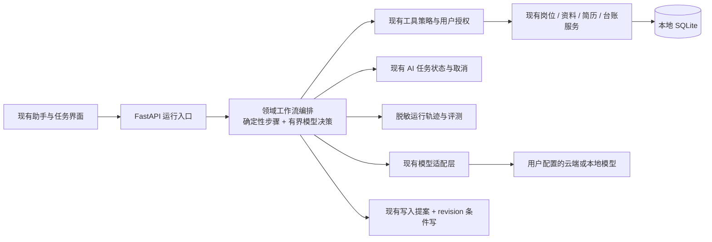

# ResumeForge Agent 原生化建议

> 调研日期：2026-11-07。GitHub 星标数是该日期附近的 API 查询快照，会持续变化；星标只用于发现项目，不代表安全性或适用性。本文是架构建议，不表示已决定引入任何新依赖。

## 建议结论

ResumeForge 不需要从聊天机器人重写成一个开放式自主 Agent。它已经有流式求职助手、模型适配层、工具注册与授权、待确认写入提案、简历事实核验、可管理的 AI 任务登记和离线评测。建议把“Agent 原生”定义为：用户能以目标描述工作，应用能在受约束的领域流程里组合现有能力、展示证据和进度，并在写入或外部动作前交还控制权。

推荐沿现有 FastAPI + React + SQLite、本地优先架构渐进演进：先建设一个可追踪的“求职工作流”编排层，保持单 Agent 或模型加确定性步骤；先复用现有服务与测试体系，再用小型适配试验决定是否引入 PydanticAI 或 LangGraph。MCP、AG-UI、OpenTelemetry 和 promptfoo 分别作为互操作、交互事件、遥测与评测的可选标准/工具，不要打包成一次性平台迁移。

## ResumeForge 已有的可复用基础

| 现有能力 | 代码位置 | Agent 化时的用法 |
| --- | --- | --- |
| 多轮工具调用、SSE 流式事件、工具结果归档、轮数/用量/时间预算 | `backend/app/api/assistant_stream.py`、`backend/app/api/assistant_budget.py` | 作为当前交互运行时和成本边界；在其上增加领域工作流事件，不另写聊天循环 |
| 模型供应商与协议适配 | `backend/app/services/llm/` | 保持用户自带模型、OpenAI 兼容和本地模型选择；框架评估必须覆盖非 OpenAI 提供方 |
| 工具注册表、每轮策略重判、执行期白名单 | `backend/app/services/assistant_tools/` | 用工具元数据表达只读/写入、权限、预览与领域输入；继续让下发与执行共用策略 |
| 写入预览、一次性审批、数据集代次绑定、重复执行保护 | `backend/app/services/assistant_tools/authorization.py`、`backend/app/api/assistant_proposals.py`、`frontend/src/features/assistant/components/ActionProposalCard.tsx` | 作为 Agent 写入的唯一批准入口；改动仍由用户审阅，模型不能批准自己的提案 |
| 通用长任务状态、阶段进度、取消和终态仲裁 | `backend/app/models/ai_task.py`、`backend/app/services/ai_task_runner.py` | 用于后台 Agent 流程的状态与取消；先确认任务生命周期需求，再决定是否加检查点 |
| 简历生成快照、来源关联、事实锁与 revision 条件写入 | `backend/app/services/resume/generate_snapshot.py`、`backend/app/services/resume/content_locks.py`、`backend/app/services/resume/` | 保持事实选择、证据跟踪和冲突检测由领域服务负责，不把事实真伪交给 Agent 自评 |
| 确定性与合成数据评测 | `backend/tests/evals/` | 扩展工作流轨迹、工具选择、拒绝越权、事实与隐私回归；继续让常规 CI 离线运行 |
| 动态功能目录和助手技能 | `backend/app/services/feature_catalog.py`、`backend/app/services/assistant/assistant_skills.py` | 保持能力发现与提示上下文来自单一事实来源；技能是可组合知识/指引，不等同可任意执行的代码 |

主要缺口不是“没有 Agent 框架”，而是目前助手循环和离散 AI 任务之间还没有一个明确的、可复盘的领域工作流契约。当前写入提案放在进程内存，服务重启即失效；这是可接受的短时交互策略，但不是长流程断点恢复的持久化方案。

## 产品与架构原则

1. **让 Agent 组合能力，不替换领域规则。** 把现有匹配、生成、建议、风险扫描、事实台账、版本和导出服务作为可调用节点。规则明确的步骤继续走确定性代码；模型用于理解目标、处理非结构化文本、组织候选方案和解释结果。
2. **默认只读，最小上下文。** 每次运行明确列出使用的数据集、岗位、简历、资料范围、联网状态和模型提供方；按任务装配上下文，不把全量个人资料或会话历史默认塞给模型。现有放宽模式继续作为敏感资料的显式授权边界。
3. **工具权限由服务端决定。** 每个工具有稳定的 schema、读写类别、输入上限、超时、幂等策略和审计摘要。执行时重新检查数据集身份、授权和当前业务状态；工具输出也作为不可信数据处理，不能因检索到网页/JD 里的指令而提升权限。
4. **写入和外部副作用必须能看、能停、能核对。** 写入先显示目标、差异、事实依据和版本冲突，再由用户批准；批准后再次验证 revision 并执行。投递、网申提交、发送消息、删除等高影响动作保持逐项人工确认。
5. **轨迹要有用但不能泄露。** 记录 run ID、步骤/工具名、开始结束时间、状态、模型与用量、授权决策、revision 和脱敏摘要；默认不记录完整简历、附件、Key、模型思维链或提示词原文。
6. **避免为了“多 Agent”而拆 Agent。** 多 Agent 增加转交、提示注入和成本面。只有当单个流程的质量评测证明职责隔离或并行能带来收益，才试验独立角色；并行只用于无写入副作用的独立分析。

建议的逻辑结构：

这里的编排应是一份显式状态机/流程定义，而不是让模型在无限循环中自己决定所有步骤。一次运行的状态可先用现有 `ai_task` 的 `kind`、受限 `payload`、`result_ref` 和结构化事件实现。如果确实要跨重启恢复到某一步、持久化人工等待状态或允许用户检查点续跑，再设计最小 Agent run/checkpoint 存储；不要把完整个人资料复制到任务 payload。

## 推荐试点：岗位到可审阅简历草稿

这是能展示 Agent 价值、又可以复用最多现有逻辑的端到端流程：

1. 用户选定目标岗位和资料范围，Agent 总结拟执行步骤，并明确模型供应商/是否联网。
2. 本地服务读取 JD、相关资料与已确认事实；每个候选事实保留资料来源或事实台账标识。
3. 现有匹配与生成流程生成简历候选稿，并输出岗位要求覆盖说明及省略理由。
4. 现有风险扫描、简历审核和事实锁检查候选稿；模型可根据结果提出修订，但不能压过确定性阻断。
5. 展示候选稿、证据来源、变更差异、风险项与版本冲突。用户可逐条采纳、修改或放弃。
6. 用户确认后复用现有写入提案和 revision 条件写入；导出由用户触发。

试点的成功标准应该是“减少完成一份可信简历需要的时间和手工往返”，并且不降低事实准确率、可追溯率、隐私边界或用户对写入的控制。用现有 50 份合成资料样本，加上合成岗位与任务轨迹评测；真实模型评测仍然 opt-in 且预算有界。

**暂不作为首个试点：** 自主批量投递、自动提交网申、Agent 自己找工作并持续执行、全站万能命令面板。这些需要更广数据、更强身份验证、更细权限和跨网站稳定性，失败代价更高。

## 分阶段路线

| 阶段 | 交付目标 | 建议工作 | 退出条件 |
| --- | --- | --- | --- |
| 0. 定义边界 | 可审阅的产品/安全契约 | 定义 Agent 能做/不能做、数据发送说明、工具读写分级、预算、取消、运行保留策略；为岗位到简历试点写成功指标 | 产品语义与现有权限、数据集隔离、隐私规则一致 |
| 1. 运行轨迹 | 可解释、可诊断 | 在现有 SSE/消息上下文和 AI 任务中统一 run/step/tool 状态；输出脱敏参数摘要、来源、耗时、费用、错误类别和审批状态 | 不采集简历正文、密钥或思维链；取消/超时/切数据集都有真实终态 |
| 2. 单工作流试点 | 目标驱动的岗位简历流程 | 把既有服务以类型化步骤编排；实现预览/恢复/失败重试；补充合成轨迹与提示注入测试 | 离线质量门槛稳定通过，人工审阅明确，端到端可取消且可重放分析 |
| 3. 可恢复性 | 长流程不中断 | 只有若产品需要时，给 Agent run/checkpoint 与待审批状态加持久化；重新授权和校验快照 revision；迁移需备份、升级/降级测试 | 崩溃恢复不重复执行写操作，旧审批不能跨数据集或过期复用 |
| 4. 可扩展互操作 | 接入外部生态 | 外部工具需要时实现受控 MCP server/client；多前端/实时协作需要时再评估 AG-UI；标准化 GenAI traces | 明确威胁模型、工具信任分区、许可证和网络数据流 |

**建议先做的工程切片：** 增加一个薄的 `agent_workflows/` 领域包（不是通用 Agent 平台），定义 Run、Step、Tool result、Approval reference 的 Pydantic schema 与状态转移；由现有 `ai_task_runner` 管长任务；调用现有 assistant policy 和领域服务；由前端复用助手消息和统一任务进度组件。若模块超过 500 行，按职责继续拆分。先用纯 Python 测试流程与状态，不动数据库；确认必须持久化后再写 Alembic 迁移。

## 开源项目：看什么，先不搬什么

以下星标为调研时 GitHub API 返回的近似数。许可证以仓库显示为准；经依赖传递、托管组件或代码片段使用前仍应逐项核对仓库 `LICENSE`、版本和依赖许可。

| 项目 | 星标 / 许可证 | 对 ResumeForge 的价值 | 建议 |
| --- | --- | --- | --- |
| [PydanticAI](https://github.com/pydantic/pydantic-ai) | 约 21.1k / MIT | Pydantic 类型化 Agent、结构化输出与模型适配，与 FastAPI 技术栈接近 | **首选做隔离式技术验证**：用现有工具实现一个只读小流程，检查 OpenAI 兼容、本地模型、Anthropic、流式体验、异常与依赖体积；通过后再决定是否逐步接入 |
| [LangGraph](https://github.com/langchain-ai/langgraph) | 约 44.6k / MIT | 图式状态流、checkpoint、暂停/恢复和人工介入 | 当需要持久化检查点/长流程恢复且 `ai_task` 无法覆盖时再验证；一般简历生成路径可能用现有 runner + 明确状态机更简单 |
| [OpenAI Agents SDK (Python)](https://github.com/openai/openai-agents-python) | 约 30.5k / MIT | tools、handoff、guardrails 与 tracing 的参考实现 | 适合学习 Agent 控制和护栏；需重点验证用户自带的多供应商与本地模型是否仍可工作，避免把供应商能力变成隐性前提 |
| [MCP Python SDK](https://github.com/modelcontextprotocol/python-sdk) | 约 24.8k / MIT | 官方 Model Context Protocol Python SDK | 未来可作为外部工具插件的互操作边界；内部 Python 服务调用无需包一层 MCP |
| [AG-UI](https://github.com/ag-ui-protocol/ag-ui) | 约 17.0k / MIT | Agent 到前端的事件协议，适合研究计划、工具状态、确认、用户输入的 UI 事件 | 先对照当前 SSE 事件模型；只有要多客户端或生态兼容时再实现协议适配器。不要为此替换 Ant Design 前端 |
| [promptfoo](https://github.com/promptfoo/promptfoo) | 约 26.9k / MIT | 提示词、Agent 流程评测和安全/红队测试 | 适合作为现有 `tests/evals` 的补充对比工具；保留本项目的离线、确定性回归为 CI 硬门槛 |
| [Langfuse](https://github.com/langfuse/langfuse) | 约 37.1k / API 未给出 SPDX | LLM/Agent trace、观测和评测；适合研究仪表盘与数据模型 | 暂不默认引入；自托管方式、各组件许可证、网络流量、数据脱敏与 SQLite/单机部署成本要先逐一核验 |
| [LiteLLM](https://github.com/BerriAI/litellm) | 调研代理报告约 63k；本轮未独立复核 / 待核验 | 模型网关、供应商路由与成本限制 | 当前已有模型预设与用户自带 Key，先复用现状；只有集中路由或统一限额成为明确需求时再评估 |

**求职领域参考实现（只研究产品边界和流程）：**

- [career-ops](https://github.com/career-ops-hq/career-ops)：岗位匹配、简历定制与申请跟踪，保留用户提交申请的步骤。可对照“Agent 准备材料，用户最后提交”的边界。
- [ResumeSkills](https://github.com/Paramchoudhary/ResumeSkills)：面向多种编码 Agent 的简历相关 skills，适合研究跨 Agent 的职业资料/技能包表达；不要默认授予对本地 ResumeForge 数据的访问权。
- [JobFinderOS](https://github.com/matthewprice/JobFinderOS)：岗位发现、评分和面试准备的组合，可观察工作流的评测方式。
- [offeros](https://github.com/averatec0773/offeros)：强调本地数据与用户自己的 API Key，适合对照隐私文案与数据流设计。
- [job-application-agent](https://github.com/vaibhavarora14/job-application-agent)：结合 Agent Skill、CLI 和申请跟踪，可参考能力封装方式。

这些领域仓库的具体代码、活跃程度和许可证状态**未作为本次技术选型的已验证前提**。移植前需在 GitHub 当前页面检查维护活动、依赖、威胁面、许可证兼容和数据外传行为，并先以小型独立原型验证。

## 标准与安全参考

- [Anthropic: Building effective agents](https://www.anthropic.com/research/building-effective-agents)：用可组合、尽量简单的工作流处理任务；有证据表明需要时再扩大 Agent 自主性。
- [MCP 2025-11-25 工具规范](https://modelcontextprotocol.io/specification/2025-11-25/server/tools)：工具发现、schema、调用结果与错误语义；MCP 不代表工具天然可信。
- [AG-UI 协议](https://docs.ag-ui.com/introduction)：Agent 与 UI 之间的事件交互模型。
- [OpenTelemetry GenAI spans](https://opentelemetry.io/docs/specs/semconv/gen-ai/gen-ai-spans/)：生成式 AI 操作的 span 属性和遥测语义；不要照搬会落入原始输入/输出的配置。
- [OWASP Agentic AI Threats and Mitigations](https://genai.owasp.org/resource/agentic-ai-threats-and-mitigations/)：Agent 权限、提示注入、工具滥用等威胁分类。
- [NIST AI Risk Management Framework](https://www.nist.gov/itl/ai-risk-management-framework)：识别、衡量与管理 AI 风险的框架，可用于组织上线验收。
- [PydanticAI 文档](https://ai.pydantic.dev/agents/)、[LangGraph interrupt 文档](https://docs.langchain.com/oss/python/langgraph/interrupts)、[OpenAI Agents SDK 文档](https://openai.github.io/openai-agents-python/)：分别研究类型化 Agent、人工暂停/恢复和工具/护栏实现。

## 立项前的检查项

- 画出每个场景的数据流：哪些个人资料/JD/附件到模型、何时联网、模型供应商如何选择、失败日志保留什么。
- 给工具按只读、可撤销写入、不可逆写入、外部副作用分级；每个高影响步骤配置明确确认与幂等保护。
- 把 JD、网页、附件、模型返回的文本都视为不可信内容；模型不能授予自身权限，检索片段也不能改写系统策略。
- 用数据集 ID + generation、业务 revision 和审批状态绑定运行；切换数据集、修改源资料或审批过期时必须重新预览/确认。
- 规定 trace 保留与清除语义，并用合成数据开展普通回归；真实模型评测需显式 opt-in、成本和时限预算。
- 对所有新增依赖检查许可证、维护状态、供应链、桌面打包影响和额外服务需求；当前本地单用户模式不能被云端追踪默认破坏。
- 对用户可见的 Agent 计划明确其是“拟执行步骤”，不能暗示模型内部思考或保证事实准确；结果必须标明证据、缺口与待用户判断的事项。

这条路线把 Agent 能力建在 ResumeForge 的优势上：本地数据边界、资料与简历领域模型、显式权限、用户审阅、事实核验和可离线验证。最重要的选型门槛是：任何新框架都必须证明它比现有服务组合更可靠或显著减少维护成本，才能进入生产依赖。
