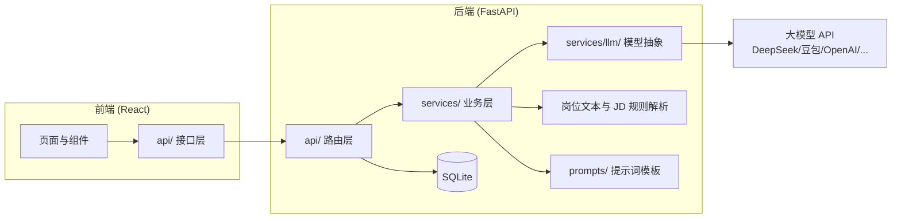
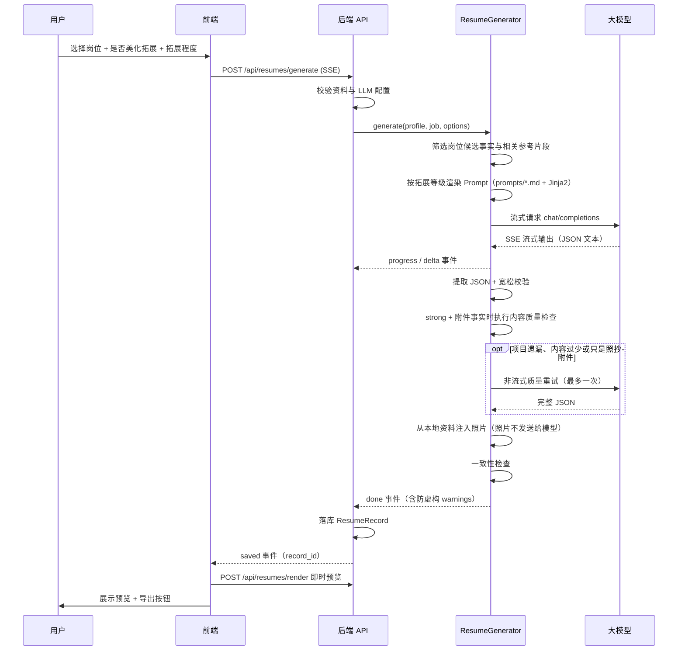

# 架构设计

## 总体架构

前后端分离：React（Vite + TypeScript + Ant Design）+ FastAPI（Python），本地 SQLite 存储，单用户本地部署，零外部依赖服务。



## 目录结构

```
backend/app/
├── main.py            # 应用入口：装配路由/中间件/建表与兼容升级
├── config.py          # 服务端配置（.env）
├── database.py        # 数据库连接、会话与 SQLite 缺列补齐
├── models/            # ORM 模型（profile/job/resume/setting）
├── schemas/           # Pydantic 数据结构（前后端契约）
├── api/               # 路由层：校验参数、编排服务、组装响应
├── services/          # 业务层：核心逻辑，与框架解耦
│   ├── llm/           # 大模型抽象（base + openai_compat）
│   ├── job_text_parser.py  # 粘贴招聘文本解析为可编辑岗位草稿
│   ├── jd_parser.py   # JD 规则解析（技能标签/学历/年限）
│   ├── resume_generator.py  # 简历生成流水线
│   ├── exporter.py    # 导出 JSON/Markdown/HTML
│   ├── profile_service.py   # 个人资料读写
│   └── settings_service.py  # 运行时配置存取
├── prompts/           # 提示词模板（独立于代码，方便调参）
├── templates/         # 简历 HTML 模板（Jinja2）
└── data/              # 技能词典
```

## 岗位管理与个人资料

- 岗位备注随岗位保存，并纳入岗位列表的关键词搜索。批量状态更新使用 `POST /api/jobs/batch-status`，批量删除使用 `POST /api/jobs/batch-delete`。
- 两个批量接口都会先去重并校验全部岗位 ID；只要有 ID 不存在就不执行任何修改，全部有效时才在单一事务中提交，提交异常会回滚。
- 个人照片以通过格式、文件签名和体积校验的 data URL 保存在本地资料中。照片不会发送给大模型，而是在模型输出解析完成后注入结构化简历，供 HTML 预览、浏览器打印及导出使用。
- 教育、实习/工作、校园和项目条目各可保存一份 UTF-8 Markdown/TXT 参考文件。浏览器只保存文件名与正文，不保存本机路径；生成器只把与目标 JD 相关的正文片段放入候选上下文。

已有 SQLite 数据库启动时先执行 `create_all`，再由 `ensure_sqlite_columns` 幂等补齐已知的新增列。当前兼容岗位备注/收藏、个人照片、经历参考文件与简历美化拓展元数据；新增列都有安全默认值，因此旧岗位、资料和简历记录不会被重建或丢失。更复杂的表结构变更仍应引入正式迁移工具处理。

## 核心数据流：AI 生成简历



## 关键设计决策

| 决策 | 理由 |
| --- | --- |
| SQLite 本地存储 | 单用户工具，零部署成本；换多用户时替换 `DATABASE_URL` 即可 |
| LLM 走 OpenAI 兼容协议 | DeepSeek/豆包/Kimi/智谱/Ollama 全部兼容，一套实现全覆盖 |
| 用户 API Key 存本地 DB | 定位为个人本地工具，不对外暴露；README 有安全说明 |
| Prompt 独立成文件 | 模板与代码分离，调参改 `prompts/*.md` 即可，无需动代码 |
| PDF 用浏览器打印实现 | 服务端 PDF 在中文环境依赖系统字体，跨平台极易踩坑；浏览器打印零依赖且排版稳定 |
| 模型输出宽松解析 + 修复重试 | 大模型输出不稳定，先容错提取 JSON，失败后用修复 Prompt 重试一次，再失败友好降级 |
| 深度美化质量门槛 | 在事实回填前识别合法但空洞的附件项目，最多非流式重试一次，避免前端拼接两份 JSON；失败时保留首轮结果 |
| 分级美化拓展 | 关闭时严格回填资料原文；开启后允许基于资料与相关参考片段重组表达，但结构事实和数字仍受校验 |
| 一致性校验（防 AI 虚构） | 固定名称、角色、时间、技能等结构事实，并拦截资料或参考文件未支持的量化结果 |
| 岗位文本使用本地规则解析 | 粘贴内容不发送给大模型，先生成可编辑草稿，用户确认后才入库 |
| 照片在模型调用后注入 | 避免把无意义的 base64 内容发送给模型，同时保证预览与导出使用已校验的本地照片 |
| SQLite 启动时补齐已知列 | `create_all` 不会升级旧表，轻量幂等补列可在不重建表的前提下兼容现有本地数据 |

## 扩展点

1. **新增模型提供商**：非 OpenAI 兼容协议时，在 `services/llm/` 新增 Provider 类，并在 `create_provider` 中按 `provider` 字段分发。
2. **扩展岗位文本识别规则**：在 `services/job_text_parser.py` 增加字段标签或章节规则，并补充对应离线测试。
3. **新增导出格式**：在 `services/exporter.py` 加导出函数，`api/resumes.py` 的 `_EXPORT_FORMATS` 加一行。
4. **调整美化拓展策略**：后端 `resume_generator.py` 的分级指令与前端 `config.ts` 的 `RESUME_ENHANCEMENT_LEVELS` 保持一致，并补充生成器测试。

## 测试策略

- 后端核心业务（岗位文本/JD 解析、资料参考文件、岗位相关片段筛选、分级生成、照片校验与渲染、导出、防虚构校验）有单元测试，生成流水线用假 Provider，不依赖真实网络。
- API 层有冒烟测试（TestClient），覆盖岗位备注搜索、批量操作原子性、照片往返与其他核心链路。
- SQLite 兼容升级使用临时旧表验证新增列、幂等执行与原数据保留，不接触真实用户数据库。
- 前端为薄展示层，暂不写测试；类型系统（TS strict）+ 构建检查兜底。
