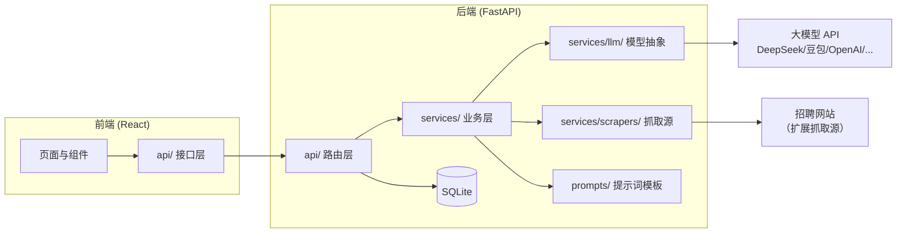
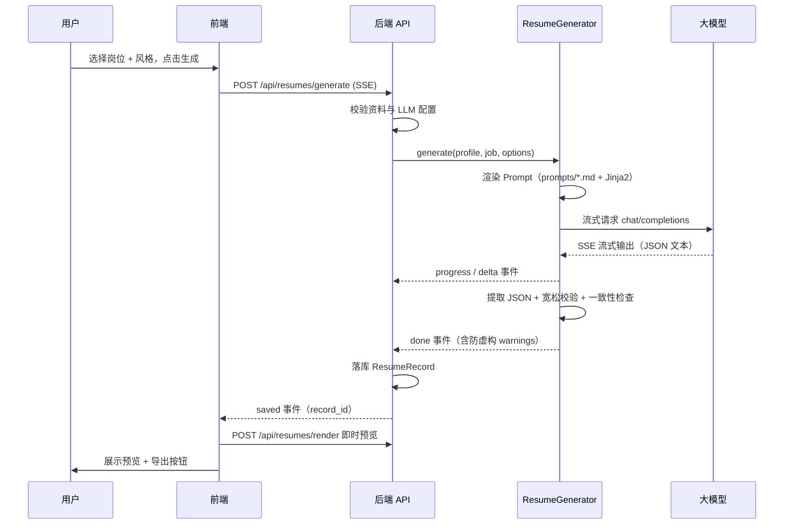

# 架构设计

## 总体架构

前后端分离：React（Vite + TypeScript + Ant Design）+ FastAPI（Python），本地 SQLite 存储，单用户本地部署，零外部依赖服务。



## 目录结构

```
backend/app/
├── main.py            # 应用入口：装配路由/中间件/建表
├── config.py          # 服务端配置（.env）
├── database.py        # 数据库连接与会话
├── models/            # ORM 模型（profile/job/resume/setting）
├── schemas/           # Pydantic 数据结构（前后端契约）
├── api/               # 路由层：校验参数、编排服务、组装响应
├── services/          # 业务层：核心逻辑，与框架解耦
│   ├── llm/           # 大模型抽象（base + openai_compat）
│   ├── scrapers/      # 抓取源框架（base + registry + sources/）
│   ├── jd_parser.py   # JD 规则解析（技能标签/学历/年限）
│   ├── resume_generator.py  # 简历生成流水线
│   ├── exporter.py    # 导出 JSON/Markdown/HTML
│   ├── profile_service.py   # 个人资料读写
│   └── settings_service.py  # 运行时配置存取
├── prompts/           # 提示词模板（独立于代码，方便调参）
├── templates/         # 简历 HTML 模板（Jinja2）
└── data/              # 技能词典、示例岗位数据
```

## 核心数据流：AI 生成简历



## 关键设计决策

| 决策 | 理由 |
| --- | --- |
| SQLite 本地存储 | 单用户工具，零部署成本；换多用户时替换 `DATABASE_URL` 即可 |
| LLM 走 OpenAI 兼容协议 | DeepSeek/豆包/Kimi/智谱/Ollama 全部兼容，一套实现全覆盖 |
| 用户 API Key 存本地 DB | 定位为个人本地工具，不对外暴露；README 有安全说明 |
| Prompt 独立成文件 | 模板与代码分离，调参改 `prompts/*.md` 即可，无需动代码 |
| PDF 用浏览器打印实现 | 服务端 PDF 在中文环境依赖系统字体，跨平台极易踩坑；浏览器打印零依赖且排版稳定 |
| 模型输出宽松解析 + 修复重试 | 大模型输出不稳定，先容错提取 JSON，失败后用修复 Prompt 重试一次，再失败友好降级 |
| 一致性校验（防 AI 虚构） | 对比生成结果与资料中的学校/公司/项目名，可疑内容给用户警告 |

## 扩展点

1. **新增模型提供商**：非 OpenAI 兼容协议时，在 `services/llm/` 新增 Provider 类，并在 `create_provider` 中按 `provider` 字段分发。
2. **新增抓取源**：在 `services/scrapers/sources/` 新建文件继承 `JobSourceBase`，自动注册，详见 [scraper-guide.md](scraper-guide.md)。
3. **新增导出格式**：在 `services/exporter.py` 加导出函数，`api/resumes.py` 的 `_EXPORT_FORMATS` 加一行。
4. **新增简历风格**：`resume_generator.py` 的 `TONE_GUIDES` 与前端 `config.ts` 的 `RESUME_TONES` 同步添加。

## 测试策略

- 后端核心业务（JD 解析、生成流水线、导出、防虚构校验）有单元测试，生成流水线用假 Provider，不依赖真实网络。
- API 层有冒烟测试（TestClient），覆盖核心链路。
- 前端为薄展示层，暂不写测试；类型系统（TS strict）+ 构建检查兜底。
