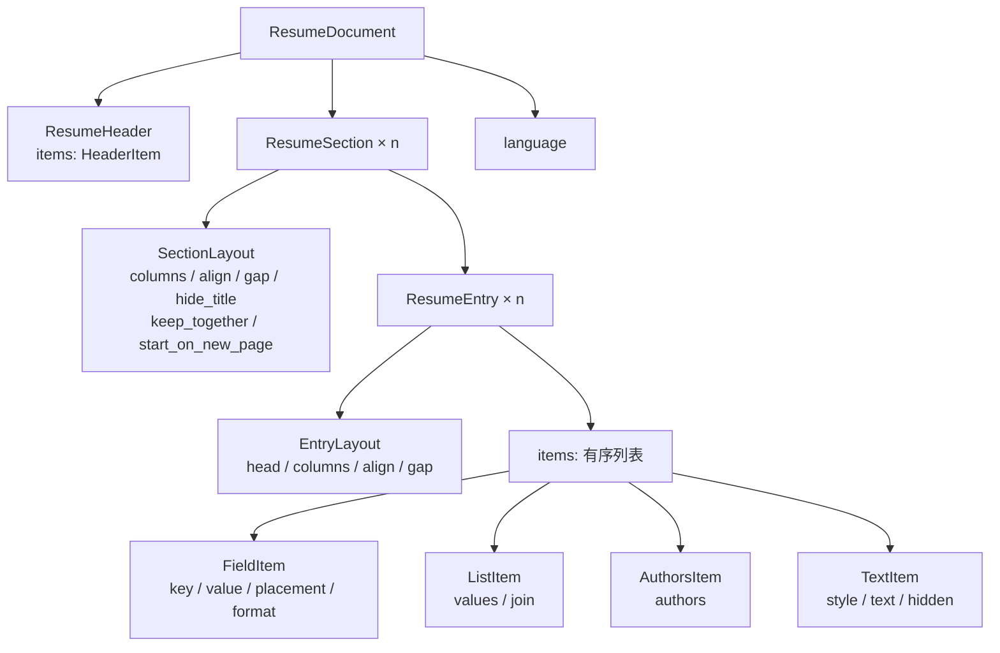

# 简历文档模型 v2（开发者说明）

> 状态：2026-10-30 起生效。本文件描述**已获用户批准并正在实施的终态**，是给维护者与开发者的实现说明；
> 用户向说明见 [user-guide.md](user-guide.md)，系统级数据流见 [architecture.md](architecture.md)。
> 执行契约：`deliverables/software-company/ResumeForge-document-model-v2-plan-20261030.md`；
> 背景与调研：`deliverables/software-company/ResumeForge-field-placement-plan-20261029.md` 附录 A。

## 1. 为什么有 v2

v1 的简历内容模型是「11 个按分区写死的数组 + 承载区文本 + 固定灰行」：

- 每个分区（教育 / 实习 / 项目 / 校园 / 奖项 / 论文 / 科研 / 专利 / 证书 / 技能 / 语言）在
  `ResumeContent` 里有自己的一组字段，渲染时由四份处理器（HTML / PDF / Word / Markdown）各拼一次；
- 自定义字段**没有独立槽位**，只能以「标签：值」追加进承载区文本（教育 `achievements`、
  工作 `description` 等），再靠 `ensure_custom_field_lines` 在 AI 改写后补回；
- 一部分灰色小字是模板里写死的固定行（绩点 / 核心课程 / 技术栈 / 作者 / 详情……），
  另一部分是可编排短字段（`format_config.field_layout`），两层长得一样但一套能调、一套不能。

结果是「看起来都能调、实际很多调不了」，且同一个字段怎么上纸面要在四个渲染器里各写一遍。
v2 把**每个字段变成一等公民，位置变成数据**：一个统一的 `ResumeDocument` + 一个唯一的
布局规划器（planner），HTML / PDF / Word / Markdown 只消费 planner 的输出。

### 1.1 v1 与 v2 的核心差异

| 维度 | v1 | v2 |
|---|---|---|
| 内容组织 | 11 个分区各自写死的数组 / 标量 | 一条有序 `items` 列表（每个字段一个 item） |
| 自定义字段 | 追加进承载区文本「标签：值」 | 真实 item，带 `source` 溯源、可拖到任意位置 |
| 纸面位置 | 由分区代码与模板写死 | `placement` 枚举（六抽屉），用户可改 |
| 灰色短字段 | 固定灰行 + 可编排短字段两套 | 全部是 item，lead / trail 两个位置 + `solo` |
| 排版计算 | 四份渲染器各写一遍 | 唯一 planner 产出 `DocumentPlan` |
| 模板职责 | 外壳 + 字段拼装 | **只负责外壳与 CSS**（主题变量），不碰字段 |
| 版本判定 | 无版本号 | `content.version`；读取时检测、保存写 v2 |

## 2. 数据模型

### 2.1 存放与版本化

- v2 文档仍是**一个 JSON**，存在 `resume_record.content` 列里——文档结构本身不新增表 / 列。
  资料侧新增的自定义字段纸面属性（`default_placement` / `material_only`）随迁移 `0069`
  **只加两列**（旧库兼容、可降级，见 `services/profile/field_placement.py`）。
- 顶层带 `version: 2` 作为判定依据。读写边界只有一道门（`services/resume/document_io.py`）：
  **读**走 `ensure_document_version(content)`——`version == 2` 直通并归一化，否则交给 converter
  转成 v2（**只在内存里转，不写库**）；**写**走 `prepare_document_for_save(content)`，落库永远是 v2。
- 结构定义在 `backend/app/schemas/resume_document.py`：各模型 `ConfigDict(extra="ignore")`，
  **未知键丢弃不报 422**；结构类型错误由 `parse_document()` 抛 `DocumentValidationError`，API 层
  翻成 422 并在错误信息里给出可读路径（如 `sections.0.entries.0.items.0.value: …`）。
- 所有 id 沿用 W01 的 `OBJECT_ID_PATTERN`（`[A-Za-z0-9_-]{8,32}`；schema 与
  `services/resume/document_identity.py` 各声明一份，由测试钉住两份一致）。缺失 id 由
  `ensure_document_ids()` 补 `ob_<16hex>`；写入前 `validate_document_ids_v2()` 拒绝非法 / 重复 id。

### 2.2 顶层结构

```python
class ResumeDocument(BaseModel):
    version: Literal[2] = 2
    language: Literal["zh-CN", "en-US"] = "zh-CN"
    header: ResumeHeader
    sections: list[ResumeSection]
```



### 2.3 item 类型（discriminated union）

```python
Placement = Literal["title", "meta", "lead", "trail", "body", "hidden"]
Format = Literal["text", "date", "date_range", "list", "enum", "url", "authors", "number"]

class FieldItem(BaseModel):
    kind: Literal["field"] = "field"
    id: str                    # 稳定 id：编辑定位 / 撤销 / 预览高亮
    key: str                   # 内置字段 key 或 custom:<uuid>
    label: str = ""            # 空 = 用字段目录按语言取标签
    value: str = ""            # 规范值（日期存 ISO 风格字符串）
    placement: Placement = "trail"
    hidden_from: Placement | None = None   # 隐藏前位置；显示时恢复，planner 不消费
    format: Format = "text"
    wrap: Literal["none", "paren"] = "none"   # 行内区块用（技能等级 / 语言成绩）
    show_label: bool = True    # lead/trail 默认「标签：值」；title/meta 默认 False
    solo: bool = False         # 灰色短字段独占整行
    source: FieldSource | None = None         # {section_key, field_id}
    body_style: Literal["bullet", "paragraph"] = "bullet"  # placement=body 时用

class ListItem(BaseModel):
    kind: Literal["list"] = "list"
    id: str; key: str; label: str = ""
    values: list[str]
    placement: Placement = "trail"
    hidden_from: Placement | None = None
    join: Literal["comma", "semicolon", "dot", "inline"] = "semicolon"
    show_label: bool = True
    solo: bool = False
    body_style: Literal["bullet", "paragraph"] = "bullet"

class AuthorsItem(BaseModel):
    kind: Literal["authors"] = "authors"
    id: str; key: str; label: str = ""
    authors: list[Author]      # {name, is_self, corresponding}
    placement: Placement
    hidden_from: Placement | None = None
    show_label: bool = False

class TextItem(BaseModel):
    kind: Literal["text"] = "text"
    id: str                    # 沿用 v1 point id（大纲 / 隐藏 / 复制兼容）
    style: Literal["bullet", "paragraph"] = "bullet"
    text: str
    hidden: bool = False

ResumeItem = Annotated[FieldItem | ListItem | AuthorsItem | TextItem, Field(discriminator="kind")]
```

约定：

- **只有 FieldItem 用 `format`**；列表类（课程、技术栈）与作者类保持结构化，不拍平字符串。
- `label` 为空时由字段目录按 `language` 查标签；用户自定义字段的 `label` 存在 item 上，覆盖目录。
- 作者本人加粗、通讯作者星号由渲染器按 `is_self / corresponding` 处理，**不写进 name**。
- 日期的规范值是字符串（如 `"2021-09|2024-06"` 表示日期范围），显示时由 planner 按语言格式化。
- 切换界面 / 简历语言**不迁移数据**，只改渲染。
- `source` 记录来源资料字段（`{section_key, field_id}`，`field_id` 形如 `educations.school`），
  供溯源 / 刷新 / AI 补值；**AI 只写 `value`，不决定 placement 与 format**。
- `TextItem` **不参与位置拖拽**（没有 placement，只有 `hidden` 开关）；`show_label` / `solo` 在
  所有带 placement 的 item 基类上。Field/List/Authors 隐藏时把原 placement 记进 `hidden_from`，
  点显示时恢复到该位置；`hidden_from` 只由编辑器消费，planner 与导出不读。

### 2.4 页眉

```python
class HeaderItem(BaseModel):
    kind: Literal["field"] = "field"
    id: str; key: str; label: str = ""
    value: str = ""
    placement: Literal["name", "name_meta", "subtitle", "contact", "photo", "hidden"] = "contact"
    format: Format = "text"

class ResumeHeader(BaseModel):
    items: list[HeaderItem]
    contact_breaks: list[str] = []   # 沿用 v1 format_config.contact_breaks
```

- 页眉不参与板块排序，永远在纸面最前；`photo` 只交给模板定位与缩放。
- 联系方式行按 items 顺序渲染，`contact_breaks` 指定某个字段后强制换行；字段整体不折行，
  字段之间可以换行（沿用 v1 语义）。
- `contact_breaks` 白名单沿用 `services/resume/resume_contact.py` 的 `CONTACT_FIELDS`。

### 2.5 板块、条目与布局

```python
class SectionLayout(BaseModel):
    columns: Literal[1, 2, 3] = 1
    align: Literal["equal", "flow"] = "equal"
    gap: float | None = None            # 字号倍数（0–30）；None = 该 align 的兜底值
    hide_title: bool = False
    keep_together: bool = False
    start_on_new_page: bool = False
    title_override: str = ""            # 系统板块标题可覆盖；空 = 目录标题

class EntryLayout(BaseModel):           # 条目级覆盖，None = 继承分区
    head: Literal["split", "stacked", "meta_first"] = "split"
    columns: Literal[1, 2, 3] | None = None
    align: Literal["equal", "flow"] | None = None
    gap: float | None = None            # 字号倍数（0–10）；None = 继承分区
    start_on_new_page: bool = False     # 条目级分页：这条从新页开始
    keep_together: bool = False         # 条目级分页：整条不跨页

class ResumeEntry(BaseModel):
    id: str | None = None
    hidden: bool = False
    lock_content: bool = False
    lock_layout: bool = False
    layout: EntryLayout = EntryLayout()
    items: list[ResumeItem]

class ResumeSection(BaseModel):
    key: str                            # education / ... / custom:<uuid>
    title: str = ""                     # 空 = 字段目录标题
    kind: Literal["entries", "inline", "text"] = "entries"
    layout: SectionLayout = SectionLayout()
    entries: list[ResumeEntry]
```

`kind` 的语义：

| kind | 用在哪 | 纸面形态 |
|---|---|---|
| `entries` | 教育 / 实习工作 / 项目 / 校园 / 奖项 / 论文 / 科研 / 专利 / 证书 / 自建板块 | 条目卡：head + lead + body + trail |
| `inline` | 专业技能 / 语言能力 | 行内列表：条目内字段按顺序拼成段落 |
| `text` | 个人总结 | 单入口段落（不渲染 head，只输出正文块） |

- `entry.id / item.id` 由服务端 normalize 时补（`ensure_document_ids`），旧数据转换时生成。
- 自建板块与系统板块**同构**：都是 Section/Entry/items，只有字段目录与默认值不同。
- 条目级 `layout` 只覆盖列数 / 对齐 / 间距 / head 布局 / 分页（`start_on_new_page` / `keep_together`）；
  其余继承分区。分区级分页同名字段在 `SectionLayout` 上，两者都由「排版参数 → 分页」面板写入。

### 2.6 校验与归一化

保存前必须 normalize（唯一实现放在 schema 模块）：

- 去空 section / 空 entry / 空值；`title/meta/lead/trail/body` 的混合顺序**保留**；
- 同 key 的 item 允许重复（用户可以在两处各放一个「备注」），但**内置 key 只能有一个**：
  `normalize_document()` 丢弃同一 entry 内重复的内置 key（保留第一个），自定义 key（`custom:*`）可重复；
- 长度上限沿用 v1 schema（姓名 128、描述 2000 等），超长**截断 + warning**，不静默丢整条；
- 私密字段（证书编号等）永不进 content（沿用 v1 红线）；
- 空 section / 空 entry / 空 header item 不序列化（保存前 normalize 掉）；序列化用
  `document_to_json()`（`exclude_none=True`，`gap` / `columns=None` 这类继承值不落盘）；
  `normalize_document` 幂等（`normalize(normalize(x)) == normalize(x)`），转换器与 API 写入口共用它。

## 3. 位置（placement）

### 3.1 六个位置

`items` 是一条**有序列表**，`placement` 决定它上纸面的位置。拖拽 = 改数组顺序 + 改 placement。

| 值 | 界面正名 | 纸面位置 | 内容类型 |
|---|---|---|---|
| `title` | **标题行** | 条目头左侧（黑、加粗） | 字段 / 列表 |
| `meta` | **元信息** | 条目头右侧（灰） | 字段 / 列表（日期、学历、机构等） |
| `lead` | **正文前灰字** | 条目头之下、正文之前（灰短字段组） | 字段 / 列表 |
| `trail` | **正文后灰字** | 正文之后（灰短字段组） | 字段 / 列表 |
| `body` | **正文** | 黑字正文块（段落 / 要点） | 字段 / 列表 / 作者 / 文本 |
| `hidden` | **隐藏** | 不上纸面，数据保留 | 全部 |

- `lead` / `trail` 各自按同一套列布局装箱；`solo` = 该字段冲行后独占整行。
- `hidden` 与「仅素材」不同：`hidden` 是**文档层**位置（用户主动隐藏，可恢复）；
  「仅素材」是**资料层**标记（字段目录 `material_only`，只进 AI / 网申素材，默认投影成 hidden item）。
  两者在界面上都要明确标注，不能合并成一个词。
- 「用户隐藏」（资料层 `profile_field_preference.hidden`）与文档层 `hidden` 也是两件事：
  前者不进任何消费链路，后者只影响这一份简历的纸面。

### 3.2 页眉的六个位置

`name`（姓名，强调色大字）/ `name_meta`（姓名旁灰色小字）/ `subtitle`（求职意向行）/
`contact`（联系方式行）/ `photo`（照片）/ `hidden`。

### 3.3 条目头三种布局

`EntryLayout.head` 三选一（默认 `split`）：

| 值 | 界面 | 纸面 |
|---|---|---|
| `split` | 左右 | 标题左、元信息右（同一行） |
| `stacked` | 上下 | 标题一行、元信息下一行左对齐 |
| `meta_first` | 元信息在上 | 元信息一行、标题下一行 |

- head 只取顶层（item 顺序）的 `title` / `meta` 字段，title 内用 ` · ` 连接、meta 内用 ` · ` 连接。
- 长 meta 换行显示，**不自动缩字号**；PDF / Word 用同一份左右两段 plan 做右对齐。

### 3.4 lead / trail 的列装箱

- 按 items 顺序过滤出该位置的全部字段，每个字段渲染成「标签：值」（`show_label=False` 时只渲染值）；
- 按分区 / 条目 layout 的 `columns` / `align` / `gap` 装箱；`solo` 字段先冲行、再独占整行；
- `align=equal`（默认）列宽取该组最宽内容、同一 entry 的所有行共用一个网格（跨行对齐）；
- `align=flow` 用分隔符连接（PDF 里按语义退回单列行内连接）；
- `gap` 是字号倍数，`None` 时取该 align 的兜底值。

## 4. 字段目录（`document_catalog.py`）

字段目录是**默认位置、格式与标签的唯一来源**（不写第二份映射）。数据与查询只在
`document_catalog.py`，planner / converter 都从它取；渲染器与模板不直接读它。

```python
@dataclass(frozen=True)
class FieldSpec:
    key: str                  # v2 item key，与 v1 ResumeContent 属性名对齐
    label_key: str            # resume_labels 的标签键
    fmt: Format = "text"
    default_placement: Placement = "trail"
    material_only: bool = False   # 只进 AI / 网申素材，不上纸面
    private: bool = False
    body_style: BodyStyle = "bullet"
    wrap: str = "none"           # 行内区块用（技能等级 / 语言成绩）
    join: str = "semicolon"       # ListItem 的分隔符
    enum_kind: str = ""           # publication_status / patent_status / credential_status / experience_kind
    profile_key: str = ""         # source.field_id = <section profile_key>.<profile_key>

@dataclass(frozen=True)
class SectionSpec:
    key: str; title_key: str; kind: SectionKind
    profile_key: str              # 资料分区 key（educations / ...）
    fields: tuple[FieldSpec, ...]

@dataclass(frozen=True)
class HeaderFieldSpec:
    key: str; label_key: str; placement: HeaderPlacement
    fmt: Format = "text"; profile_key: str = ""
```

- 系统板块顺序固定为 `SECTION_ORDER`：教育 → 实习/工作 → 项目 → 学术成果 → 科研项目 → 知识产权 →
  证书资质 → 专业技能 → 语言能力 → 校园经历 → 荣誉奖项 → 个人总结；自建板块排在最后。
- 页眉目录 `HEADER_FIELDS`：name / gender（name_meta）/ job_intent（subtitle）/ phone / email /
  city / birth_year / github / personal_website（contact）/ photo（photo）。
- 便捷函数：`field_spec()` / `field_label()` / `section_spec()` / `resolve_section_title()` /
  `custom_field_placement()`；`profile_field_id()` 给出 item 的 `source.field_id`（如 `educations.school`）。

### 4.1 系统板块默认位置

实现时按下表写死，用户可拖走（表格里只列关键项，完整清单以目录代码为准）：

| 板块 | title（标题行） | meta（元信息） | lead（正文前灰字） | trail（正文后灰字） | body（正文） |
|---|---|---|---|---|---|
| 教育 | school, major | degree, period | gpa, courses | study_form, degree_type, department, rank, advisor, research_direction | achievements |
| 实习/工作 | company, role | period | — | team_size, experience_kind | description |
| 项目 | name | role, period | — | project_size, tech_stack, artifact_type, public_url | description, highlights |
| 校园 | organization, role | period | — | activity_type | description |
| 奖项 | name | date | — | issuer, level, ratio | description |
| 论文 | title | venue, year, status | — | authors, outcome_type, my_rank, volume_pages, doi, url, note | — |
| 科研 | name, role | organization, period | — | level, funding | description, outcomes |
| 专利 | title | patent_number, country, status | — | inventors, filed_date, granted_date, url；outcome_type / inventor_rank（仅素材，转换后 hidden） | — |
| 证书 | name | issuer, status | — | credential_type, issue_date, expiry_date, verify_url, note | — |
| 技能（inline） | — | — | — | category | name, level(paren) |
| 语言（inline） | — | — | — | obtained_at | name, level(paren), certificate(paren), score(paren) |
| 个人总结（text） | — | — | — | — | content |
| 自建板块 | 主文本字段（`primary_field_id`） | — | — | 其余字段（标签：值） | 主文本默认 body 段落 |

- `period` 是**一个** item（`format=date_range`，value=`start|end`）；编辑时渲染两个日期输入，
  空 end 渲染「至今」，语言切换自动改分隔符 / 格式。
- `courses` / `tech_stack` 是 `ListItem`（`join=comma`）；`authors` / `inventors` 是
  `AuthorsItem`（`fmt=authors`）。
- 枚举（工作类型 / 论文状态 / 专利状态 / 证书状态）用 `format=enum`，标签按 `enum_kind` 从
  `resume_labels` 取。
- `material_only=True` 的字段（如知识产权 outcome_type / inventor_rank）：转换后是 hidden item +
  目录标记；资料页与制作台都标注「不上纸面，仅生成素材」。

### 4.2 自定义字段的默认位置

- 用户在资料页添加字段时选「纸面位置」，默认按字段类型给建议（`CUSTOM_FIELD_DEFAULT_PLACEMENT`）：
  `single_line` / `date_text` / `enum` / `number` → `trail`；`multi_line` → `body`；
  用户可改到六个位置中的任意一个。
- 资料定义上的 `default_placement` / `material_only` 存在资料库，投影时按它生成 item；
  converter 的输入 `CustomFieldHint` 携带同一组信息（section_key / field_id / label / field_type /
  default_placement / material_only），用于识别承载区里的「标签：值」行。
- 系统字段与自定义字段的纸面属性由 `GET /api/profile/field-placement-catalog` 下发（`schemas/profile_field_catalog.py`：
  标签 / 格式 / 默认位置 / 仅素材 / 资料字段 id），资料页与制作台共用，**前端不复制一份映射**；
  自定义字段的默认位置来自迁移 `0069` 的两列，仅素材字段的 placement 恒为 `hidden`。
- 新增一个系统字段 = 目录里加一行 `FieldSpec` + `resume_labels` 加标签（若上纸面还要给
  `default_placement`）；不允许在渲染器或模板里再写一份「哪个字段放哪」。

## 5. v1 → v2 转换器（`document_converter.py`）

### 5.1 模块与原则

- 模块：`document_io.py`（读写边界：读时转换 / 写时收口）、`document_converter.py`
  （编排 + 版本收口）、`document_converter_sections.py`（逐分区字段映射）、
  `document_converter_custom.py`（页眉 / 自建板块 / 承载区自定义字段）、`document_conversion_types.py`
  （`ConversionReport` / `ConversionError` / `CustomFieldHint`）。分析直接读取 `document_view`；
  历史持久路径只由 `document_paths` 解析到现有节点，不重建槽位模型。
- 原则：**文字不丢、条目数不丢、顺序可解释**；识别不了的原文一律变 `TextItem`；确定性纯函数；
  v2 再转一次不变（幂等）；转换**不写库**（读时转换、保存写 v2）；允许视觉变化。

### 5.2 入口函数

```python
ensure_document_version(content, *, language=None, format_config=None, custom_fields=None) -> dict
ensure_document_version_with_report(...) -> tuple[dict, ConversionReport | None]
convert_content(content, *, language="zh-CN", format_config=None, custom_fields=None)
    -> tuple[ResumeDocument, ConversionReport]
```

- `ensure_document_version*`：v2 → `parse_document()` 归一化后直通（报告为 `None`）；v1 → `convert_content`
  转换；其它类型抛 `ConversionError`。**API 用「报告是否为 None」决定要不要提示已升级**。
- `document_io.py` 在以上函数外再包一层：`prepare_document_for_save()`（保存前收口）、
  `conversion_summary(report)`（详情响应的 `document_conversion`）、`custom_field_definitions(db)`
  （按当前方案读自定义字段提示）。
- 输入 v1 用 `schemas/resume.py` 的 `ResumeContent`；`custom_fields` 是 `CustomFieldHint` 列表
  （按资料分区归组），没有资料定义时传空。
- `ConversionReport.as_dict()` 字段（详情响应 `document_conversion` 与批量脚本 `--report` 共用）：
  `version`（转换器版本）、`source_version`、`fields_recognized`、`lines_preserved`、`fields_dropped`、
  `fields_merged`、`custom_fields_recorded`、`empty_sections`、`warnings`。

### 5.3 映射（按分区）

| v1 来源 | v2 落点 |
|---|---|
| 页眉 name / gender / job_intent / phone / email / city / birth_year / github / personal_website / photo | header items：name / name_meta / subtitle / contact（按 `HEADER_FIELDS` 顺序）/ photo |
| 教育 school/major → title；degree/period → meta；gpa/courses → lead；其余短字段 → trail；achievements → body bullet | 同左 |
| 实习 company/role → title；period → meta；team_size / experience_kind → trail；description → body bullet | 同左 |
| 项目 name → title；role + period → meta；project_size / tech_stack / artifact_type / public_url → trail；description、highlights → body bullet（各成块、保序） | 同左 |
| 校园 organization/role → title；period → meta；activity_type → trail；description → body | 同左 |
| 奖项 name → title；date → meta；issuer/level/ratio → trail；description → body paragraph | 同左 |
| 论文 title → title；venue/year/status → meta；authors → AuthorsItem(trail)；其余 → trail；无法拆的 publication_detail 整段进 note 的 TextItem（报告标注） | 同左 |
| 科研 name/role → title；organization + period → meta；level/funding → trail；description、outcomes → body | 同左 |
| 专利 title → title；patent_number/country/status → meta；inventors → AuthorsItem(trail)；filed/granted/url → trail；outcome_type/inventor_rank → hidden（material_only，保留数据） | 同左 |
| 证书 name → title；issuer/status → meta；credential_type/issue/expiry/verify_url/note → trail | 同左 |
| 技能（inline）name → body；level → body(wrap=paren)；category → trail | 同左 |
| 语言（inline）name → body；level/certificate/score → body(wrap=paren)；obtained_at → trail | 同左 |
| 个人总结 summary → 一个 paragraph TextItem | 同左 |
| 自建板块主文本 → body paragraph；`lines` 每行「标签：值」→ trail FieldItem；空行跳过 | 同左 |

补充：

- `period` 由 v1 的 `start_date` + `end_date` 合成规范值 `start|end`（空端保留位，显示为「至今」）。
- 正文类文本（`achievements` / `description` / `highlights` / `outcomes` / 说明等）**按行拆成独立 TextItem**
  （bullet / paragraph 按分区），v1 的 `point_ids` 沿用为 `TextItem.id`（大纲 / 隐藏 / 复制兼容）；
  空行跳过、不造空块。
- 内置字段 item 的 `id` 转换时生成（`it_` / `pt_` / `hd_` 前缀），写入校验前由 `ensure_document_ids` 保证唯一。

### 5.4 承载区「标签：值」行解析（自定义字段）

- 只认**带资料定义**的标签：用 `CustomFieldHint`（label → hint）匹配承载区文本行；
  命中 → `FieldItem`（`key=custom:<field_id>`、`label`、`source` 写入；placement 取 hint 的
  `default_placement`，没有则按 `field_type` 兜底；`material_only` 直接 hidden）；
- **不做正则猜测**：没有资料定义时，「标签：值」形状的行保持原样 `TextItem`，报告计入 `lines_preserved`；
- 同名标签只取第一行，后续行保留为文本并写 `warnings`；
- 自建板块的 `lines` 逐行转换：命中 hint → FieldItem（带 source），未命中 → trail FieldItem（source=None）。

### 5.5 `format_config` 迁移

- `section_order` → sections 顺序（系统板块按 `SECTION_ORDER`，自建板块固定在后；未知 / 缺失按默认顺序补齐）；
- `field_layout` → 对应 `SectionLayout` / `EntryLayout`：`columns/align/gap`、`meta_position=above`
  时把该分区 lead / trail 对调、`order` 影响 trail 内 item 顺序、`hidden` → placement hidden、
  `entries.<id>` 覆盖 → 对应 `entry.layout`；**转换后 v1 `field_layout` 丢弃**；
- `roles` / 颜色 / 字号 / 行距 / 页边距 / 页数 / `contact_breaks` / `document_mode` / `section_order`
  等继续留在 `format_config`（v2 仍用同一结构，角色样式不变；`contact_breaks` 由 planner 消费）。

### 5.6 触发点、转换提示与批量脚本

- 所有读取 `resume_record.content` 的入口（详情 / render / export / AI / 双语 / 历史读）统一走
  `document_io.ensure_document_version*`：v1 在**内存里透明转换**，不写库；保存统一走
  `prepare_document_for_save` 写 v2。
  旧简历第一次**保存**后才真正落 v2，第二次打开不再转换（报告为 None）。
- 详情响应带可选 `document_conversion` 摘要（`ConversionReport.as_dict()`），制作台据此显示
  **转换提示条**（文案在 `zh-CN.document.ts` 的 `document.conversion.*`）：标题「旧简历已转换」、
  正文「已整理为字段级结构，文字与条目都在」、按钮「查看转换摘要」（打开摘要面板：
  `fields_recognized` / `lines_preserved` / `warnings` / `empty_sections`）、`dismiss`「收起提示」、
  Toast「旧简历已转换，可以继续编辑」。提示不阻塞编辑。
- 提示语义：旧简历在**保存为 v2 之前**每次打开都会提示（每次读取都转换、`document_conversion` 非空）；
  「收起提示」只隐藏本次会话，不做本机永久静默；保存后 content 变 v2，不再提示。
- **不提供逐条报告视图**：提示条的「查看转换摘要」只显示上面的汇总；完整逐条报告由
  `scripts/convert_resume_documents.py` 产出——`--db` 指定数据库、`--report` 输出 JSON、默认 **dry-run**
  （只读库、只出报告）；真正写回要显式 `--write`，写真实库还要额外 `--allow-production-db` 且先备份。
  本批不在真实库上跑批量转换。
- 备份 / 导入：JSON 备份原样存 content（v2 JSON），导入校验接受 v1（先转换）与 v2。

## 6. 布局规划器（`document_plan.py`，唯一真相）

规划器是**纯函数**：输入 `ResumeDocument` + 语言（`build_document_plan(document, format_config=None,
language=None)`；`format_config` 只为兼容调用面保留——列布局已在文档的 SectionLayout / EntryLayout 里，
角色样式由渲染层消费，planner 不碰），输出 `DocumentPlan`；不依赖 Jinja / PDF / Word / DB，可单独测试。
四个出口都只消费它。`document_plan_format.py` 提供 `item_inlines()` / `plain_text()` 等格式化原语；
`plan_to_text()` 把 plan 展平成纯文本行（文本等价 / 对拍用）。

### 6.1 输出结构（定义在 `schemas/resume_document.py`，planner 与渲染器共用同一 shape）

```python
class Inline(BaseModel):
    text: str = ""; role: str = "body"
    strong: bool = False; italic: bool = False
    link: str | None = None
    path: str = ""

class CellPlan(BaseModel):
    segments: list[Inline]; solo: bool = False

class BlockPlan(BaseModel):
    kind: BodyStyle; segments: list[Inline]; path: str

class HeadPlan(BaseModel):
    layout: HeadLayout; title: list[Inline]; meta: list[Inline]; path: str

class EntryPlan(BaseModel):
    id: str
    layout: EntryLayout          # 生效布局（分区默认叠上条目覆盖）
    head: HeadPlan
    lead_rows: list[list[CellPlan]]
    body: list[BlockPlan]
    trail_rows: list[list[CellPlan]]

class SectionPlan(BaseModel):
    key: str; title: str; kind: SectionKind
    layout: SectionLayout
    entries: list[EntryPlan]
    rows: list[list[CellPlan]] = []   # inline kind：每个条目一行
    row_separator: str = ""           # inline 条目之间的语言分隔符

class HeaderPlan(BaseModel):
    name / name_meta / subtitle: list[Inline]
    contact_lines: list[list[Inline]]
    photo: str | None

class DocumentPlan(BaseModel):
    language: str; header: HeaderPlan; sections: list[SectionPlan]
```

### 6.2 计算规则

- **head**：只取 `placement in ("title", "meta")` 的字段（TextItem 不参与）；title / meta 各自按 item
  顺序用 ` · ` 连接；`split` / `stacked` / `meta_first` 由生效的 `layout.head` 决定；任一侧可为空。
- **lead / trail**：按 items 顺序取 `lead` / `trail` 字段，以 role=`meta` 渲染（是否带「标签：」由
  `show_label` 等格式化原语决定）；`_pack_rows` 装箱：
  - `solo` 先冲行、再独占整行；
  - `equal`：每行 `columns` 个（条目覆盖优先，否则分区默认）；
  - `flow`：全部字段排成一行，字段间用语言的列表分隔符；
  - `gap` 是字号倍数（分区 0–30、条目覆盖 0–10），随 plan 的 layout 交给渲染器换算实际间距。
- **body**：`placement=body` 的字段 → `BlockPlan`（`item.body_style` 决定 bullet / paragraph，
  `show_label` 决定是否带「标签：」前缀）；`TextItem` 直接成块；`hidden=True` 的 TextItem 跳过（数据保留）。
- **inline kind**：每个条目一行；item 的 role = `body`（正文）/ `meta`（trail 灰字）；`wrap=paren`
  时值包「（…）」；`row_separator` 由 planner 按语言给定（中文「；」/ 英文 `"; "`），渲染器不写语言文案。
- **text kind**：不渲染 head，只输出 body 块（段落）。
- **header**：name / name_meta / subtitle 三个槽位按 placement 分；contact 按 items 顺序、`contact_breaks`
  在指定字段后强制换行（字段整体不折行），github / personal_website 带标签前缀；photo 单独给模板。
- **隐藏与空**：`entry.hidden` 的条目不进 plan；没有可见条目的 section 不产出 `SectionPlan`
  （= 空板块不渲染）；`placement=hidden` 的 item 不参与任何位置。
- **标题**：`section.layout.title_override` 优先；自建板块用 `section.title`；系统板块按语言取目录标题。
- **角色**：条目头 title 用 `entry_title`、meta 用 `meta`；section 标题由模板用 `section_title`；
  正文用 `body`；作者本人用 `strong`，不新增角色。
- **路径**：head 为 `{section_key}.{entry_id}`；lead / trail / body 的 Inline / Block 为
  `{section_key}.{entry_id}.{item_id}`；header 为 `header.{item_id}`。供草稿预览点击定位与高亮。
- **分页**：`SectionLayout.start_on_new_page / keep_together` 与 `EntryLayout.start_on_new_page / keep_together`
  随 plan 交给渲染器；PDF 在测量阶段按「整块 / 整条不跨页」预留高度，Word 落成段前分页符与
  `keepNext`，HTML/草稿只做连续流（不画假分页线，界面注明去精确预览 / 导出核对）。
- **不缩字号**：plan 不含任何缩放系数；PDF 装不下时按页数上限截断并标 overflow（沿用 v1 提示口径，
  `noAutoShrinkGuard` 继续有效）。

## 7. 四个出口

四出口共用两个前置步骤（唯一实现，禁止各渲染器自己判断版本 / 自己过滤隐藏）：

1. **入口归一化**：`document_html.coerce_document(content)` → `ResumeDocument`（v2 直通；v1 走
   converter，读时转换不写库）；
2. **纸面视角过滤**：`document_html.paper_document(document)` 剔除 hidden 条目、`TextItem.hidden`
   与 `placement=hidden` 的字段——这是「hidden = 数据保留、不上纸面」的**唯一过滤点**，HTML / PDF /
   Word / Markdown 都以过滤后的文档去 planner；源内容（编辑态 / 内部快照 / 备份）不受影响。

| 出口 | 位置 | 消费方式 | 产物 |
|---|---|---|---|
| HTML | `services/resume/document_html.py` + `templates/_resume_document.j2` + 9 套 `resume*.html.j2` | `coerce_document → paper_document → build_document_plan`，Jinja 只遍历 plan 画语义标记 | 草稿预览 / HTML 导出 / 浏览器打印 |
| PDF | `services/pdf_exporter/document_render.py`（+ `fit.py` 分页/截断、`header.py` 页头） | 按 plan 测宽排表、绘制 Inline | 精确预览 / PDF 导出 |
| Word | `services/docx_document_render.py` | plan → docx 段落 / 无框表格 / 制表位 | Word 导出 |
| Markdown / TXT / JSON | `services/resume/markdown_export.py` / `services/txt_exporter.py` / exporter | plan 展平 / 由 Markdown 去标记 / 直接输出 v2 | Markdown / 纯文本 / JSON |

### 7.1 HTML

`document_html.py` 是 HTML 的**唯一语义层**：归一化 + 纸面过滤 + 构造模板上下文（plan、语言分隔符、
照片 alt、结构 CSS）；`_resume_document.j2` 只按 plan 画标记，宏包括 `role_spans` / `path_spans` /
`entry_head` / `sub_rows` / `body_blocks` / `inline_block` / `section_block`。

- 标记契约（与角色样式注入、前端纸面定位绑定）：`data-role` 五角色（name / section_title /
  entry_title / body / meta）、`data-resume-path`（v2 路径）、`data-object-id`（条目 id）。
- 9 套内置模板改成「`:root` 变量 + 主题 CSS + ``」，只负责外壳与
  配色字号；`_resume_sections.j2` 保留为一行别名（历史自制模板的稳定契约，preflight 必需文件不变）。
- 灰字段列间距兜底 `equal=1.6 / flow=1.2`（字号倍数）由 `document_html.default_cell_gap()` 统一给出，
  四出口共用同一默认值。
- 链接只放行 `http(s)` / `mailto`（其余按纯文本渲染，防 XSS）；自动转义开启。

### 7.2 PDF

- `document_render.py` 消费 plan：`draw_document` 按章节 / 条目绘制，内部 `_draw_head`（右对齐元信息）、
  `_draw_cell_rows`（lead / trail 列）、`_draw_body_blocks`（要点 / 段落）、`_reserve_entry_height`
  （keep_together 预留）等；`fit.py` 负责准备文档、调 planner、算页数与截断/溢出结论。
- 按纸张可用宽度测文字宽度（沿用现有字体度量）；head 左右两段两端对齐；列宽按 equal / flow 计算，
  逐行取最大行高；页眉在 `header.py`（版式计算 + 照片）。
- 分页：分区 / 条目级 `start_on_new_page` 先开新页；`keep_together`（分区整块 / 条目整条）在测量阶段
  作为整体预留高度，避免标题或单条落在页尾。
- 溢出标 `overflow`、真实页数走 `X-Resume-Pages-Needed`（接口不变）；**不缩字号**。

### 7.3 Word

- `docx_document_render.py` 消费 plan，只把 plan 落成 Word 元素：
  - 条目头 `split`：左标题加粗、右侧元信息用**定在版心右缘的右制表位**（与预览的 space-between 同效）；
    `stacked` / `meta_first` 用段落换行；
  - lead / trail：`equal` 用**无框表格**（`solo` 行横向合并单元格），`flow` 用一行段落（分隔符已由
    planner 写进 segments）；
  - body：bullet 走悬挂缩进列表、paragraph 走普通段落；inline 板块（技能 / 语言）用一段多 run 文本
    （条目内字段用「 · 」连接、条目间用 planner 的 `row_separator`）；
  - 分页：分区 / 条目级 `start_on_new_page` 落成 Word 分页符；`keep_together` 用 `w:keepNext` 表达
    （分区整块或条目整条尽量同页），导出侧只标记 overflow、**不截断内容**。
- 字号 / 颜色 / 间距全部来自 `ResumeLayout` 与 `DocxTheme`（与 PDF 同一来源），不存第二份数值；
  没有可用中文字体时仍可生成（python-docx 只写字体名），但页数估算为 `None`。

### 7.4 Markdown / TXT / JSON

- Markdown：`coerce_document → paper_document → build_document_plan`，head = 标题 + 「 」、lead / trail
  每行「标签：值」、body 用 `- ` / 段落、inline 用 ` · `，空行规则沿用现有导出；
- TXT：由 Markdown 展平（去掉标记）；
- JSON 导出：直接输出 v2 document + layout（不再输出 v1 chunks）。

### 7.5 四格式一致性的保证

- 一致性由三层保证：**同一份 plan**（字段拼装只写一次）+ **同一个 paper_document 过滤**
  （hidden 语义四出口一致）+ **文本对拍测试**（同字段、同顺序；差异只允许在版式层——分页、
  右对齐、强调）；
- 模板只负责外壳与 CSS，不参与字段拼装；任何「在某个渲染器里补一段字段」的改动都视为返工。

## 8. 前端契约

| 层 | 位置 | 职责 |
|---|---|---|
| 类型 | `frontend/src/types/resumeDocument.ts` | 与后端 v2 一一对应（discriminated union、placement / format / kind、header / section / entry / layout） |
| 纯函数 | `frontend/src/features/resume-document/` | normalize / ensureIds / paths / placement 操作（moveItem / setPlacement / reorderItems）/ defaults / convertFromProfile / summarize，全部可单测 |
| 编辑器 | `components/resume-editor/` | 三区卡：HeadZone（标题 + 元信息）、DetailZone（lead / trail 灰字段行）、BodyZone（正文块）+ 字段位置下拉 + 添加字段；中栏顶部 `ProfileFillMenu`（点开才拉投影、按 source 去重、只补空字段） |
| 工作台页签 | `components/resume/WorkbenchParamsColumnV2.tsx` | 排版参数 / 本份简历结构 / 双语版本 / 表达资产库 / 来源核对 / 历史（后四个按宿主是否挂载显示；窄屏抽屉同组件） |
| 排版参数 | 同上 | 文档模式（顶部，仅已有记录）/ 模板与版式 / 排版参数 / 间距 / 外观 / 局部排版 / **局部排版工具** / **分页** / 条目字段排版 |
| 局部排版工具 | `typography/TypographyToolsPanelV2.tsx` | 条目排版（作用范围：整条 / 条目头 / 正文 / 灰字，分别写 `objects` 与 `object_roles`）/ 文字级别 / 格式刷 / 多选批量；只写 `format_config` 的角色 / 对象域，不动正文 |
| 分页 | `pagination/SectionPaginationPanel.tsx` | 板块级 `start_on_new_page` / `keep_together` + 已设置断页汇总 / 恢复自然分页；条目级开关在结构页签的条目字段排版内（`EntryLayoutPanel`），经 `onChange` 交宿主记历史与保存 |
| 结构面板 | `components/resume/structure/` | 树 = 页 / 栏提示 → 板块 → 条目 → 位置分组；拖拽排序、跨组移动、显示 / 隐藏、复制、锁内容 / 锁排版、搜索、与画布联动；条目勾选框 + Shift 连选，与样式页「多选批量」共用宿主的同一份选择状态 |
| 双语版本 | `components/resume/bilingual/BilingualWorkspaceV2.tsx` | 字段对照基于 v2 **item path**；采纳只写语言变体，**不替换主稿、不推进简历 revision**；「在工作台查看这份译文」打开只读真实版式预览（关掉不影响主稿与脏值） |
| 表达资产库 | `components/resume/assets/PhraseLibraryPanelV2.tsx` | 检索 / 插入（服务端生成新对象身份，插入成功自动选中新 item）/ 删除进回收站 |
| 来源核对 | `components/resume/sources/SourceChainPanelV2.tsx` | 来源链、关联覆盖、过期状态；按选中 v2 锚点建立 / 解除关联、新建手工来源、来源详情与修订、采纳写回（条件写 + 冲突提示）、事实锁增删；「当前改写」按 v2 身份解析 |
| 新建简历 | `ManualResumeModal` → `DocumentEditor` | 弹窗内嵌与制作台相同的新编辑器；初始内容整份来自当前方案投影；v1 编辑器最后入口已移除 |
| 预览联动 | `ResumePreview` 等 | 点击纸面 → 新路径解析 → 编辑器定位；hover 字段 → 对应行描边（复用现有高亮注入） |

- 拖拽必须有**键盘等价物**（方向键 + Enter 确认 / Esc 取消）；拖到非法位置给可读提示，不静默失败。
- 每个 item 的编辑控件按类型：字段（输入框 / 日期范围两个输入 / 枚举下拉 / URL）、列表（逐项输入）、
  作者（作者行编辑，含本人 / 通讯作者标记）、文本块（多行文本）。
- 新中文界面文案一律走语言包 + `t()` + `useLocale()`；位置名称见 §9。
- 分页面板的页缩略图、来源核对的建立 / 解除 / 采纳写回与事实锁、双语「在工作台查看这份译文」
  的只读预览均已恢复；页数来自真实 PDF，翻译采纳只写变体，不改主稿。
- 旧的 v1 `ResumeContent` 与各分区接口、承载区往返逻辑（`carrierFieldValue` / `carrierDisplay` /
  `AppendedCarrierFields`）已从渲染 / 编辑链路删除；v1 `ResumeContent` 只作为 converter 的输入存在。
- **v1 收尾**：`ResumeEditorModal` 已删除，「新建简历」弹窗改用 `DocumentEditor`；生成后处理里的 v1 承载区
  辅助函数经审计确认**全部仍有调用**（服务生成链路的 v1 中间态 → converter 转换），按 T5 计划以
  「保留 + 调用点注释」处理。分析 / 写作 / 来源 / 锁 / 批注 / preflight 已直接读取 v2；
  反向投影模块及其包装、前端同类投影、投影响应中的过渡字段均已删除。

- **第四阶段收尾（2026-10-30）**：生产代码检索 document_to_legacy / legacy_content_dict /
  legacy_or_422 均为 **0 命中**，test_no_reverse_document_bridge.py 钉住「桥不会回潮」。
  T7e 收口：U5 字段级格式（日期 / 日期范围 / 枚举 / URL / 列表 / 作者标记）、
  U6 插入后自动选中新 item、U7 结构树多选与样式批量同源都已接到宿主并在真实浏览器验证。
  canary 真机用例还抓到一处富文本回读脚本缺陷（richtext 分支引用 select 才有的变量会抛异常，
  富文本填完永远判 unverified），已修注入脚本并补离线字符串级回归。

### 8.1 历史路径与快照兼容

`resume_block_source`、`resume_fact_lock` 和批注中的旧路径不改列、不批量回写；
读取时把路径解析为 `section.entry_id.item_id` / `header.item_id`，新关联使用该稳定锚点。
旧的 `relative_path` 仍随 object_id 解析；日期两端与作者属性分别比对；旧聚合锁按其存储字段比较，
含历史 500 字符前缀的截断语义，不扩大成全新事实判断。显式身份被删即失联，不回退同下标。
只有无身份的 path-only 行按原可见顺序解析；来源采纳直接修改目标 item，保留隐藏 / 仅素材内容。
无法解析的旧来源关联不再被静默丢弃：读侧新增只读字段 `unresolved_links`（`link_id` /
`source_id` / `source_title` / `path` / `field` / 稳定原因码），界面据此提示「需重新建立关联」并给出
删除 / 重新关联出口。字段只增不改，**不迁移、不改写、不按同下标猜目标**，旧行原样留在库里。

新离线分享快照与 JSON 导出同为 v2 纸面文档，排除隐藏值与照片 data URL；旧快照重建时只在内存
向前转换。版本比较不重建固定分区；字段、作者、格式、位置和自建板块都保留在原文档中。
`tests/document_v1_oracle.py` 是冻结的历史断言基线，只用于兼容回归，不被生产代码引用。

## 9. 位置术语（界面与文档统一）

| 枚举 | 界面正名 | 英文 | 说明 |
|---|---|---|---|
| `title` | 标题行 | Title line | 条目头左侧 |
| `meta` | 元信息 | Metadata | 条目头右侧 / 下一行 |
| `lead` | 正文前灰字 | Gray fields before body | 正文之前的灰色短字段组 |
| `trail` | 正文后灰字 | Gray fields after body | 正文之后的灰色短字段组 |
| `body` | 正文 | Body | 黑色正文块 |
| `hidden` | 隐藏 | Hidden | 保留数据、不上纸面 |
| — | 仅素材 | Material only | 只进 AI / 网申素材，不上纸面（字段目录标记） |

页眉位置：name「姓名行 / Name line」、name_meta「姓名旁小字 / Text next to name」、subtitle「求职意向行 /
Job intent」、contact「联系方式行 / Contact line」、photo「照片 / Photo」、hidden「隐藏 / Hidden」。
条目头布局：split「左右 / Side by side」、stacked「上下 / Stacked」、meta_first「元信息在上 / Metadata first」
（英文口径见 `docs/ui-copy-guide-en.md` §1.10）。

- 界面上的位置选择、结构面板分组、拖拽提示、资料页「纸面位置」都用上表正名；
- 「灰字」在正文里首次出现时补一句说明（它指 lead / trail 两个位置，不是颜色设置）；
- 禁用「大字段 / 小字段 / 补充字段 / 固定灰行 / 承载区」这类 v1 内部词出现在新界面文案里
  （允许出现在历史迁移说明、CHANGELOG 与本文件的 v1 对照中）。

## 10. v1 路径的删除实况（2026-10-30 收尾）

本批删除了 **v1 渲染 / 导出 / 字段排版实现**（v1 内容只存在于 converter 的输入）：

- 模板：`_resume_blocks.j2`（v1 七分区宏）已删除；`_resume_sections.j2` **保留为一行
  `` 兼容别名**（历史自制模板的稳定契约），`preflight.py` 的
  `_REQUIRED_FILES` 与 `scripts/Build-Release.ps1` 的 `$RequiredFiles` 已同步；
- 资料侧：`profile_field_lines.py`、`resume_field_layout.py`、`resume_field_layout_css.py` 已删除
  （列布局逻辑已进 planner / 模板 CSS）；
- PDF：`research_render.py` / `short_sections.py` / `profile_fields.py` 已删除，绘制编排在
  `document_render.py`；`render.py` 只保留结果对象与字体注册；
- Word：`docx_sections.py` / `docx_academic_sections.py` / `docx_education_section.py` /
  `docx_section_shared.py` / `docx_custom_sections.py` / `docx_language_section.py` 已删除，
  v2 渲染在 `docx_document_render.py`；
- 前端：旧工作台 / 文档大纲的死代码删除；**v1 `ResumeEditorModal` 已删除**，「新建简历」弹窗在补完批次
  改用 `DocumentEditor`（初始内容整份来自当前方案投影），新建 / 从资料的 v1 投影写入链路随之移除。

**仍保留到后续批次（不要在文档里写成已删除）**：

- 生成后处理里的 v1 承载区辅助函数（`generation_postprocess.ensure_custom_field_lines_in_resume` 等）
  经审计全部仍在生成链路中使用（R-37 单源，输出 100% v2），保留理由见 `runtime/investigation/phase3/T5-record.md`。
- 全部分析与导出消费原生文档；版本升级只保留 v1→v2 的单向读兼容。路径兼容见 §8.1，
  没有数据库结构迁移或自动改写旧行。

## 11. 常见改动怎么做

| 你要改什么 | 只改这里 |
|---|---|
| 新增一个系统字段 | `document_catalog.py` 加 FieldSpec + `resume_labels` 加标签；如要上纸面，给默认 placement |
| 改某字段默认位置 | `document_catalog.py` 的 `default_placement`（唯一来源） |
| 新增一个 format（如百分比） | `schemas/resume_document.py` 的 `Format` + `document_plan.py` 的格式化分支 + 前端类型 |
| 新增一种位置 | 模型层改 `Placement` / planner / 四出口 / 编辑器 / 语言包——**本批不做**，六个抽屉是产品边界 |
## 12. 测试与守卫

- 模型：`tests/test_document_model.py`（v2 schema 的 normalize / 校验 / 长度 / 私密字段 / hidden 保留 /
  重复 key / id 补全与重复拒绝）；
- 转换：`tests/test_document_converter.py`（逐分区 fixtures：中文 / 英文 / 空值 / 超长 / 自定义字段标签行 /
  自建板块 / 旧 field_layout；文字不丢、条目数不变、位置符合映射、幂等、转换报告字段）；
- 规划：`tests/test_document_plan.py`（head 三种布局、lead / trail 列装箱 1/2/3 列、equal / flow、
  gap=0、solo、inline / text 板块、页眉 contact_breaks、路径唯一性）；
- 出口：四格式文本对拍（同一 document 的 HTML / PDF / Word / Markdown 产物同字段、同顺序）；
  PDF 侧既有 `test_pdf_exporter_*`（分页 / 溢出 / 列 / 页眉 / 孤行）继续守版式；Word 侧
  `test_docx_exporter*` 守页数估算与现有行为；
- 前端：`features/resume-document/*.test.ts`（normalize / operations / paths / summarize / format /
  catalogConvert 等纯函数全分支）+ 编辑器与结构面板的 vitest；
- 守卫：`noAutoShrinkGuard`、`cjkRatchet`、`messagePacks`、`popupGuard` / `popupStackGuard`、
  `userGuideCopyRef`、文件行数预算与既有后端测试继续通过。

## 13. 术语对照（v1 → v2）

| v1 说法 | v2 说法 | 说明 |
|---|---|---|
| 承载区 / 正文块 | 正文（`body`）；自定义字段成为独立 item | v1 的「标签：值」串在转换时被拆成字段 |
| 固定灰行 | 正文前 / 正文后灰字（`lead` / `trail`） | 不再有写死在模板里的灰行 |
| 可编排短字段 | 正文后灰字（默认）或用户拖到的任意灰字位置 | 与固定灰行合并成同一个概念 |
| 条目字段排版（1–3 列） | 条目的 lead / trail 列布局（`columns / align / gap`） | 逻辑从 `resume_field_layout` 移进 planner |
| 文档大纲 | 本份简历结构 | 数据源换成 v2 items；旧名只允许出现在历史文案 / 变更记录 |
| field_layout（7 分区硬编码） | 删除；只留 `SectionLayout` / `EntryLayout` | v1 配置在转换时迁移掉 |
| 隐藏字段（`resume_visibility`） | 条目 / 文本块的 `hidden` + item 的 `hidden` placement | 导出前统一过滤；内部快照保留 |
| 自定义字段（承载区追加） | `FieldItem`（`custom:<uuid>` + `source`） | 可拖 / 可排 / 可隐藏 / 可进正文 |
