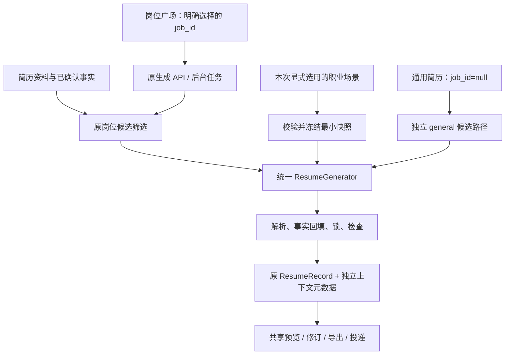
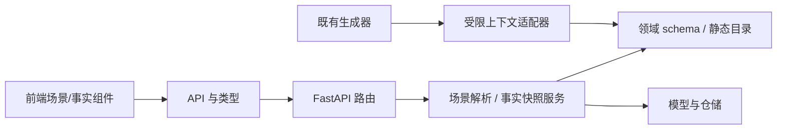

# 简历通跨行业与专业工作台优化计划

> 日期：2026-10-25  
> 依据：D:\ResumeForge，代码基线 `bc62f339`；实际实施前重新核对 HEAD、工作区和 AGENTS.md  
> 文档性质：产品方案 + 技术设计 + 分阶段执行合同 + 验收清单  
> 本次交付：仅新增本文档，未修改应用代码、提示词、数据库或配置  
> 推荐路线：统一事实底座 + 多维职业场景 + 显式生成上下文 + 现有专业制作台的整合升级

## 0. 给维护者和执行 agent 的结论

**建议支持用户选择“职业场景”，而不是增加一个会改变全站行为的全局“角色”。** 用户可以同时是在职员工、跨行求职者、兼职创作者；行业、职能、职业阶段、就业状态、使用目的应分别表达。内置场景只是这些维度的快捷组合，允许跳过、调整和自定义。

切换场景只改变本窗口的引导、建议与入口推荐。影响 AI 时，用户在生成配置中显式选用，后端把实际使用的场景冻结到任务和成品的元数据中。**切换场景不会改个人资料、当前岗位、已有简历、投递准入、模型设置或数据集。**

项目已有相当完整的专业工具基础。应优先补齐跨行业事实表达、端到端 AI 保真、入口一致性、工作流连贯性和成品质量，再发展社区资产生态。“成为行业标杆”是长期质量与采用程度的目标，无法由一次功能堆叠或一次 agent 执行证明。

本文把一次交接分成两类：

- **本次实施包 A0–A8：全部纳入交接，按依赖逐阶段完成。** 涵盖安全基线、职业场景、通用 AI 入口、资料扩展、生成保真、专业界面整合、跨功能回归、文档与交付证据。
- **后续路线 B1–B4：明确列出，不算本次实施完成项。** 包括开放资产包、外部扩展协议、研究性高级编辑和社区验证。

“一次性交给 agent”意味着使用同一份合同持续完成多个可验证阶段，不意味着一次提交所有改动。每个阶段有独立验收和回退方式；不能以“后续再补测试”交付半条数据链。

术语说明：用户提到的“简历广场用 AI 生成简历”，现有代码对应的是**岗位广场**里的“用 AI 生成简历”。本文使用现有产品名称；不新增另一个“简历广场”，也不改既有路由。

## 1. 现状盘点：复用什么，真正缺什么

以下是源码与文档静态核查结果，不代表已经启动应用做过完整运行验收。

| 领域 | 已有能力及依据 | 本次处理 |
| --- | --- | --- |
| 产品基础 | README：本地优先、无注册、SQLite、可使用本地模型 | 保持定位，新增能力不依赖账号与云服务 |
| 岗位生成 | `frontend/src/pages/JobsPage.tsx` → `components/GenerateResumeModal.tsx` → 后台任务 | 原入口和关联关系保留，场景是可选附加上下文 |
| 两种生成语义 | `backend/app/services/profile/profile_relevance.py` 中 targeted/general 两套上下文构造 | 保留分支；通用简历不能用“空岗位”冒充 |
| 两种生成传输 | `backend/app/api/resumes/generate_routes.py` 的 SSE 与后台任务端点 | 两条都接入相同的场景解析与快照逻辑 |
| 通用 AI | 后端支持 `job_id=null`，生成弹窗也支持 `job=null`；`ResumesPage.tsx` 当前新建主要进入手写 | 补可发现的通用 AI 入口，同步文档 |
| 防虚构 | claims、grounding、consistency、coverage、来源标注、事实锁 | 新字段必须经过相同约束，不新建弱校验旁路 |
| 修订与匹配 | `prompts/resume_revise.md`、`prompts/job_match.md` 已规定局部保留、证据不足与五类结论 | 保持约束；场景不成为能力证明或准入条件 |
| 科研内容 | `schemas/resume_research.py`、`ResumeContent`、PDF/Word 等已有科研呈现 | 补资料来源和 AI 全链路；先验证修订保留风险 |
| 普通生成页数 | `GenerateOptions.page_limit` 当前最大 3；制作台已有 `document_mode=long_cv` | 显式支持生成长 CV，沿用统一模式上限；不自动切换 |
| 专业制作台 | `components/resume/Workbench*.tsx`、`features/resume-proview/` 已有工作区、缩放、命令面板等 | 整合入口和上下文，不再造画布引擎 |
| 文档操作 | `features/resume-document/`、`resume-outline/`、来源、历史、局部排版 | 复用稳定 ID、命令与撤销，扩展新栏目 |
| 版本与变体 | `models/versions.py`、`document_versions.py`、`document_variants.py` | 命名版本不可变；变体独立可编辑；补场景继承规则 |
| 输出与交付 | 多格式导出、预检、导出配置、交付原件与哈希 | 新栏目逐格式验证，继承已有质量与备份体系 |
| 模板推荐 | `resume_template_market.py` 的预设混合行业/雇主类型/人群 | 作为排版建议来源；不能当职业角色模型 |
| 模板兼容 | 当前目录有 6 套可见模板，另有历史模板；部分文档数量滞后 | 以运行目录为准；修正本次相关文档，不借机恢复下线的自制 HTML 模板 |
| 多行业评测 | `backend/tests/evals/` 已有 50 份合成样本与确定性检查器 | 扩展覆盖和实际执行率，不复制评测框架 |

### 1.1 必须先验证的缺口

1. `resume_content.py::coerce_resume` 当前只显式构造旧的六类栏目；`resume_revision.py` 调用它。已用纯内存合成数据确认：同一含论文的输入，经 ResumeContent 校验保留 1 条论文，经 coerce_resume 后变为 0 条。**解析层丢字段已复现；完整修订 API 是否被锁等机制阻断，仍需补端到端复现。** 先构造含科研三栏的记录，验证“只改总结”与整体改写，再做最小修复。
2. `UserProfile`、`ProfileOut`、资料白名单和候选筛选尚未贯通科研三栏。不能因为制作台可以手写论文，就宣传“科研资料能被 AI 完整使用”。
3. 跨行业需求不能只改场景名称：资格证照、作品与服务经历需要真实可表达的事实结构；证照不应塞入荣誉，客户不应强行当雇主。
4. `Job.job_type` 当前缺省为“校招”。新录入未知岗位不应被误判为校招；必须审计手动录入、解析、备选岗位导入、测试与示例，渐进调整新记录缺省，保留旧记录。
5. 职业场景的“角色”与现有排版对象的 `ROLES`（姓名/正文/元信息等）不是同一概念。新代码采用 `career_scenario`，避免复用 `role` 命名。

## 2. 产品定位与可验证目标

推荐产品定位：

> 面向不同职业阶段和行业的本地简历工作台：管理真实经历，制作多种求职表达，核对来源，可靠交付。

三层能力同时成立：

| 层级 | 用户获得的价值 | 完成判据 |
| --- | --- | --- |
| 普适性 | 无正式工作、非技术、转行、项目制、科研等用户都能表达真实经历 | 覆盖矩阵通过，缺某类资料不阻断手写或导出 |
| 专业性 | 可定位、可比较、可撤销、可恢复、可重复交付 | 版本/冲突/来源/导出测试与实际产物证据 |
| 易用性 | 新人能顺利产出，熟手能高效精修 | 连贯任务流程、键盘可用、响应式、主题截图和可用性试用 |

不把“界面复杂”“功能数量”“模板数量”“AI 次数”作为行业标杆判据。也不声称通用简历可以自动满足所有地区的法定申请材料、特殊招录表格或所有 ATS。

## 3. 用户覆盖：用组合维度替代单选身份

### 3.1 职业场景的数据维度

| 维度 | 建议取值/形式 | 作用与边界 |
| --- | --- | --- |
| 职业阶段 | 未设置、在校、初入职场、有经验、资深 | 调整引导重点；不推断年龄或任职资格 |
| 当前就业状态 | 不提供、在职、待业、自雇、学习中、职业间歇、其他 | 可选、本地保存；默认不进 AI 和导出 |
| 使用目的 | 通用准备、实习、求职、转行、内部转岗、科研申请、项目合作、职业回归 | 说明这次工作的意图；不替换 `job_id` |
| 目标行业 | 多选标签 + 自定义，最多 5 个，每个最多 40 字 | 推荐案例与资料提示；未知行业照常可用 |
| 目标职能 | 用户文本 + 常见建议，最多 120 字 | 如“质量工程”“护理”“门店运营”，与行业分开 |
| 合作形式 | 未设置、全职、兼职、合同/项目制、自雇等 | 偏好，不能改写真实经历的雇佣关系 |
| 内容语言 | 本次显式选项 | 与现有纸面语言、双语正文机制区分 |
| 使用地区 | 选填 | 提供可解释的建议，不声称全球统一规范 |

内置快捷场景建议：通用、在校与应届、职场发展、跨行转岗、自由职业、科研学术、职业回归、资深管理。它们是快捷组合，不是互斥身份；“在职 + 跨行 + 制造业 + 数据分析”是一组正常选择。

初次启动可直接跳过场景设置。老用户升级后默认“未选场景”，不根据姓名、学校、照片、年龄、简历文本或最近岗位自动打标签。

### 3.2 首版行业覆盖矩阵

每行至少提供两份合成验收样例：一份资料充分、一份资料稀疏或边界案例。行业分类用于验证覆盖，不作为硬编码生成分支。

| 行业/职能组 | 重要事实 | 最容易产生的错误 |
| --- | --- | --- |
| 软件/数据/产品 | 项目、工具、上线范围、个人贡献 | 技术栈扩写成未掌握技能 |
| 制造/工程/质量 | 工艺、设备、检验、标准实践、证照 | 团队产能当个人业绩 |
| 医疗/护理/健康服务 | 执业资格、科室实践、继续教育 | 编造资质、泄露患者信息 |
| 教育/培训 | 授课对象、课程、教学实践、资格 | 把参与授课写成独立主讲 |
| 财务/金融/法务 | 资质、流程、审计/合规实践 | 暗示未经证实的执业资格 |
| 销售/客户成功 | 客户类型、销售过程、回款/续约事实 | 自动补收入、增长率或客户名称 |
| 运营/行政/人力 | 流程、协调范围、成本与服务结果 | 所有成果强制量化 |
| 零售/餐饮/酒店/物流 | 服务、排班、设备、安全与现场经验 | 用软件项目叙事替换现场技能 |
| 设计/内容/传媒 | 作品链接、署名、客户授权、传播事实 | 将团队作品全部归为个人原创 |
| 科研/学术 | 论文状态、作者顺序、项目、专利 | 在投写成发表、申请写成授权 |
| 自雇/顾问/创业 | 服务项目、合同关系、交付与贡献 | 将客户写成雇主，收入等于利润 |
| 公共服务/社会组织/技能工种 | 志愿服务、培训、技能资质与实际职责 | 要求必须有大学学历或办公室经历 |

就业状态还需覆盖：在校无实习、在职换岗、待业、转行、兼职并行、自雇、创业后求职、长期间歇回归、内部转岗、资深再就业。不把“空窗期解释”设为必填，不从时间间隔自动推断失业原因。

### 3.3 资料与文案的普适化

- 学历、照片、出生年、GitHub、校园经历均是可选事实；不因缺失它们扣通用质量分。
- 技术、销售、服务、教学等不同成果均可用定性事实表达；无数字不是质量缺陷。
- 项目表单面向普通用户可使用“工具与方法”，保留内部 `tech_stack` 键，改文案必须同步指南与测试。
- 页面默认展开与本次任务相关的栏目，所有栏目仍可添加；推荐折叠不能过滤数据或改变已保存顺序。
- 沿用“简历资料”与“网申资料”隔离。就业状态、家庭、健康、证件等不得借“普适化”默认扩大发送面。
- 准备培训案例时使用虚构人物与组织；不把真实简历或用户资料提交进测试仓库。

## 4. 借鉴行业标杆：迁移工作原则，复用已有能力

以下“标杆能力”有官方文档依据，“简历通方案”为本计划的产品推导，并非原厂对本产品的建议。

| 标杆与官方依据 | 可迁移原则 | 简历通已有基础 | 本次具体升级 |
| --- | --- | --- | --- |
| Photoshop 的[非破坏性编辑](https://helpx.adobe.com/photoshop/desktop/create-manage-layers/create-layer-compositions/non-destructive-editing-techniques.html) | 原始材料与处理结果分开，调整可回退 | 事实、来源、锁、版本、变体 | 场景只生成表达候选；已有简历适配先创建独立变体 |
| Photoshop 的[工作区恢复](https://helpx.adobe.com/photoshop/desktop/get-started/learn-the-basics/restore-workspaces.html) | 定制界面有稳定复位入口 | 工作区预设与参数继承 | 面板配置独立保存；复位工作区不复位简历内容 |
| DaVinci Resolve 的[任务页面与集成交付](https://www.blackmagicdesign.com/products/davinciresolve) | 同一项目贯穿素材、制作、检查、交付 | 资料、岗位、制作台、预检、导出、跟踪 | 跨页面保留当前简历和目标提示；完成检查直达导出配置 |
| Blender 的[工作区](https://docs.blender.org/manual/en/3.0/interface/window_system/workspaces.html) | 同一份数据支持不同任务视图 | 内容撰写/精细排版/投递检查 | 统一选中对象与属性入口，切视图不重置草稿 |
| Blender 的[修改器](https://docs.blender.org/manual/en/4.5/modeling/modifiers/introduction.html) | 原数据、可调参数、最终结果分层 | 排版覆盖、事实锁、局部改写 | 将“表达候选”“排版试用”“写回保存”区分；不引入复杂节点计算引擎 |
| Blender 的[资产浏览机制](https://developer.blender.org/docs/release_notes/3.0/asset_browser/) | 结构化资产可以发现与复用 | 表达资产库、模板、资料来源 | 汇合检索入口，插入后生成独立对象身份并保留来源 |

行业标杆还有可学习的发布纪律：可靠恢复、清楚的能力差异、稳定快捷键、可验证的成品、示例工程和教育内容。这些比复制黑色皮肤、时间线、节点图或大量浮窗更重要。

## 5. 四种作用域：场景切换安全的核心设计

### 5.1 各层职责

| 层 | 保存什么 | 切换行为 | 能否写简历正文 |
| --- | --- | --- | --- |
| 数据集 | 真实业务库与附件 | 继续走已有租约/切换机制 | 通过业务操作 |
| 职业场景 | 阶段、目标、可选偏好与建议 | 改本窗口引导；可保存多份 | 不能 |
| 工作区 | 面板可见性、密度、焦点、缩放等 | 复用现有专业工作区 | 不能 |
| 本次生成上下文 | 用户明确选用的场景快照与本次要求 | 请求发出后冻结 | 生成新记录或待审候选 |
| 简历/变体 | 内容、排版、来源、修订号 | 显式编辑、采纳、恢复 | 通过现有条件写与撤销 |

“职业场景”不是账户权限、岗位过滤器、数据集、模板，也不是提示词中的模型扮演角色。

### 5.2 明确禁止的副作用

仅切换职业场景时，必须保证：

1. `UserProfile`、Job、ResumeRecord、ResumeVariant、投递/网申/面试记录均零写入。
2. 不重置岗位筛选、分页、当前详情、未保存表单或选中简历。
3. 不修改模板、字号、行距、页边距、页数、正文语言或资料板块顺序。
4. 不取消/重启生成、分析、导出；后台提醒不会重复注册。
5. 不改变模型、密钥、联网、放宽模式或其他权限。
6. 不把当前场景自动带入岗位匹配、投递准入或网页填表。
7. 不以场景 ID 作为应用根组件的 `key`，避免整站 remount。
8. 不默认隐藏某类岗位、简历、教育或工作经历。

### 5.3 用户操作语义

- **“切换场景”**：切换本窗口建议，可以立即恢复到“通用”。
- **“用于本次生成”**：显式确认把经过裁剪的场景上下文发送给所选模型。岗位生成默认不启用。
- **“采用建议”**：预览板块顺序或排版变更，再写入当前编辑草稿；进入统一撤销历史。
- **“创建变体”**：为已有简历建立独立表达；不覆盖当前简历，也不自动同步其他变体。
- **“恢复工作区”**：只复位界面配置；不回退简历内容、不删除场景。

文案先在 `docs/ui-copy-guide.md` 登记“职业场景”“当前就业状态”“用于本次生成”的实体/动作/位置。弹层文案执行 AGENTS 中更严格的标题 7 字、正文 30 字、Toast 20 字限制。

### 5.4 偏好与草稿保存

- 场景定义保存在当前数据集的 SQLite 中；不能放进所有数据集共用的模型配置文件。
- 当前窗口选择的场景 ID：`sessionStorage`，按 datasetId 隔离，只存 ID。
- 可提供“下次沿用”的显式偏好，用数据集内 `AppSetting` 存默认 ID；它只影响新窗口初始化，不强制改其他窗口。
- 场景编辑草稿只放 `sessionStorage`，剔除凭据，沿用 debounce/pagehide 模式。
- `localStorage` 可保存纯界面密度等偏好，不保存场景正文、就业状态、简历或资料内容。
- 数据集切换清理的是当前视图引用与缓存命名空间，不删除其他数据集的持久场景或历史快照。

## 6. 岗位广场 AI 生成：不可破坏的兼容合同

### 6.1 保留的主链路



### 6.2 六条硬合同

| 编号 | 合同 | 验证方法 |
| --- | --- | --- |
| C1 | `job_id` 决定岗位模式，场景不能把它置空或替换 | 前端请求断言 + API 落库关联断言 |
| C2 | 不启用场景、没有新增事实时，旧请求候选资料和提示词保持原样 | 捕获 fake provider 输入并逐字/结构比较 |
| C3 | 通用路径保持全貌优先，只受明确资源预算限制 | general/targeted 分支与省略说明测试 |
| C4 | 场景仅影响允许的表达指导；首版不改变现有岗位筛选排序算法 | 同资料同 JD 多场景比较候选集合、顺序、事实基线 |
| C5 | 场景快照不晚于创建任务完成时冻结，运行中不查询当前场景 | 队列阻塞后修改/归档场景、切窗口，再断言 provider 输入 |
| C6 | 同一上下文解析器服务 SSE 与后台生成；保存成功才宣布完成 | 两条传输、失败、取消、超时、数据库异常回归 |

C2 不是要求真实模型每次输出相同文字：模型可能具有随机性。它约束确定性的输入、关联、参数和解析行为。修复已复现的旧 bug 或用户新增事实可以改变结果，必须单列变更依据，不能伪装成兼容性。

### 6.3 冲突处理优先级

先判断约束，再采用偏好：

1. **不可越过：**隐私边界、真实事实、事实锁、结构校验、资源上限、数据集归属。
2. **目标约束：**本次明确的 Job/JD 决定投递目标；JD 只是要求，不是用户已具备能力的证据。
3. **本次显式指令：**在前两条内控制修改范围和表达。
4. **已选场景：**提供行业措辞、说明重点、可转移能力的表达建议。
5. **产品默认值：**只补用户尚未选择的设置；排版建议须显式采用。

例：选择“跨行转岗”但正在为护理岗位生成简历，不能改变 job_id，不能补出护理资格，也不能让旧工程经历伪装成临床经历。资料没证据应提示“资料中未提供”。

### 6.4 请求与异步冻结时序

1. 前端打开配置时读取场景目录；默认“未用于本次生成”，当前场景仅显示为可选建议。
2. 用户启用后，本地表单捕获选择及版本；之后全站场景切换不能改这个已打开表单。
3. 服务端在当前数据集会话/租约保护下验证场景版本，解析受限配置，裁剪隐私，创建不可变快照。
4. 后台任务同时保存 public options 与专用 context_snapshot；runner 只读该快照。SSE 使用同一解析服务。
5. 已有后台入口先建 task、再由 runner 获取租约。不能想当然声称入口全程已冻结：应补“创建与 start 之间切数据集”的竞争测试，并通过租约交接或显式冻结身份校验封住窗口。
6. 若身份/版本变动，明确拒绝本次启动或返回冲突；不得重读“当前库”继续写，也不能悄悄降级为其他场景。
7. 资料/JD 的现有快照时机单独保持并记录。若需要把它们也提前到创建时，应独立改造、测试和迁移，不能把场景冻结与资料冻结混为一谈。
8. 每个成功生成记录保存实际上下文快照。失败、取消任务不产生成功简历；保持原预算、终态、取消及租约释放语义。

### 6.5 历史简历与其他功能

- 旧简历上下文为 null，含义是“未记录/未使用”，不能根据当前场景回填。
- AI 局部修订仍以当前简历为事实范围；场景不得扩大用户指定的修改范围。
- 重新生成或岗位建议如要使用场景，只能显式使用当前记录保存的快照，不能读取 UI 当前选择。
- 记录内上下文说明历史生成条件，不允许靠修改元数据追溯改变历史。更换场景表达创建新变体。
- 既有建议接口读取 Job 的行为不在此暗中改成冻结 JD。若岗位已变化/删除，继续当前兼容行为并提示；冻结 JD 的完整可重放属于独立设计。
- `job_match.md` 五类证据结论、`models/apply.py::admission_of` 唯一准入实现不受场景影响。
- 助手仅在明确关联场景的会话/动作中使用它；网申、采集、提醒、备份、统计不默认引入场景过滤。


## 7. 数据与 API：首版采用的具体设计

本节给出推荐决策，执行 agent 不需要在多套互斥架构间自由发挥。若与实施时的源码存在冲突，先复核已有唯一实现，再记录小范围修正。

### 7.1 新增对象与存储

| 对象 | 推荐位置与字段 | 规则 |
| --- | --- | --- |
| BuiltinScenario | 后端静态 JSON 目录；key、catalog_version、名称 key、维度默认、建议 ID | 不含用户数据；前端从 API 读取，不维护第二份业务枚举 |
| CareerScenario | 新表 `career_scenario`；整数 id、name、schema_version、revision、config JSON、archived、时间 | 每数据集独立；config 走严格 schema；首版归档代替删除 |
| GenerationContextSnapshot | task/record/version/variant 的独立 nullable JSON 字段 | server-owned；与 content、format_config、render_context 分离 |
| ProfileFact | 新表 `profile_fact`；稳定 id、profile_id、kind、schema_version、payload JSON、revision、deleted_at、时间 | 只承载本次新增事实，不搬旧教育/经历表；payload 按 kind 严格校验 |
| 当前场景选择 | 本窗口 sessionStorage；可选数据集 AppSetting 默认 ID | 不作为后端生成的隐式参数 |

`ProfileFact` 是固定类型的补充事实容器，不是任意 JSON/HTML 栏目编辑器。首版只接收六类：论文、科研项目、专利、资格证照、作品项目、实践/服务经历。禁止模型或资产包动态注册可执行类型。

`ProfileFact` 的源 ID 使用稳定 UUID（沿用项目已采用的身份生成规则与长度），不能因排序或保存重建。证号等私密属性保存在本地事实中，生成快照按白名单裁剪。

### 7.2 场景配置的限制

建议边界，实施时与现有请求体总限制取更严格值：

- 场景名称最多 40 字；每数据集最多 50 个自定义场景。
- 每场景配置 JSON 最多 16 KiB；自定义表达偏好最多 800 字。
- 行业标签最多 5 个；推荐栏目仅允许已登记 section key；模板推荐只引用现有目录。
- `schema_version`、`catalog_version`、场景 `revision` 分别描述结构版本、内置规则版本、用户编辑版本，不混用。
- 未知枚举和未知请求字段返回可理解的校验错误；不让前端任意上传系统提示词。
- 归档场景不影响在途任务、旧简历和历史快照；重新启用仍保留原 ID。
- 升级读取未知历史快照版本时保留原始元数据、明确标注无法解释；禁止静默重写为最新规则。

### 7.3 新接口与兼容示例

新增专用路由；以下路径为计划接口，不表示当前已经存在。

| 方法与路径 | 作用 | 失败语义 |
| --- | --- | --- |
| GET `/api/career-scenarios/catalog` | 内置场景、合法维度、建议清单、目录版本 | 加载失败可继续不带场景使用 |
| GET `/api/career-scenarios` | 当前数据集已保存场景 | 列表带 revision |
| POST `/api/career-scenarios` | 创建受限配置 | 数量/格式限制错误 |
| PATCH `/api/career-scenarios/{id}` | 更新名称、配置或归档；带 expected_revision | 冲突 409，避免窗口间覆盖 |
| GET `/api/profile/facts` | 读取新增事实，支持 kind/分页 | 不返回软删数据 |
| POST/PATCH `/api/profile/facts[/<id>]` | 新增或条件更新单条事实 | 校验失败不修改旧值 |
| DELETE `/api/profile/facts/{id}` | 软删，接既有回收站与撤销 | 历史简历保持其已保存内容 |

旧请求仍然合法：

```json
{
  "job_id": 123,
  "options": {
    "enhance": false,
    "page_limit": 1
  }
}
```

显式采用已保存场景：

```json
{
  "job_id": 123,
  "options": {
    "enhance": false,
    "page_limit": 1,
    "career_context": {
      "scenario_id": 7,
      "expected_revision": 2,
      "include_employment_status": false
    }
  }
}
```

显式采用内置场景：`career_context` 使用 `preset_key` 与 `catalog_version`，不能同时提供 `scenario_id`。需要调整内置场景时先保存为自定义场景，再引用其 ID；首版不再引入第三套任意 inline 配置协议。

- `career_context` 缺省/null = 不启用；无新增事实时继续旧生成分支。
- 请求不接收 `snapshot`、hash、系统指南正文；由服务端解析。
- 引用归档/不存在/跨数据集场景时明确拒绝；不自动落到别的场景。
- `GenerateOptions` 保持严格字段校验。服务端快照单独存列，不能塞进 options 后又交给 `extra=forbid` 的 schema。
- 保留 `GenerateRequest` 当前顶层字段兼容策略，不因加功能顺便收紧整个旧协议。
- 新客户端遇到旧后端无 catalog 时，隐藏新能力并保留旧生成；场景已明确启用但服务失败时不能无提示丢弃选择。
- 升级前的排队任务没有场景与快照，继续旧逻辑；新任务声明启用场景却缺少/损坏快照时明确失败，不能重读当前场景补齐。显式重试需让用户选择沿用原条件或重新配置，记录新的任务身份。

### 7.4 快照内容与生命周期

快照建议保存：

```text
schema_version
scenario_origin: preset | saved
scenario_id / preset_key
scenario_revision / catalog_version
display_name
resolved_dimensions          # 仅本次允许使用的维度
approved_guidance            # 服务端解析后的受限表达建议
disclosure                   # 本次是否允许使用就业状态
resolver_version
prompt_fragment_version
context_sha256               # 实际语义配置的规范化哈希
captured_at
```

时间戳不参与语义哈希；不把完整资料、密钥、照片、证号、家庭或健康信息复制进场景快照。context hash 是上下文追踪，不承诺同模型重跑能复现相同文字，也不能替代完整输入溯源。

| 操作 | 上下文处理 |
| --- | --- |
| 初次生成 | 从请求冻结；task 与成品记录一致 |
| 命名版本 | 深拷贝当前记录上下文，与版本内容一起不可变 |
| 派生变体 | 默认继承来源版本/记录快照，明确标明“派生来源” |
| 为变体另选场景 | 新建变体/候选及新的来源元数据；不重写旧快照 |
| 选择性同步正文 | 不顺便同步职业场景、岗位、语言、排版；保持目标变体的上下文 |
| 双语翻译 | 继承来源说明，另记翻译操作；不把当前 UI 场景带入 |
| 从版本恢复 | 将版本的内容、排版与上下文一起写成新的当前修订；历史版本不动 |
| 导出 | 只读已保存/明确草稿输入；职业场景元数据不自动印到纸面 |
| 场景编辑/归档 | 不追溯修改任何记录快照 |
| 旧记录 | 保留 null，不伪造历史场景 |

不要把可编辑的变体说成整体不可变。不可变的是命名版本和一次生成的来源说明；变体仍按既有规则独立编辑。

### 7.5 迁移、备份与回退

- 本次读取的 head 是 `0060_variant_layout`；实施时运行 Alembic heads 确认，再分配新编号，禁止照抄一个可能被占用的 0061。
- 场景与快照迁移、补充事实迁移分开；仅新增表/nullable 列，不重写旧 content，不以当前场景回填旧记录。
- 新模型在 `app/models/__init__.py` 注册。新 `deleted_at` 表必须登记 `TRASH_SPECS`、恢复、统计和备份测试。
- 新列的目标表不存在时跳过；新表创建满足外键依赖。部分历史库须有专项用例。
- **表集合断言按迁移类型区分：**只加列的迁移前后表集合相同；加表迁移应等于原集合加明确新表。不能对加表迁移照抄“表集合不变”。
- 搜索旧 head 字面量，更新数据库、备份、迁移 QA、助手搜索等钉住 head 的测试。
- 旧备份导入候选库后先迁移，确认旧业务记录数/哈希不变、新表为空或有明确默认；新备份需完整 round trip。
- 快照纳入新版本备份；公开分享包与纸面导出默认不携带就业状态等私密元数据。
- 回退优先关闭功能入口、使用兼容代码，保留新表与新字段。真正降级只在备份副本中验证，不自动对用户生产库执行删除列。
- 不承诺旧版二进制能理解新栏目。跨版本回退须使用兼容导出或经用户确认恢复迁移前备份，并说明会失去备份之后的新增内容。

## 8. 让各行业真正可用：补充事实与端到端保真

### 8.1 首版字段范围

| 事实种类 | 最小字段 | 映射/复用 |
| --- | --- | --- |
| 论文 | 标题、作者顺序/本人标记、刊物、年份、状态、DOI、URL | 共用现有科研字段规则，输出 `publications` |
| 科研项目 | 名称、机构、角色、时间、经费事实、贡献与成果 | 输出 `research_projects` |
| 专利 | 标题、发明人顺序、国家、申请/授权日期、状态、专利号 | 输出 `patents` |
| 资格证照 | 名称、颁发机构、签发/到期日期、状态、证号（私密）、公开核验链接、说明 | 新 `credentials` 栏目；状态 unknown/pending/active/expired，不自动认定资格 |
| 作品项目 | 名称、本人角色、说明、成果类型、公开链接、贡献、时间、工具与方法 | 复用项目内容/编辑器，输出 `projects`，补可选 public_url/artifact_type |
| 实践/服务经历 | 机构或客户称谓、角色、关系类型、日期、贡献 | 复用经历内容/编辑器，输出 `experience`，补可选 experience_kind |

保留内部 company/role/tech_stack 等既有键。新增实践资料的 UI 使用中性“机构或客户”等标签，既有工作经历页面保持原有语义；只有明确选择自雇/合同等类型才记录关系，不靠场景猜测。

作品项目不是一个新的富媒体作品集网站。首版每条一个公开 URL，复用项目表单、来源和导出；链接不被自动抓取。任意附件画廊、在线托管另列后续。

### 8.2 为什么补充事实走独立 CRUD

现有 `profile_service.update_profile` 的旧列表保存有整体替换行为。若直接把新列表默认设成空数组，旧客户端保存旧资料时可能清空新增内容。

推荐做法：

1. 新事实保存在 `profile_fact`，只由新 API 负责写入；旧 Profile PUT 不接管。
2. 生成入口显式读取旧资料与新增事实，形成同一数据集内的只读事实快照。
3. 新事实 schema 复用科研纯字段规则；不把简历里的 hidden/lock/point_ids 当成原始资料字段。
4. 适配器把研究三栏、credentials、作品项目、实践经历映射为候选上下文，同时维护稳定 source_id。
5. 旧资料列表的重建行为不在本批大改。新事实不会随着旧 PUT 被重建、删除或重新分配 ID。
6. 新事实更新有 expected_revision；排序不改变身份。删除进回收站；已生成简历继续保存其生成时的事实表达。

可复用现有项目/经历表单的小组件，但不复制整套页面。若复用要求改变旧整表保存协议，优先提取纯输入组件，保持新 CRUD 与旧保存路径隔离。

### 8.3 每类字段都必须走完的链路

以下清单是发布门槛，不能只实现表单、schema 或提示词中的一段：

1. **输入与解析**：独立 CRUD、长度限制、日期/状态/链接校验，文本识别先出草稿后确认；资料箱选入必须显式核对。资料非空/修订结果非空判断必须包括新栏目，避免只有论文或证照的有效输入被旧条件误拒。
2. **候选资料**：targeted/general 两条路径、LLM 白名单、预算、排序、选中/省略统计；证号等私密值默认不发送。
3. **生成与解析**：输出 schema、`coerce_resume`、JSON 修复，不能丢已支持字段；空可选字段不改变旧记录序列化。
4. **事实保护**：grounding、restoration、consistency、coverage、事实锁；论文/资格状态、作者顺序、责任范围不能被升级。
5. **AI 后续操作**：局部修订、整体重写、建议、局部候选、翻译，未涉及栏目保持原样；暂不支持的操作明确禁用，不静默删除。
6. **编辑与身份**：稳定对象/要点 ID，大纲、隐藏、锁、复制、撤销、选择、局部排版、来源定位。
7. **纸面与文件**：栏目标签与顺序、HTML/PDF/Word/Markdown/TXT/JSON，所有可见模板和旧模板兼容。
8. **质量与隐私**：预检、ATS 文本抽取、链接协议、脱敏、页数/截断提示。
9. **版本与交付**：命名版本、变体、双语、选择性同步、交付哈希与冻结内容。
10. **恢复与升级**：备份导入导出、回收站、旧客户端更新、未设置新字段的旧记录。

重点审计入口：`resume_content.py`、`resume_grounding.py`、`resume_consistency.py`、`resume_coverage.py`、`resume_suggestions.py`、`bilingual_variants.py`、`resume_assets.py`、`document_provenance_source_text.py`。这些模块存在旧栏目白名单或映射，新增 schema 不会自动让它们全部支持新事实。

### 8.4 源身份与证据

- 不用数组下标当持久来源 ID；不按文字相似度自动建立“已核实”关联。
- 为新事实定义 `profile-fact:<stable-id>` 的来源定位方式，并保存关联时的 revision。
- 模型生成的扩写不是新增事实。未知指标给出补充提示，不把【待补】塞进可直接交付的正文。
- 资格编号默认不进模型、日志或纸面。用户若显式要求展示，由本地渲染/受控字段注入处理。
- 论文状态、执业证照、专利状态不能用 AI 或关键词判断“真实有效”；只能保留来源状态并提示核对。
- 隐藏、删除原始来源不应让已保存简历静默改写；来源面板显示缺失/过期状态。

### 8.5 跨行业匹配与筛选

现有技能词典已覆盖部分非技术领域，但部分 domain/ATS 信号仍偏技术。这不是加一行“你擅长所有行业”的提示词能解决的。

- 先跑固定的非技术职位回归，记录筛选前后保留的经历与技能，找出实际被错误遗漏的案例。
- 在原 `profile_matching` 体系中修复通用 fallback；不另建“医疗匹配器”“销售匹配器”等并行实现。
- 未识别领域时，保留合理的原始经历候选并解释信息不足，不能把所有经历筛空或编造关键词。
- 每次排名规则调整作为独立行为变更：保留旧 IT/产品样例结果，对新行业给出改善证据。
- 不把匹配分当录用概率，不改变五类结论与硬门槛规则。场景选项不证明用户符合任何要求。
- 收集行业专用术语时标注来源与维护人；行业规范若无法核验，显示建议，不建立硬阻断。

### 8.6 长 CV 与页面预算

- 将 `GenerateOptions` 扩展为可选 `document_mode`，缺省 resume；page_limit 按 `MODE_PAGE_LIMITS` 校验。
- 科研场景只建议长 CV，不自动切换。普通简历保持 1–3 页；长 CV 使用项目已有上限（当前 10 页）和资源预算。
- 检查变体排版的 `_normalize_layout` 等是否仍按 `MAX_RESUME_PAGES` 固定校验，统一复用模式规则。
- 字号、行距、页边距按用户参数渲染。超页如实提示；禁止自动缩字号。
- 长 CV 是页数策略，不等于学术场景；资深管理、复杂经历也可显式选用。
- 所有页数/渲染耗时/内容大小都需有上限和友好失败，不能因新增人群造成无界输入。

## 9. AI 提示词与质量控制

### 9.1 提示词分层

保留原系统事实约束；场景作为 user context 内单独、限长、可解释的数据区块。使用明确字段和边界，不把用户自定义名称拼成“你现在必须扮演……”的系统命令。

推荐固定内容：

- 使用目的与目标职能。
- 允许采用的表达重点，如“解释可转移技能”“突出项目交付”；不写“补齐相关证书”。
- 禁止推断的内容：就业状态、任职年限、资格、收入、管理人数与团队贡献。
- 本次信息不足如何反馈。
- 被显式允许的就业状态，只用于用户要求的解释，不默认出现在正文。

未启用场景且没有扩展事实时，模板条件块应完全不渲染，保住旧 prompt 契约。新增事实存在时输出结构可以扩展，这是明确的资料能力变化，不把它误归因于“切换场景”。

### 9.2 各 AI 功能的接入边界

| 功能 | 本次是否使用场景 | 规则 |
| --- | --- | --- |
| 新建岗位/通用简历 | 显式选用 | 请求冻结，统一生成器 |
| 已有简历 AI 局部修订 | 仅已有上下文或本次明确指令 | 不扩大修改范围；未知新字段拒绝覆盖 |
| 面向新场景适配 | 是 | 创建变体 + 候选差异 + 逐项采纳 |
| 岗位匹配/投递准入 | 否 | 事实与 JD 决定，保持唯一实现 |
| 面试训练 | 不自动接入 | 现有面试 persona 是会话角色，与职业场景分离 |
| 求职助手 | 用户显式关联时 | 可读边界不扩大，默认不读取私密就业状态 |
| 网申填表/浏览器采集 | 否 | 保持原来源、隐私和只填不交边界 |

### 9.3 可解释输出

复用现有 rationale、coverage_notes、fact_annotations：

- 展示“本次采用的职业场景”和“只影响哪些表达偏好”。
- 将“没写入的资料”与“疑似虚构/事实冲突”分开。
- 场景建议与硬错误分级：教育位置、篇幅建议不能阻止导出。
- 事实锁冲突显示具体字段，保留原值；不要用模糊的“角色不兼容”。
- 不为了减少警告数而关闭检查；警告减少必须与已知坏输出检出率一起评估。

### 9.4 评测方法

- 复用 `backend/tests/evals/`，新增至少 24 个合成场景（第 3 节 12 行 × 2），补齐就业状态和对抗组合。
- 每个新增案例都要实际进入确定性检查或 fake provider 管线。**只放样本、没有 recording 而被 harness 跳过，不算覆盖。**
- 报告同时列 available/executed/skipped，说明跳过原因；关键场景 executed 必须等于要求数。
- 检查事实添加、遗漏、职责膨胀、隐私、注入、矛盾、状态升级以及新栏目保留。
- 真实模型评测独立运行：使用合成资料，预算与模型配置明确，遵循当前会话授权；没有授权/密钥时完成离线验收并列明尚未评估。
- 不能把 fake provider 测试通过写成“所有模型都能高质量生成”；不能把文本抽取测试写成“通过所有 ATS”。


## 10. 界面优化：形成统一的专业体验

### 10.1 视觉方向

采用“安静、清楚、以纸面为中心”的专业工具界面。延续现有品牌色、Ant Design 和 `--rf-*` tokens；本批不换组件库，不把产品页面改成营销落地页，不加入滚动劫持或大型装饰动画。

| 元素 | 推荐规格 | 验收要点 |
| --- | --- | --- |
| 应用背景/面板/画布 | 明确三级表面，纸面与工具区分开 | 深浅主题中均能辨认边界，不靠重阴影堆层次 |
| 字号层级 | 先复用现有 12/14/16/20 等 token；正文操作不靠极小字塞下 | 125%/150% 系统缩放可用，中文无截断 |
| 间距 | 复用现有 4/8/12/16/24 节奏；内容组间距大于组内 | 工具密集但不拥挤；无无意义的大面积空白 |
| 色彩 | 品牌色只强调主动作；状态色有文字/图标辅助 | 场景不分成八套皮肤，不靠颜色判断事实风险 |
| 控件 | 同组统一高度；常用项直接可见，高级项渐进展开 | 不出现“每个参数一个卡片”的视觉碎片 |
| 图标 | 复用 antd 图标；图标按钮有可见 Tooltip 与 aria-label | 用户能预测动作，键盘可触发 |
| 动效 | 只用于展开、焦点反馈、保存结果；建议 120–180ms | 遵循 reduced-motion，不延迟操作 |
| 密度 | 舒适/紧凑只影响界面；纸面字号独立 | 改密度后 PDF/Word 参数与内容哈希不变 |

上述数值为设计建议，不是已经测得的现有配置；优先映射现有 tokens，仅在确有缺口时增补。

### 10.2 页面级布局

保持“岗位广场、简历中心、我的资料、投递台、求职进度、面试、助手、设置”等现有入口可达。新增场景入口放在稳定的个人工作区区域，和数据集选择器明确分开；不让用户误以为换场景会换一套资料。

简历中心增加一组明确动作：

- 保持现有“新建简历”的手写行为和快捷键。
- 新增“AI 生成”入口，打开 `GenerateResumeModal(job=null)`，窗口内明确“通用简历”。
- 场景建议卡可提供“从资料开始”“生成通用简历”“选择目标岗位”，不自动调用模型。
- 最近简历优先显示真实更新时间、关联岗位、保存状态；不因场景切换过滤掉其他简历。

### 10.3 制作台布局

复用现有三栏、拖拽宽度、工作区和专业视图。推荐在现有容器内调整组织，不把大纲、编辑器、画布整体换位制造迁移成本。

```text
顶部：简历名称 · 目标岗位 · 保存状态        版本 / 检查简历 / 导出
上下文条：职业场景 [未使用/已记录]          工作区 [内容撰写/精细排版/投递检查]

左栏：大纲 / 来源 / 表达资产 / 排版参数
中栏：选中条目的结构化编辑与 AI 候选
右栏：A4 草稿或精确预览、页导航、缩放与溢出提示

底部/局部：当前操作状态、可撤销提示；后台任务复用现有统一入口
```

“选中同一条内容”在大纲、编辑器、来源面板、纸面之间应保持一致。当前 UI 若已有统一 selection bridge，就扩展它；不能新增另一套 `selectedItem` 导致不同面板各说各话。

### 10.4 工作区与新手体验

- **内容撰写**：优先事实、编辑、候选，隐藏高级排版组但保留入口。
- **精细排版**：优先参数、真实预览和局部排版，保持内容可编辑。
- **投递检查**：优先内容/排版/产物问题、版本与导出配置。
- **全部面板**：保留现有专业用户自由组织的入口。

不新造“基础版/专业版”两套功能。新手通过推荐下一步与高级折叠降低复杂度；熟手通过命令面板、键盘、工作区与选择联动提高效率。引导允许跳过，用户重新进入不重复打断。

### 10.5 生成配置的层级

先展示真正影响决策的信息：

1. 目标：具体岗位或通用简历。
2. 事实来源概况与模型可用状态。
3. 内容美化、篇幅和模板。
4. 可选职业场景：“用于本次生成”默认关闭，并展示允许发送的维度。
5. 补充要求。
6. 底部唯一主操作“开始生成”；长篇说明用展开区。

这是一处流程重组，不重写已有生成状态机。轮询、取消、关闭后后台继续、完成提醒、预览重排仍复用原逻辑。

按 AGENTS 修正本次触及弹层：有写入动作禁蒙层关闭；Esc/× 同义。请求正在提交时暂禁关闭，拿到后台 task ID 后允许关闭并继续运行。不要把“后台生成中”误当整个期间都不能关。

如果生成流程需要编辑复杂场景配置，在当前弹层切换内部视图或先退出到独立页面；不叠加第二个 Modal/Drawer。

### 10.6 响应式与无障碍

| 视口 | 行为 |
| --- | --- |
| 1440px 及以上 | 三栏，保留用户已调整宽度 |
| 1024–1439px | 复用现有栏宽断点，允许折叠辅助栏，画布可缩放适宽 |
| 768–1023px | 编辑/预览切换，辅助面板就地展开或单一 Drawer |
| 390–767px | 单列任务流程、固定可达主动作，精确预览独立适宽；不强塞三栏 |

以项目 `theme/breakpoints.ts` 为唯一断点来源；表中是布局意图，不在各组件散落四套数值。

要求：键盘可完成场景选择、资料新增、生成、取消、采纳/撤销、导出；弹层关闭后回到触发元素；不抢占文本输入的常见快捷键；焦点清晰；非文本状态有文字；长标题和错误信息可读。自动 axe 检查不能替代键盘与屏幕阅读器的人工验收。

### 10.7 四条完整用户旅程

| 旅程 | 操作序列 | 终点 |
| --- | --- | --- |
| 初入职场、无工作经历 | 跳过/选场景 → 录教育/实践 → AI 通用或手写 → 补事实 → 检查 → 导出 | 无虚构工作经历的可读成品 |
| 在职跨行 | 选场景 → 选岗位 → 显式启用场景 → 生成 → 看可转移能力候选 → 创建/编辑变体 | 原岗位关联和原始资料保持 |
| 科研申请 | 录论文/科研/专利 → 选长 CV → 生成 → 核对状态与署名 → 导出 | 新栏目完整，修订不丢字段 |
| 自雇/技能服务 | 录项目或服务经历/证照 → 指定目标 → 生成 → 核对机构与关系 → 导出 | 无“客户变雇主”“参与变主导” |

## 11. 模块规划与实施边界

### 11.1 单向依赖



schema 不反向 import service；底层不读取 React 状态、global active scenario 或当前可变数据库指针。事实、场景、生成、渲染的业务边界分开。

### 11.2 建议新增文件

以下为目标结构及生产代码估算；测试紧邻前端模块、后端按契约拆文件。名称可适配现有目录惯例，但职责不能合并成大文件。

| 计划文件（相对仓库根） | 层/职责 | 估算行数 |
| --- | --- | --- |
| backend/app/schemas/career_scenario.py | 领域：场景请求与响应、枚举和边界 | 150–240 |
| backend/app/schemas/generation_context.py | 领域：引用与快照结构 | 100–180 |
| backend/app/models/career_scenario.py | 数据：保存场景 | 60–110 |
| backend/app/api/career_scenarios.py | 接口：CRUD 与目录 | 100–180 |
| backend/app/services/career_scenarios/catalog.py | 业务：版本化目录读取校验 | 80–160 |
| backend/app/services/career_scenarios/store.py | 业务：条件保存、归档、限额 | 140–230 |
| backend/app/services/career_scenarios/resolve.py | 业务：引用解析、裁剪、冻结与 hash | 150–240 |
| backend/app/data/career_scenarios/*.json | 数据：按场景分文件，零用户信息 | 单份小配置 |
| backend/app/services/resume/scenario_context.py | 适配：把快照转成表达指南 | 80–150 |
| backend/app/schemas/profile_facts.py | 领域：固定类型事实联合及 CRUD | 160–260 |
| backend/app/schemas/resume_credentials.py | 领域：资格证照内容字段 | 80–140 |
| backend/app/models/profile_fact.py | 数据：稳定事实身份与版本 | 60–110 |
| backend/app/api/profile_facts.py | 接口：事实 CRUD | 120–200 |
| backend/app/services/profile/fact_store.py | 业务：事实读写、软删与冲突 | 140–240 |
| backend/app/services/profile/fact_context.py | 业务：只读生成事实快照与隐私白名单 | 150–250 |
| backend/app/services/profile/fact_mapping.py | 纯映射：事实到候选/正文栏目 | 120–220 |
| frontend/src/features/career-scenarios/types.ts | 契约类型，不重复业务字典 | 80–150 |
| frontend/src/features/career-scenarios/api.ts | API 调用 | 50–100 |
| frontend/src/features/career-scenarios/useScenarioSelection.ts | 本窗口选择与数据集隔离 | 100–180 |
| frontend/src/features/career-scenarios/ScenarioSelector.tsx | 纯选择 UI | 80–140 |
| frontend/src/features/career-scenarios/ScenarioEditor.tsx | 场景配置，复杂字段拆子组件 | 160–260 |
| frontend/src/features/career-scenarios/GenerationScenarioControl.tsx | 本次生成选用与披露 | 100–180 |
| frontend/src/features/profile-facts/types.ts / api.ts | 类型与事实 CRUD | 各 60–160 |
| frontend/src/features/profile-facts/FactList.tsx | 固定事实列表 | 100–180 |
| frontend/src/features/profile-facts/editors/*.tsx | 按事实类型编辑，共用既有字段组件 | 每个 100–220 |
| frontend/src/i18n/messages/zh-CN.scenarios.ts | 新文案，按项目聚合机制接线 | 100–180 |
| backend/tests/test_career_scenarios*.py | 场景存储、版本与隔离 | 每个 150–300 |
| backend/tests/test_generation_context*.py | 生成快照、旧请求、并发 | 每个 150–300 |
| backend/tests/test_profile_facts*.py | 输入/隐私/旧 PUT/来源 | 每个 150–300 |
| backend/tests/test_resume_extended_fields*.py | AI 与六格式字段保留 | 每个 150–300 |

新增源码目标 ≤300 行；接近 500 行拆分；入口保持装配职责。对既有大文件先只读定位最小闭包，不全仓扫尾。生成类型、锁文件、静态目录与本计划文档不套用业务源码行数阈值。

### 11.3 必须接线的既有模块

| 领域 | 既有文件/目录 | 最小改动 |
| --- | --- | --- |
| 应用注册 | application.py、models/__init__.py | 路由/模型装配 |
| 请求与记录 | schemas/resume_generation.py、schemas/resume.py、models/resume.py | 可选请求、长 CV 模式、快照字段 |
| 生成入口 | api/resumes/generate_routes.py、resume_generate_runner.py | 同源解析、冻结、存储、竞争窗口防护 |
| 生成服务 | resume_generator.py、resume_record.py、prompts/resume_generate_*.md | 可选上下文和扩展事实 |
| AI 保真 | resume_content/grounding/consistency/coverage/revision/suggestions | 新字段贯通，不丢旧/新字段 |
| 匹配 | profile_matching、profile_relevance、相关常量与预算 | 只修被回归证实的跨行业缺口 |
| 原始资料 | profile_service、profile_context | 旧保存不接管新表；显式组装生成视图 |
| 文档工具 | document_identity、provenance、resume_assets、相关前端 features | 稳定源身份与新字段能力 |
| 版本/双语 | models/versions.py、document_versions/variants、bilingual_variants | 上下文继承、字段保留与导出 |
| 呈现 | templates、pdf_exporter、docx_exporter、其他 exporter | 新栏目/链接/状态一致，复用科研渲染 |
| 前端入口 | ResumesPage、JobsPage、GenerateResumeModal、GenerationConfigStage | 通用入口与显式场景控制 |
| 制作台 | Workbench 系列、resume-proview、resume-document、resume-outline | 统一选中、面板、建议采纳、无副作用切换 |
| 基础保障 | trash、data_backup、runtime/dataset_scope | 新表登记、备份、租约回归 |
| 文档 | README、CHANGELOG、architecture、api、user-guide、ui-copy-guide | 现状同步、字段/隐私/兼容说明 |

表中简写模块实施时用 rg 定位实际路径，不凭文件名猜测。保留已有兼容 re-export；尤其生成路由测试通过 `app.api.resumes.create_provider/get_llm_config` monkeypatch，不能改成提前绑定的具名导入使测试失去作用。

## 12. 一次交接的执行阶段与退出门槛

### A0：冻结基线，修复已复现的数据丢失风险

**交付：**基线说明、关键输入/输出固定样例、科研字段修订回归；确认问题后最小修复。

- 读取 Git 状态与新 AGENTS，记录已有用户改动，不 reset、不清理。
- 记录当前生成 payload、两条传输、资料分支、输出哈希、已知测试失败。
- 先加含科研三栏的局部修订/整体改写/解析回归；检查 IDs、locks 等是否也被剥离。
- 仅保留受支持的 schema 字段，不能以“保留字段”为名无校验透传任意 JSON。
- 修复与新场景功能分开验证。

**退出：**复现用例从失败变通过；旧生成确定性输入不回归；未解释的事实丢失为零。  
**回退：**只回退本阶段补丁，保持新增测试说明；任何回退遵守用户文件安全规则。

### A1：场景领域、迁移与快照合同

**交付：**场景目录/API、持久配置、nullable 快照列、解析服务、迁移与备份测试。

- 此阶段不向模型注入新指令。
- 验证场景跨数据集隔离、版本冲突、归档和旧数据 null。
- 冻结专用 snapshot，不污染 render_context 或 content 哈希。
- 设计并验证后台创建/start 的数据集身份约束。

**退出：**旧请求、旧备份、新旧 schema 往返通过；不产生破坏性数据回填。  
**回退：**关闭新入口，保留新增表/列，不自动 downgrade 生产库。

### A2：可选场景引导与通用 AI 入口

**交付：**场景选择、编辑、建议概览、简历中心通用 AI 入口。

- 初次可跳过，老用户默认未选；选择只改本窗口建议。
- 通用 AI 复用 GenerateResumeModal(job=null)，保留新建手写快捷键语义。
- 目录加载失败时继续已有流程，不阻断岗位生成。
- 触及的弹层、文案、加载/空/错态按项目规范改。

**退出：**切场景时业务 API 零写入、输入不丢、后台任务不重启；新入口端到端可达。  
**回退：**隐藏场景 UI 和新增入口，原岗位生成继续可用。

### A3：跨行业事实底座

**交付：**ProfileFact、六种受限事实、CRUD、来源、回收站，资料箱显式选入。

- 四类新主体：科研三栏与证照；作品与实践复用既有项目/经历表单与输出。
- 私密字段默认不发送，公共链接校验协议但不抓取。
- 旧 Profile PUT 保留新数据；每条来源稳定 ID 和 revision。

**退出：**新事实保存/重开/排序/软删/撤销/备份 round trip 通过；旧资料保存不清空新事实。  
**回退：**只关闭新输入入口，保留已有新事实供兼容读取/导出。

### A4：扩展事实全链路与跨行业质量

**交付：**第 8.3 节十段链路全部贯通，长 CV 生成，跨行业筛选修复及六格式产物。

- 按“科研 → 证照 → 作品/实践”逐种完成，不先堆完所有 UI 再做导出。
- 场景仍不改变筛选算法；非技术 fallback 的修正单独建立回归。
- 旧记录无新增字段时序列化/hash 不变，新字段空值遵守既有 OptionalEmpty 规则。
- 所有 AI 消费者明确支持新字段或安全保留；不得有静默丢失路径。

**退出：**24 个跨行业案例执行到位；所有新栏目在生成、修订、变体与导出中有证据；长 CV 不被旧 3 页校验误拦。  
**回退：**关闭新生成能力仍须保留新字段读写/导出，不能换回会丢字段的解析器。

### A5：显式场景参与 AI 与变体适配

**交付：**career_context 请求、冻结快照、表达指南、生成说明、已有简历创建场景变体流程。

- 两种 transport 统一使用 resolver。
- 场景关闭/缺省保持旧输入；启用只影响许可范围。
- 展示发送维度，默认排除就业状态；不自动调用模型。
- 已有简历先派生独立变体，再预览差异和采纳，不直接覆盖源简历。
- 如已有变体缺少通用 AI 修订能力，新增薄适配用例调用现有受控修订服务，输出候选；不临时覆盖母版来借用 API。

**退出：**第 13 节全部场景隔离与竞态项通过；历史修订不读取 UI active scenario。  
**回退：**停止新场景注入，保存和展示已有快照；不要删除场景元数据。

### A6：专业界面整合与视觉打磨

**交付：**第 10 节界面规格、四条任务旅程、深浅主题/响应式截图、键盘验收。

- 复用工作区、命令面板、来源、大纲、预检、导出配置与后台任务。
- 清楚显示“当前场景建议”与“这份简历采用的场景”，避免两者不同却被 UI 混写。
- 统一保存/未保存、冲突、来源过期、任务失败、超页的呈现和修复入口。
- 任何新增界面容器都不能使原有生成/预览/制作台出现叠层失控。

**退出：**四条旅程可完成；视口无阻断性溢出；快捷键、输入焦点和撤销正确；关键截图人工检查。  
**回退：**切回原工作区组织，业务字段和文档数据保持可读取。

### A7：全量质量、性能与恢复验证

**交付：**相关测试 → lint/typecheck/build → 全量测试与后端覆盖率 → 六格式样例 → 并发/恢复与安装烟测报告。

- 性能与新增数据量使用相同机器、相同样例对比；报告基线与新结果。
- 所有已有业务域完成受影响链路回归，不能只验证职业场景页面。
- 新增/修改前端入口需走 Windows 干净启动链 CI；涉及 macOS 启动/包时追加对应三个 macOS 作业。
- 无法运行的外部环境验收必须写明，不把“未运行”记为通过。

**退出：**没有未解释失败，覆盖率报告真实打印并过 80%；恢复和关键记录数通过。  
**回退：**修复失败阶段或关闭新功能；不放宽断言/门槛凑通过。

### A8：文档、可审查结果与交付

**交付：**实现清单、迁移/回退说明、测试报告、截图与样例路径、已知限制、面向用户的更新说明。

- 同步 userGuideSteps、docs/user-guide、README 相关条目、CHANGELOG。
- 同步架构/API/提示词说明和质量规范，更新 feature_catalog 中真实能力。
- 文档里的按钮名称必须与实现逐字一致；不宣传未验证能力。
- 不自行 commit、push、merge、发 Release、发群消息或上传用户资料。
- 外部发布是独立动作，遵循后续会话的明确授权。

**完成定义：**A0–A8 每阶段都有实际结果，不以“已搭框架”“页面能看”“单测部分通过”替代整体完成。

### 12.1 可并行分工

| 角色 | 独立负责 | 必须等待 |
| --- | --- | --- |
| 集成负责人 | 契约、迁移顺序、版本/数据集/合并验证、最终报告 | 汇总各领域结果 |
| 后端领域 agent | 场景/事实服务、快照与 AI 保真 | A0 契约；不与其他 agent 同改生成入口 |
| 前端 agent | 新模块、场景 UI、通用入口、工作区整合 | 请求/响应和错误契约冻结 |
| 质量 agent | 合成样例、契约回归、导出与视觉矩阵 | 依次消费阶段产物，不改业务行为让测试变绿 |

迁移编号、共有 schema、生成入口和 i18n 聚合文件由一名负责人串行合入。共享工作区不允许两个 agent 同时修改同一文件；先做文件所有权划分。

粗估工作量属于排期参考，不是承诺：A0–A2 为中等，A3–A5 为高复杂度，A6 为中等，A7–A8 为中高。自动编码速度不能缩减备份、视觉、真实模型和跨平台验证所需的实际时间。


## 13. 验收矩阵：证明切换不影响其他功能

### 13.1 职业场景与生成隔离

| ID | 场景 | 必须断言 |
| --- | --- | --- |
| G01 | 旧客户端不传新字段 | 旧接口可用，确定性候选/提示词/岗位关联与基线一致 |
| G02 | 岗位生成前切换至少 6 种场景，但不选用于生成 | 请求仍指向原 job_id，场景上下文为空 |
| G03 | 生成配置已打开后切换全站场景 | 当前配置不被后台改写，用户输入不丢 |
| G04 | 点击生成，排队期间修改场景 | 任务使用创建时快照，记录 revision/hash 一致 |
| G05 | 生成运行中归档/改名场景 | 继续原任务，来源说明保持历史值 |
| G06 | 生成后切换场景，再重开简历 | content、layout、job_id、revision 均不因切换变化 |
| G07 | A/B 两窗口选择不同场景 | 各自请求上下文独立，默认偏好不覆盖另一窗口 |
| G08 | 数据集 A/B 有相同数字场景 ID | 只解析本数据集，缓存不串；创建/start 竞争不会跨库写 |
| G09 | 场景请求与服务器 revision 不一致 | 409，用户刷新比较，不静默用新版 |
| G10 | 未知/归档场景或非法参数 | 失败明确，不创建成功任务或悄悄忽略 |
| G11 | SSE 与后台任务同输入 | resolver 结果与落库上下文一致，事件/终态兼容 |
| G12 | 超时、用户取消、provider 异常、保存异常 | 终态明确、租约释放，无假成功简历 |
| G13 | 已有生成任务时重复点击 | 保持 409/去重语义，不重复消耗模型 |
| G14 | 关闭弹窗、导航离开、再回来 | 任务继续，完成提醒一次，原任务可追踪 |
| G15 | 场景选择就业状态但未允许发送 | provider 输入、正文、公开导出、日志都不含该值 |
| G16 | 场景/JD 含提示注入 | 不覆盖系统约束，不扩大数据读取面 |
| G17 | 相同 JD，启用不同职业场景 | 事实与岗位目标不变；只允许表达候选差异 |
| G18 | 场景不适合目标岗位 | 不改 job_id、不编资格；给建议而非权限阻断 |
| G19 | general + 场景为空/启用 | 保留通用路径语义，省略有解释 |
| G20 | 科研简历只改总结/整体重写 | 研究字段、状态、署名、未涉及段落保留；锁生效 |
| G21 | 旧 Profile PUT 保存基础字段 | 新事实条数、ID、revision、来源保持 |
| G22 | 版本恢复/变体/翻译/同步 | 按第 7.4 节继承，无全局场景读取 |
| G23 | 没有姓名/工作经历，只有新事实 | 依据真实事实判断是否可生成，不被旧“资料为空”条件误拒 |
| G24 | 只有科研/证照内容的有效简历做修订 | 不被只检查旧六栏的“空简历”保护误拦；真正空输出仍拦截 |

可优先扩展的现有测试：

- 后端：`test_api_resume.py`、`test_resume_general.py`、`test_resume_revision.py`、`test_resume_research.py`。
- 任务与隔离：`test_resume_generate_task.py`、`test_resume_generate_task_format_config.py`、`test_resume_generate_budget.py`、`test_resume_generate_recovery.py`、`test_dataset_scope.py`、`test_dataset_scope_stream.py`。
- 版本与备份：`test_document_versions.py`、`test_bilingual_variants.py`、`test_data_backup.py`、`test_backup_apply_tables.py`。
- 前端：`GenerateResumeModal.test.tsx`、`GenerateResumeModal.layout.test.tsx`、`ResumesPage*.test.tsx`、`ResumeWorkbenchWorkspace.test.tsx`、`ResumeWorkbenchSelection.test.tsx` 与新的场景测试。
- 对尚不存在的测试文件先新增，不把计划文件名当作已经执行的证据。

### 13.2 全功能影响面

| 功能域 | 新能力应影响的部分 | 必须保持的部分 |
| --- | --- | --- |
| 岗位广场 | 可选场景配置、泛行业新录入缺省 | 搜索、筛选、详情、收藏、状态、批量、目标关联 |
| 简历中心 | 通用 AI 入口、场景来源说明 | 手写、历史、收藏、备注、排序、草稿排除、软删 |
| 我的资料 | 新增事实模块与自选引导 | 旧字段值与排序，旧 PUT 兼容，网申隔离 |
| 制作台 | 新栏目编辑、建议、焦点整合 | 保存条件写、冲突处理、撤销、版本、真实参数 |
| AI 生成/修订 | 显式上下文、扩展事实 | 防虚构、局部保留、总预算、取消与任务恢复 |
| 岗位匹配 | 新事实可作为真实证据 | 五类结论、未知语义、唯一准入实现 |
| 投递台 | 使用已保存的相应简历 | 站点适配、批次、失败诊断、去重，不按场景擅自投递 |
| 网申填表 | 本批不自动映射新字段 | 资料权限、只填不交、字段学习与敏感拦截 |
| 面试/助手 | 能理解用户显式附加的材料 | 当前会话边界、工具授权、模型配置、历史作用域 |
| 导出/交付 | 新字段、长 CV、上下文出处 | 六格式、版本冻结、脱敏、水印、保存位置、参数诚实 |
| 提醒/统计/知识库 | 无隐式场景过滤 | 记录数、查询与既有入口 |
| 数据集/备份/回收站 | 新表与新字段完整纳入 | 旧备份可导入、隔离、恢复和资产覆盖 |

### 13.3 视觉与产物验收

必须保存合成数据的证据，避免截到真实用户资料：

- 390、768、1280、1440 宽度，浅/深主题的关键页面；检查 125%/150% 缩放。
- 新事实空态、加载、保存冲突、错误、生成中、取消、返回预览。
- 6 套当前可见模板至少各一份完整产物；历史模板继续可渲染。
- 新增栏目分别检查 HTML、PDF、Word、Markdown、TXT、JSON 的字段与顺序。
- 科研长 CV、资格到期状态、作品链接、无工作经历、长机构名、多作者、超页、混合中英文等边界。
- 草稿/精确预览/导出共享一份内容与明确的排版参数；允许的格式能力差异必须说明。
- PDF 检查文本可提取与阅读顺序，Word 检查结构；未做真实 ATS/Word/屏幕阅读器真机测试时明确写未验证。
- 修改/导出失败应能保留草稿并重试，不把失败后空界面当正常结果。

## 14. 验证命令与环境纪律

以下供**实施代码的 agent**使用。本次只写计划，不运行应用全量测试，也不据此宣称实现已通过。

先读取最新 AGENTS。测试应在隔离临时目录/测试库上运行，禁止对用户业务库跑迁移试验。目录、产物和覆盖率使用本次唯一名称，避免覆盖已有报告；不清理用户数据或重复使用不明临时目录。

### 14.1 后端分层验证

在 backend 目录，先跑直接相关测试（新增测试文件按实际名称加入）：

```powershell
$env:PYTHONUTF8 = "1"
.venv\Scripts\python.exe -m pytest -q tests/test_api_resume.py tests/test_resume_general.py tests/test_resume_revision.py tests/test_resume_research.py
.venv\Scripts\python.exe -m ruff check .
.venv\Scripts\python.exe -m pip check
```

相关用例不要附加 --cov。准备全量交付时先做并行回归：

```powershell
.venv\Scripts\python.exe -m pytest -n auto
```

独立取得真实覆盖率报告，使用本次新目录，避免 pytest-cov combine 的清理问题：

```powershell
$rfCoverageDir = Join-Path $env:TEMP ("rf-career-cov-" + [guid]::NewGuid().ToString("N"))
New-Item -ItemType Directory -Path $rfCoverageDir
$env:COVERAGE_FILE = Join-Path $rfCoverageDir ".coverage"
.venv\Scripts\python.exe -m coverage run --rcfile=..\pyproject.toml -m pytest -q
.venv\Scripts\python.exe -m coverage combine --keep $rfCoverageDir
.venv\Scripts\python.exe -m coverage report --rcfile=..\pyproject.toml --fail-under=80
```

命令逐条查看结果，不把最后一个退出码代表整组状态。必须同时取得 pytest 汇总和覆盖率报告；若有已知清理守卫错误，记录具体阶段与日志。真实 failed 不得归咎于环境。若统计/覆盖率未打印，仍是未完成验收。

保持 `coverage.run.parallel=true`。新测试用 tmp_path/PID 隔离；成功路径等待预算给足，真正超时用例才用短时间。新迁移还需检查 upgrade/downgrade、旧库/部分表库、备份恢复及记录数。

### 14.2 前端分层验证

在 frontend 目录：

```powershell
npx vitest run src/components/GenerateResumeModal.test.tsx src/components/GenerateResumeModal.layout.test.tsx src/pages/ResumesPage.test.tsx
npm run format:check
npm run lint
npm run typecheck
```

再跑全量与外部唯一目录构建：

```powershell
npm test
$rfBuildDir = Join-Path $env:TEMP ("rf-career-build-" + [guid]::NewGuid().ToString("N"))
npx vite build --outDir $rfBuildDir
npm audit --registry=https://registry.npmjs.org
```

tsc 已由 typecheck 完成；构建使用新 outDir，不清理原 dist，不加复用目录的 --emptyOutDir。

干净安装验证必须运行 npm ci，但应在已确认的全新隔离 checkout 中执行，避免 npm ci 清空用户现有 node_modules。Playwright 使用仓库现有配置与测试目录，先查看配置再选 case；npm smoke/响应式项目按实际脚本执行。

守卫至少包含：antd 静态 API/覆写/废弃属性、Spin 出口、中文 ratchet、弹层蒙层/叠层/文案、用户指南引用、禁止自动缩字号。不要修改守卫阈值或新增白名单来规避失败。

### 14.3 文档、样例与跨平台

- 用现有 `scripts/quality/generate_resume_samples.py` 的 help 确认输出参数，在本次新目录生成和检查合成样例，避免覆盖默认样例目录。
- `docs/quality/resume-quality-standard.md` 与模板质量档案同步；新长 CV 规范修正旧的 3 页描述时须给产物证据。
- 新增/修改前端入口，验证 `windows-end-to-end` 能从干净安装实际获取前端入口模块。
- 触及 macOS 启动链时运行现有 bash 守卫/语法检查，并等待 `macos-launcher-guards`、`macos-runtimes`、`macos-end-to-end` 的真实环境结果。
- 无权限/环境运行 CI 时，交付明确写“待 CI 验证及预期结果”；不把未执行写成通过，也不擅自发布以获得验证。
- 执行模块行数检查，仅对本次新增/触及源码解释超限；不因检查触发全仓重构。

## 15. 质量目标、性能和可观测性

### 15.1 发布硬门槛

| 指标 | 门槛 |
| --- | --- |
| 场景切换导致业务数据写入 | 0 次（网络断言与 DB 差异双证据） |
| 关键字段静默丢失 | 0 个已知复现 |
| 已知隐私/注入/虚构负例漏检 | 不新增；必须保留已知坏例检出 |
| 旧请求/旧备份关键路径 | 全部通过 |
| 普通/长 CV 页面口径 | 按用户设置，禁止自动缩字号 |
| 后端覆盖率 | 真正打印报告且 ≥80% |
| 新样例执行 | 每个要求案例有真实执行记录，不能只存在文件 |
| UI 功能可达 | 键盘和窄屏都能完成核心旅程 |
| 失败处理 | 可解释、保留草稿或旧内容、无假成功 |
| 迁移恢复 | 测试副本恢复后关键记录数与旧内容哈希符合预期 |

### 15.2 待测的改善目标

这些是建议目标，不是本次已测结果；A0 先建立基线：

- 已加载目录后的场景切换交互反馈 p95 目标 ≤100ms；不包含首次网络加载。
- 同机器同数据集，常见界面任务 p95 不比基线退化超过 10%；至少重复 30 次，记录硬件/样本/冷热缓存。
- 12 组行业样本中，新人完成“录入 → 可用导出”的中位步骤数下降，耗时目标下降 20%；需要可用性试用验证。
- AI 扩展上下文增加固定预算，例如场景片段建议不超过 600 个估算 token；无场景为零额外片段。资料预算沿用既有统一机制。
- 导出成功率、生成失败/取消终态、恢复成功率先按合成故障测试统计；真实用户数据不能凭空宣称。
- 不用“警告率下降”单独代表质量进步；应同时测字段保留、虚构负例检出、用户可解释性。

### 15.3 日志、缓存与队列

- 日志记录 request_id、任务 ID、数据集身份、耗时、结果码和上下文版本；不记录完整场景正文、就业状态、简历、证号、密钥。
- 不新增后台遥测上传。可用性/性能报告默认本地生成，分享时脱敏且由用户选择。
- 场景解析/AI 建议缓存键包括相关事实版本、job 指纹、上下文 hash、prompt/resolver 版本。
- 渲染缓存仍由内容、模板、排版、字体、渲染器版本决定；场景不影响渲染时不要塞入其缓存键。
- 队列继续复用现有后台任务机制。没有实现崩溃恢复/幂等前，不新增无限并行生成或自动重试扣费。
- 启动重试必须显式操作；重复请求不能因场景切换变成两份任务。

## 16. 后续路线：逐步建立行业标杆能力

这些项目依赖本次质量基线，不纳入 A0–A8 的完成范围。

| 阶段 | 目标 | 推进条件 | 边界 |
| --- | --- | --- | --- |
| B1：行业资产包 | 分享场景建议、虚构案例、表达结构、排版配置 | A0–A8 稳定，已有 JSON schema/导入校验 | 本地声明式数据，不含可执行脚本或真实用户资料 |
| B2：公开扩展协议 | 稳定的导入导出、能力声明、兼容版本、文档 | 有真实使用者提出至少 3 类不同扩展需求 | 不先建任意代码插件市场；不自动扩大网络/文件权限 |
| B3：高级比较与溯源 | 变体比较看板、字段级变更链、可视化来源 | 现有 diff/来源数据完整，用户证实有需求 | 节点图是可选视图，不代替可访问的来源列表 |
| B4：社区与质量治理 | 合成示例工程、行业审核、发布质量档案、教程与贡献指引 | 有维护人、测试约定与兼容承诺 | 不承诺一次开发覆盖所有行业或地区规则 |

推荐可沉淀的护城河：

1. **可信事实链**：来源、责任边界、状态、修改与交付可以解释。
2. **稳定的专业操作**：用户知道每次点击改了什么，能撤销、比较和恢复。
3. **高质量成品**：排版参数真实、文字可读、格式能力差异透明。
4. **多职业示例库**：用例、样例和质量门槛公开可运行，持续纠正行业偏差。
5. **低学习成本**：新手有清楚的起点，熟手工具深度够，二者共用一个内核。

本批明确不做：多人云协作、收费体系、招聘中介、自动外发简历、任意脚本插件、完整作品集建站、法定资格自动判定、整站导航重写、通用图形/节点编辑器。它们会扩大部署、隐私或业务边界，不能以“像行业标杆”为由顺手加入。

## 17. 主要风险与处置

| 风险 | 优先级 | 处置 |
| --- | --- | --- |
| 科研/新增字段被旧解析器丢弃 | P0 | A0 先复现修复，端到端保留矩阵 |
| 旧 Profile PUT 清空新增资料 | P0 | 独立事实 CRUD 与旧客户端回归 |
| 场景切换改变在途 AI 输入 | P0 | 创建时快照，runner 不读 active selection |
| 创建 task 与 start 间数据集变化 | P0 | 竞争测试 + 同身份租约/冻结工厂设计 |
| 角色被当资质/录用判断 | P0 | 事实和 JD 约束，准入实现不变 |
| 私密就业状态/证号进入模型 | P0 | 默认剔除、显式披露、输入捕获与输出扫描 |
| 只有 UI 没有来源/导出支持 | P0 | 按事实类型纵向完成十段链路后才开放 |
| 工作台整合破坏选中/撤销/草稿 | P1 | 复用现有 bridge/commands，加交互回归 |
| 大量中文改名牵连全站 | P1 | 限定领域分批，四处文档同步，禁止内部键改名 |
| 新场景目录漂移导致历史不可解释 | P1 | version + 解析快照，不从最新目录重算历史 |
| 普适化变成无限字段系统 | P1 | 固定六种补充事实，未知行业回到通用结构 |
| “一次完成”使验证被压缩 | P1 | A0–A8 闸门与证据，不以时间不足跳过全量 |
| 新依赖带来包体/漏洞/许可证风险 | P1 | 优先现有工具，新增必须有理由和审计 |
| 默认预设带行业/年龄刻板印象 | P1 | 多维可选、可跳过、建议可撤销、人工跨行业评审 |

## 18. 可以直接复制给执行 agent 的任务说明

> 请基于本仓库实际状态执行《简历通跨行业与专业工作台优化计划》的 A0–A8。
>
> 目标：让不同职业阶段、行业和就业状态的人能完整录入真实事实、制作和交付简历；用户可以选择职业场景，切换场景不影响岗位广场 AI 生成、资料、已有简历、投递准入、网申或后台任务。
>
> 先读取当前 AGENTS.md、Git 状态和本文。本文基线为 bc62f339，若代码已推进，重新定位已有实现，不重复建设。
>
> 按 A0→A1→A2→A3→A4→A5→A6→A7→A8 完成。A3/A4 按事实类型逐条贯通，不以表单完成代表能力完成。对已确认的低风险步骤连续推进，不因内部阶段结束反复等待；文件覆盖/删除、数据库操作和外部发布仍遵循当前会话授权及仓库安全约定。
>
> 职业场景使用 career_scenario 命名，与排版 ROLES、面试 persona、工作区和数据集分离。默认不参与 AI；本次显式选用后由后端冻结专用上下文。禁止把上下文塞到 render_context/format_config 或改全局 UserProfile 来实现切换。
>
> 保留 job_id 及 targeted/general 两条资料路径，保留 SSE/后台任务接口。没有新场景/新事实的旧请求保持兼容。新增事实采用严格 schema 和稳定身份，旧 Profile PUT 不得清空它们。
>
> 先给现有科研 coerce/修订丢字段问题加回归再修复。所有新栏目必须贯通来源、候选、生成、修订、锁、预检、版本/变体、六格式和备份。事实/JD/隐私约束高于场景偏好；就业状态和证号默认不外发。
>
> 复用现有制作台、专业视图、命令面板、大纲、来源、版本、变体、双语、预检和导出配置。按第 10 节做视觉与交互整合，使用 antd/tokens/i18n，遵守弹层与草稿规则。
>
> 每阶段先相关测试再静态检查；交付前全量后端测试和真实覆盖率、pip check、前端全量/格式/lint/typecheck/build/audit，以及本次相关的浏览器、导出与迁移验证。不得跳过失败、放宽断言、调低门槛。
>
> 输出实现交付报告，逐项列 A0–A8 结果、文件/接口/迁移、通过/失败/未运行项、截图与样例路径、已知限制、回退方法。无法访问真实模型或跨平台 CI 时明确列未验证，并交付已经完成的离线证据；不能宣称全平台/全模型通过。
>
> 不实施 B1–B4 的远期生态项目，不自行 commit/push/merge/release，不覆盖用户无关改动，不使用真实用户数据作测试。
>
> 不以写完计划、搭完框架或只加场景选择器结束。以第 13–15 节的实际验收证据判定完成。

### 18.1 最终实现交付报告模板

```markdown
# 跨行业与专业工作台实施报告

- 实际基线 / 完成版本：
- A0–A8 状态及对应证据：
- 用户可见变化：
- 岗位广场 AI 兼容性证据：
- 新事实类型与十段链路结果：
- 新增/修改接口及旧客户端兼容：
- 数据库迁移、备份与恢复结果：
- 相关测试 / 全量测试 / 覆盖率：
- 前端检查 / 构建 / 依赖审计：
- 视觉、键盘、响应式及六格式产物：
- 真实模型 / Windows / macOS / ATS 验证范围：
- 失败项与未运行原因：
- 性能基线与新结果：
- 已知限制：
- 关闭新功能与回退方法：
- 未实施的 B1–B4：
```

## 19. 来源、核查边界与本次文档交付

### 19.1 仓库依据

实施约束以系统要求、用户明确要求和当前 AGENTS 为准。判断“现有功能实际如何运行”时，交叉核对运行契约、测试、源码与产品文档；源码/文档冲突应记录，不能把陈旧描述直接当实现。

主要核查范围：

- README、docs/architecture、docs/user-guide、docs/ui-copy-guide、docs/quality/resume-quality-standard。
- GenerateResumeModal、GenerationConfigStage、ResumesPage、JobsPage、专业视图与制作台相关文件。
- resume_generation、resume、resume_research、profile、job、versions 的 schema/model。
- generate_routes、resume_generate_runner、resume_generator、profile_relevance、profile_context、resume_content、resume_revision。
- 文档版本、变体、导出、事实来源、技能/领域信号以及现有 evals。
- 当前迁移 0060_variant_layout 与已有迁移/备份约定。

### 19.2 外部资料

访问核查日期：2026-10-25。第 4 节逐行附官方来源。Blender 引用包含版本化手册，用于说明稳定的工作区/修改器/资产概念，不声称是其最新产品版本。

这些资料支持的是设计机制，不证明 ResumeForge 已具备同等成熟度。本文的架构、阶段、数值目标与验收设计由本次项目审查推导。

### 19.3 本次完成与未做

本次完成的是一份可执行的改造计划、源码风险核查和官方参考资料核验；另有合成数据的纯内存验证，确认 coerce_resume 不保留论文字段。

本次没有修改应用代码/提示词/配置，没有迁移数据库，没有创建 commit 或推送，没有运行应用全量测试，没有做完整 UI 实机评审，也没有完成真正的跨行业模型质量验收。本文各项功能、性能目标和验收要求都属于后续实施合同，不能当作已经上线的功能清单。

