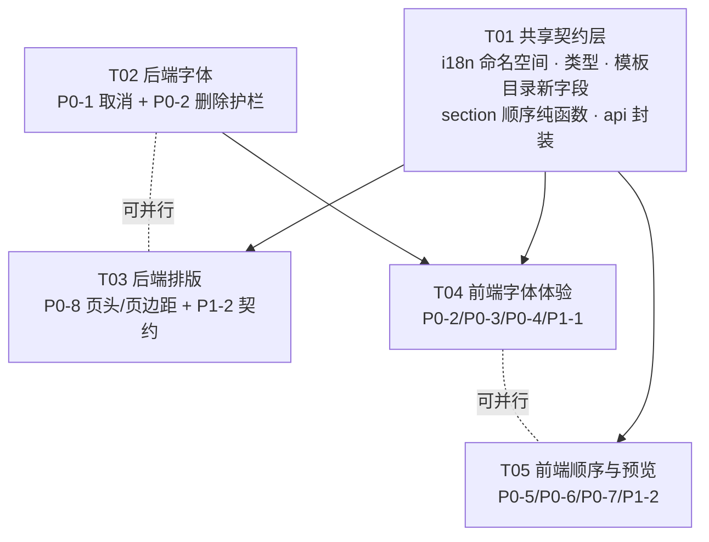

# 增量批次系统设计（P0-1 ~ P0-8 / P1-1 ~ P1-2）

> 角色：架构（Bob）· 输入：PM 的第 N 批增量 PRD · 约束：渐进改造、不重写、不删文件、主仓库不 commit
> 本文只给设计与任务分解，不含实现代码。所有"事实"都标了出处（`文件:行`），未经验证的推测会明确写成推测。

---

## Part A · 系统设计

### 0. 事实核对：P0-8 到底谁对（先给事实，再给结论）

#### 0.1 两条链路的实际实现（读代码得出，非推测）

**草稿链路**：`POST /api/resumes/render`（`backend/app/api/resumes/layout_render_routes.py:174`）→ `render_html(...)` → Jinja 模板 `backend/app/templates/resume_elegant.html.j2` + 共享片段 `_resume_sections.j2`，浏览器渲染。

**精确链路**：`POST /api/resumes/{id}/preview-pdf`（`backend/app/api/resumes/export_routes.py:354`，`template_override=payload.template`，`:395`）→ `pdf_exporter`（fpdf2 自绘，**不读 `.j2`**）→ 内嵌 PDF。

**模板来源是同一个**：两条链路的模板名都来自前端的 `layout.template`（草稿见 `api/resumeLayout.ts:72`；精确见 `components/resume-preview/exactPreviewOptions.ts:21`）。所以 **不存在"草稿用了错误模板 / 精确用了另一个 template"的可能**——这条 PM 提出的怀疑可以排除。

#### 0.2 优雅模板逐项比对（事实）

| 项 | 草稿（`resume_elegant.html.j2`） | 精确（`pdf_exporter`） | 一致？ |
|---|---|---|---|
| 姓名对齐 | `.header{ text-align:center }` + `.header-main{ flex:1 }` 继承居中（L30/L31） | `set_x(content_left)` 后 `align="L"`（`render.py:218/220`、`name_gender.py:106-113`） | ❌ **左 vs 中** |
| 姓名/分区标题字族 | `"Songti SC","SimSun",Georgia,serif`（L32/L39） | 单一 `FONT_FAMILY`（思源黑体/系统黑体） | ⚠️ 硬约束，允许不同 |
| 姓名字距 | `letter-spacing: 4px`（L32） | 无字距（全链路无 `set_char_spacing`） | ❌ 视觉宽度差 ~12% |
| 姓名字号比例 | `1.9 × --fs × --name-scale`（L32） | `name_ratio=1.9 × base`（`resume_template_layout.py:195`、`layout.py:244`） | ✅ 同源 |
| 分区标题字号/对齐 | `1.11×`、`text-align:center`、3px 字距（L39） | `1.11×`、`section_title_align="center"`（`:219/220`）、无字距 | 字号/对齐 ✅，字距 ❌ |
| 照片位置 | `.header{ flex-direction:row-reverse }`，DOM 顺序 `[header-main, photo]` ⇒ 反转后**照片在左、文字块在右**（L30，结构见 `_resume_sections.j2:9-33`） | 照片画在**右**（`render.py:209`），文字从左边距起笔 | ❌ **左 vs 右** |
| 四边页边距 | `padding: 16mm 18mm`（上下 16 / 左右 18，L28） | 注册表 `padding_mm: 16.0` → 四边 16（`resume_template_layout.py:192`、`layout.py:161-184`） | ❌ 左右差 **2mm**（>1mm 阈值） |
| 行距 | `line-height: 1.76` | `line_height: 1.76` | ✅ |
| 技能形态 | 居中标签行（`.skill-list{text-align:center}`） | `tag_align="center"`（`layout.py:294`、`skill_tags.py:271`） | ✅ |
| 强调色 | `--accent:#1f3b4d` | `accent:#1f3b4d`（注册表） | ✅ |
| 截断行为 | `.section,.entry{break-inside:avoid}` | `ensure_space` 预留"标题+一行正文"（`canvas.py:244-249`） | ✅ 等价 |

#### 0.3 结论

1. **PRD 的描述与代码一致**：草稿 = 居中 + 衬线 + 姓名字号 1.9×；精确 = **姓名左对齐** + 黑体 + 同字号（+ 照片在右）。
2. **用户截图显示的相反方向在代码里找不到出处**：唯一能产出"姓名左对齐、无衬线、字号偏小"的模板是 classic/compact 的样式；而 elegant 只有 `resume_elegant.html.j2` 这一份（`resume_template_catalog.py:36-41`），`format_css` 只产出颜色/行高/内边距/间距/系数，**从不覆盖 `text-align` 或 `letter-spacing`**（`resume_template_format.py:41-98`）。最可能的解释是**截图两栏被看反**（或左右顺序颠倒）：截图里标注"精确"的那栏若是右侧栅格图，内容正是"居中、字号更大"——与代码一致。
3. **但这不影响修复方向，两条结论指向同一个动作**：以模板的声明式 CSS 为准（优雅 = 居中 + 照片在左），**给 PDF 补上对齐/照片侧/字距，而不是把草稿改成左对齐**。谁看反了都不改变"PDF 少了 `text-align:center` 与 `flex-direction:row-reverse` 这两个语义"这个客观事实。
4. 30 秒复核方式（工程师落地前跑一次，把结果贴进 PR）：同一份内容 → `POST /resumes/render` 存 `draft.html`；`POST /resumes/{id}/preview-pdf` 存 `exact.pdf`；肉眼比对姓名水平位置与照片左右侧。**若实测与本文表格不符，以实测为准并立刻回报**（说明还有一条我没找到的链路）。

#### 0.4 其余 4 款模板的同类自查（同表口径）

| 模板 | 页边距（CSS / 注册表） | 页头对齐 | 照片侧 | 分区标题 | 已知偏差 |
|---|---|---|---|---|---|
| classic | 14 / 14 ✅ | 左 ✅ | 右 ✅ | left_bar / accent / left ✅ | 姓名字距 1px（允许不同） |
| modern | 14 / 14 ✅ | 左 ✅ | 右 ✅ | soft_box / accent / left ✅ | `align-items:center`：草稿正文块在页头内**垂直居中**，PDF 顶对齐（差 (photoH−textH)/2，实测 2~4mm）❌ |
| compact | **12mm 14mm** / 12 ❌ | 左 ✅ | 右 ✅ | underline / body / left ✅ | 左右差 2mm ❌；标题字距 0.5px |
| minimal | 18 / 18 ✅ | 左 ✅ | 右 ✅ | plain / muted / left ✅ | 无（`text-transform:uppercase` 只影响英文） |
| technical | 12 / 12 ✅ | 左 ✅ | 右 ✅ | accent_box / white / left ✅ | `.contact` 用等宽字族，PDF 无（小，本批不改） |
| editorial | 18 / 18 ✅ | 左 ✅ | 右 ✅ | underline / accent / **center** ✅ | 衬线（硬约束） |
| split | 12 / 12 ✅ | 左 ✅ | 右 ✅ | accent_box / white / left ✅ | 双栏已对齐 |

⇒ 本批 P0-8 必须修的**硬偏差只有 3 类**：① 页头对齐（elegant 独有）；② 页头照片侧（elegant 独有）；③ 模板默认四边页边距（compact / elegant，各差 2mm）。modern 的垂直居中列为"允许不同"（见 §1.8 判定表豁免），因为它不影响任何一项 10 条判定清单里的量。

---

### 1. 实现方案

#### P0-1 字体下载可中途取消（后端）

**现状**（`services/resume_font_builtin.py`）：模块级单例状态 `_state`、`_worker`；`_run_download`（`:194`）顺序下两个文件；`_download_one`（`:211`）写 `<name>.tmp` → sha256+字节数校验 → `replace`；`_cleanup(written)`（`:244`）清 `.tmp` + 本轮已落地文件；`delete()`（`:274`）直删两个正式文件。**线程没有任何停止信号**（`iter_bytes` 循环里只 `_advance`），所以取消只能靠"打断阻塞读 + 事件标志"。

**方案**：

1. 新增 `_stop = threading.Event()`（模块级，复用现有 `_lock` 保护写）。
2. `_run_download` 在三个位置检查 `_stop`：① 每个文件开始前；② `iter_bytes` 每块之后；③ **两个文件都 rename 完成、置 `done` 之前**（这一处是竞态裁决点）。
3. `_download_one` 里检查到 `_stop` 时抛内部哨兵 `_Cancelled`（**不是** `FontDownloadError`），保证失败态文案不会被写出来。
4. `cancel()`（新函数）：
   - 持锁读 `state`：不是 `downloading` → **直接返回 `status()`，不删任何文件**（幂等；这一条同时覆盖"刚好下完"的竞态：以完成为准）。
   - 是 `downloading` → `_stop.set()`；把 `_state["state"]` 保持为 `downloading`（线程还没收尾，别提前宣布 idle），另置 `_state["cancelling"]=True` 只给日志用。
   - 关掉在飞的 `httpx.Client`（新增模块级 `_client: httpx.Client | None`，`_download_one` 里登记/注销）：`client.close()` 会让阻塞中的 `iter_bytes` 立刻抛异常，**这是让取消在毫秒级生效的唯一办法**（否则要等 60s read timeout）。
   - `_worker.join(timeout=5)`；线程自己走 `_cleanup(written)` 并把状态写成 `idle / error="" / downloaded_bytes=0`。
   - join 超时（极端慢盘）→ 状态留 `downloading` + `error=""`，前端继续轮询直到 `idle`；`cancel()` 返回的 `state` 就是"当前真相"，**不假装已取消**。
5. `_run_written: list[Path]` 模块级（在 `_run_download` 开头清空）：`cancel()` 只删**本轮写过的**文件（`_cleanup` 的语义不变），历史残留不误删。
6. **下载中禁止删除**：`delete()` 开头加 `if state == "downloading": raise FontBusy`（P0-2 的后端护栏，与前端隐藏入口同源）。

**为什么不是另一种**：
- 不用 `asyncio` 任务 + `task.cancel()`：现有实现是 `threading`，改成 async 要动 `status()` 的锁与 API 的同步签名，收益只有"取消更优雅"，不值得。
- 不靠 `_download_one` 里删 `target`（正式文件）实现取消：会误删上一次干净下载的文件，且与"以完成为准"的竞态规则冲突。

#### P0-2 已下载字体可删除（前端入口 + 后端护栏）

- 入口放**设置页内置字体行**（`components/settings/BuiltinFontRow.tsx`）：`downloaded && !downloading` 时出现「删除」。
- 二次确认用 `App.useApp().modal.confirm`，正文用**新命名空间**的 key：`字体文件会被直接删掉，界面上没有恢复入口；正在使用它的简历会回到系统字体。`（与 `fonts.card.delete-body` 同句式，但内置字体是"两款文件一起删"，措辞独立一条）。
- 成功后：`setOverride` 写成 `idle` 快照 + `onChanged()` 重拉清单 → 按钮自然回到「下载」（`downloaded=false`）。
- 若当前全局字体正是它：后端 `remove_builtin_font` 已经把 `active` 置 `None`（`api/font_builtin.py:99-100`），前端只负责**明确提示**（`已删除，简历字体已回到系统字体`），并在删除**前**就知道会发生（确认正文已写明）。
- 下载中出现进度按钮、不出删除入口（`downloading` 分支已经 return，无需额外判）。

#### P0-3 制作台字体下拉里可直接下载

- 抽一个共享 hook `features/fonts/useBuiltinFontDownload.ts`：`{ status, start, cancel, remove, busy }`，内部 500ms 轮询（**只在 `downloading` 期间存续**，与 `BuiltinFontRow` 现有逻辑同源），失败原因原样透出。`BuiltinFontRow` 改用这个 hook（删掉自己那份轮询，避免两处漂）。
- `components/resume/ResumeFontControl.tsx`：
  - 未下载的内置项**不再 `disabled`**（`:106-112`）：点击 → `start()`，然后 `Select` 保持 `open`（受控 `open` 已经存在，`:90`）。
  - 该项行的右侧渲染进度（`downloaded_bytes / total_bytes` 的百分比 + 「取消」小按钮），其它项照常可选。
  - 下载完成（hook 的 `status.state === "done"`）→ **只写一次这份简历的字体**：`onChange({...layout, format_config:{...format_config, font: REGULAR_FILE}})`，并给一次 `message.success`。用 `pendingRef` 一次性标记（与 `BuiltinFontRow` 的 `pendingRef` 同一手法），避免每次重渲染都写。
  - 关闭下拉不中止：hook 是**组件级**状态、`Select` 关闭只是隐藏弹层，下载继续（不放进 `onOpenChange` 的清理里）。
  - 409「字体正在下载中」→ 不重复提交：`start()` 失败且 `state` 已是 `downloading` 时只把进度接上，不弹错。
  - 失败原因（网络 / 磁盘 507）→ 该项第二行显示原因 + 「重试」。
- 后端加一个可选查询参数 `POST /settings/fonts/builtin/download?activate=false`：制作台里下载**不该改动全局字体**（P0-3 的语义是"成为这份简历的字体"）。`activate` 缺省 `true`，行为与今天逐字一致。

#### P0-4 下拉面板收窄到 ≤260px

- `styles/resume-workbench-controls.css:344`：`.resume-params-dropdown { width: 340px }` → `260px`（**字体下拉与版式下拉共用这一个类**，见 `ResumeFontControl.tsx:173` 与 `ResumeTemplateControls.tsx:174`，所以只改一处即同时生效）。
- 选项行**不再显示磁盘文件名**：`ResumeFontControl.tsx:201-203` 删掉 `.resume-font-option-file` 那一段（`note` 那段保留，用于未下载/失败说明）；完整信息改由 `title` 给出：`展示名 · 文件名`（现有 `:190-194` 的 title 逻辑改为始终给，只要 `fileName` 存在）。
- 同步清理 CSS 里只为文件名服务的规则（`.resume-font-option-file` 收窄到只服务 `note`；或改名为 `.resume-font-option-note`）。顺手把注释里的「内容宽 340」改成新口径，避免下一个人照旧注释又改回去。

#### P0-5 板块顺序卡片 = 这份简历实际渲染顺序

**根因确认**：`components/resume/ResumeZoomModal.tsx:316` 无条件给 `ResumeTemplateControls` 传 `preferProfileOrder`。该 prop 只影响 `defaultSectionOrder`（`ResumeTemplateControls.tsx:83-89`），于是卡片把"没有 `section_order` 的老简历"按资料顺序显示；而四个渲染器读的是 `resolved_section_order(format_config)`（`services/resume/resume_sections.py:97-103`），没有键时用内置默认 —— 显示与渲染两套。✅ 与 PM 定位一致。

**方案**：
1. **删除** `ResumeZoomModal.tsx:313-316` 的 `preferProfileOrder`（连同那段注释），卡片回落到"这份简历自己的顺序"。生成配置阶段（`GenerationConfigStage.tsx:129`）继续传 —— 那里本来就是"新简历的默认值"。
2. **新简历仍要 = 资料顺序**，但改成**落库时物化**，不再靠 UI 的默认值临时生效：
   - 新增后端 helper `services/resume/resume_sections.py: default_section_order_config(db) -> dict`：`profile_to_resume_order(get_or_create_profile(db).section_order)`，与内置默认相同则返回 `{}`（沿用 `buildSectionOrderConfig` 的"没调过 = 不写键"口径）。
   - `api/resumes/crud_routes.py:50 create_manual_resume`：`record.format_config = {**default_section_order_config(db), **(payload.format_config or {})}`（新增可选字段，见 §3）。
   - `generate_routes.py:143` 同样在处理前补一次（`payload.options.format_config` 为空/无该键时）。
   - 这样：**空白简历（`ManualResumeModal`）** 这条路径自动获得 `section_order`；生成流程原有前端写入不变（后端只是兜底）；已有简历一行都不受影响（只在创建时写）。
3. 卡片、渲染、Word、文本导出全部读同一份 `format_config.section_order`，**显示与渲染从此不可能分叉**——因为分叉源（第二个默认值）被删了。

#### P0-6 卡片加「按我的资料顺序排列」（一次性快照）

- 位置：`ResumeTemplateControls.tsx` 的板块 Popover 标题行（`:215-224`，现在只有「恢复默认」）→ 同一行并排「按我的资料顺序排列」。
- 语义 = **一次性快照**：`onChange({...layout, format_config: buildSectionOrderConfig(profileOrder, builtInOrder, format_config)})`。写进去之后就是这份简历自己的顺序，资料页再拖不影响（`buildSectionOrderConfig` 已实现"等于内置默认就删键"）。
- 可用性三分支：
  - `profileOrder.join() === builtInOrder.join()` → 按钮 `disabled`，tooltip「资料顺序与默认顺序相同」。
  - 资料里**没有可排序分区**（新增下发字段 `profile_section_keys` 为空，见 §3）→ `disabled` + 悬停说明「资料里还没有可排序的板块」。
  - 其余 → 可用；点击后若当前已是该顺序，仍然写一次（幂等，无副作用）。
- 页眉不参与：`PROFILE_SECTION_TO_RESUME` 不含 `basic_info`（`resume_sections.py:49-57`），天然满足。

#### P0-7 制作台改内容 → 预览实时更新（只上行、不回灌）

**根因确认**：中栏编辑态止步于 `useResumeEditorPanel`（`Form.useWatch([])` 只在 hook 内部用，`:171`；`onValuesChange: () => void`，`:427-430`）。右栏 `content` 只来自 `liveContent`（纸面加粗 overlay，`ResumeDetailModal.tsx:411`）→ `ResumeZoomModal.tsx:479` → `ResumeWorkbenchLiveCanvas.tsx:113`。✅ 与 PM 定位一致。

**方案：单向 store + 统一合并口径**

1. 新增 `features/resume/resumeDraftContent.ts`（纯模块，可单测）：
   - `createResumeDraftStore()` → `{ set(content: ResumeContent, signature: string): void; clear(): void; subscribe(cb): () => void; getSnapshot(): ResumeContent | null }`。
   - `set` 内部：签名相同则**不通知**（一次输入里 `history.push` 引起的重复上报不会造成二次渲染）；通知用 `useSyncExternalStore` 契约（快照引用稳定）。
   - 内置 150ms 尾随节流（`flushMs` 可注入，测试用 0）：连续输入每 ~150ms 最多一次通知。
2. `useResumeEditorPanel` 增两个可选入参：`onDraftContent?: (content: ResumeContent) => void`、`onDraftReset?: () => void`；`api.onValuesChange` 改为 `(changed, allValues) => { setDirty(true); formHistory.push(); onDraftContent?.(mergePartial(allValues)); }`。
   - `mergePartial(values) = { ...content, ...values, photo: content.photo }` ——**与 `handleFinish` 里保存时用的合并完全同一句**（`useResumeEditorPanel.tsx:395`）。抽成一个内部函数两处共用：这是"预览所见 = 保存所得"的机械保证。
   - `onDraftReset` 在三处调用：内容签名变化的重填（`:301-314` 的渲染期守卫之后、`setSyncedContent` 分支）、`handleDiscard`、保存成功之后。**这三处不对齐，就会出现"存完预览闪回旧内容"**。
3. `ResumeWorkbenchEditorColumn` 把 `draftStore` 透传进 hook（`onDraftContent: (c) => store.set(c, sig)`、`onDraftReset: () => store.clear()`）。
4. `ResumeWorkbenchLiveCanvas`：新增 `draftStore?`、`mergeLive?: (c) => ResumeContent | null`；内部 `const draft = useSyncExternalStore(store.subscribe, store.getSnapshot)`；预览正文 = `draft ? mergeLive(draft) : (liveContent ?? content)`。
   - **订阅只发生在这个薄壳里**：三栏（参数 / 中栏 / 画布外壳）不因每键输入而重渲染。这是本方案唯一需要"性能敏感"的地方。
5. 加粗叠加：`mergeLive = overlays.merge`（`ResumeDetailModal` 传下去，`useRichTextOverrides.ts:170`）。`mergeOverlays` 只在"路径当前值 === overlay.base"时生效，所以**用户在编辑器里改过这个字段 → overlay 自动作废**，"加粗 + 改字"叠加时显示的是合并后的结果，无需额外通知。
6. 保存优先：`suspended={saving || editorSaving}` 已存在（`ResumeZoomModal.tsx:482`）；另外 `live.source === html` 的失效判定（`ResumeWorkbenchLiveCanvas.tsx:113`）继续生效。第 2 条的 `onDraftReset` 是"保存后不闪回"的另一半。
7. 精确模式不启用：`enabled: Boolean(content) && previewMode !== "exact"` 已在 `:82`，本批不动。

**性能账（写进任务说明，供工程师自检）**：
`useResumeLivePreview` 的防抖是**尾随且每次变化都重置**（`useResumeLivePreview.ts:215-221`），所以"连续输入 3 秒"→ 停手前 0 次请求、停手 600ms 后最多 2 次（`BURST_BUDGET`）。"停手 1000ms 内出现新值" = 600ms 防抖 + 一次 render + 一帧写入，余量足够。**不需要改 hook 的任何常数**；改常数反而会破坏这两条验收的平衡。

#### P0-8 PDF 与草稿同版面（按 §0.2/§0.4 的偏差表逐条修）

后端注册表 `resume_template_layout.py`（模板 CSS 的结构化映射，`test_resume_layout.py` 拿 CSS 逐条核对）新增三个键，`pdf_exporter` 读它们：

1. `header_align: "left" | "center"`（elegant = `center`，其余 `left`）
   - `resume_layout.py` 加同名字段 → `render.py` 里姓名 / 求职意向 / 联系方式三处 `align` 用它（`L` / `C`）。
   - `name_gender.py` 的 `plan_name_gender` / `draw_name_gender` 增 `align` 参数：`same_line` 分支要算 `x = left + (width − name_w − gender_w) / 2`，换行分支给 `multi_cell(align=...)`。
   - **量高不变**（`text_block_height` 与对齐无关），所以"量的就是画的"这条不变量不受影响。
2. `header_photo_side: "left" | "right"`（elegant = `left`，其余 `right`）——直接对应 CSS `flex-direction`。
   - `render.py:209` 的 `x` 改为按侧计算；`text_width` / 文字起笔 `content_left` 相应平移（照片在左时文字块右边对齐）。
3. 模板默认四边页边距：注册表新增 `padding_sides_mm: (top,right,bottom,left)`（compact `(12,14,12,14)`、elegant `(16,18,16,18)`；其余模板不写，回落 `padding_mm` 单值）。
   - `resume_layout_overrides.resolve_page_margins` 增可选入参 `template_sides`；**只在"没有 `page_padding` 也没有任何分边支路也没有 `legacy_margin_mm`"这一种状态**下返回 `template_sides`，其余分支一行不变（保证已设置过页边距的简历 PDF 字节数不变）。
   - `layout.py:161-184` 传入 `defaults.get("padding_sides_mm")`；`docx_exporter` 同步（Word 与 PDF 同口径是既有约束）。
4. `letter_spacing_px`（姓名 / 分区标题两个固定 px 值）—— **列为可选子项（P2）**，理由：字距不在 PRD 的 10 条判定清单里，而 fpdf2 的 `set_char_spacing` 可用性需先验证（`fpdf2==2.8.9`）。若工程师 30 秒 smoke 通过（`python -c "from fpdf import FPDF; print(hasattr(FPDF,'set_char_spacing'))"`），再按"字号不变、宽度加 `(len−1)×spacing`"实现；否则**直接跳过并在 PR 里写清原因**，不要用逐字 `cell` 推进去硬凑（会破坏 `get_string_width` 的测量一致性）。
5. 衬线字族：**明确列为"允许不同"**，不引入第二款中文字体、不改安装包。由 P1-2 的常驻说明兜住。**禁止**为了让两条链路"看起来一样"去改草稿的设计意图（例如把优雅的姓名改成左对齐）。
6. 同步更新 `test_resume_layout.py`（CSS ↔ 注册表对照）与 `test_export_page_parity.py`（新增页头对齐/照片侧/页边距三条断言，用 `elegant` 与 `compact` 做样本）。

#### P1-1 设置页点字体看样张

- 新增 `components/settings/FontSampleModal.tsx`（只读弹窗，供内置字体与历史字体共用），`ResumeFontCard` / `BuiltinFontRow` 的字体名点击都指向它。
- 固定 4 行（行高 1.7，字号 22 / 14 / 14 / 14）：
  1. 中文标题行：`张三 · 后端开发工程师`
  2. 中英数混排：`QPS 8,500 · P99 下降 42% · 2022.07 – 2024.09`
  3. 中文标点：`！？、；：「」（）——·…`
  4. 加粗示例：加粗的同一句话（`font-weight:700`）
- 关闭三路：footer「关闭」按钮 + Esc（`keyboard` 缺省 true）+ 遮罩（`mask={{ closable: true }}` 显式写出——这是只读弹窗，`popupGuard` P1 只约束含表单的写入弹窗）。
- 未下载的内置字体：点名字不打开弹窗，`message.info("下载后即可预览")`。
- 文件读不到：用 CSS Font Loading API `new FontFace("rf-sample", `url(${resumeFontPreviewUrl(name)})`).load()`，`reject` 时弹窗内显示「字体文件不可用」（比注入 `@font-face` 后静默回退到系统字体诚实得多）。
- 底部保留「设为当前」（内置字体的"当前"是全局 `PUT /settings/fonts/active`）。

#### P1-2 精确模式的字族说明

- 后端：`RESUME_TEMPLATES` 每个条目加 `serif_heading: bool`（`elegant` / `editorial` = true），由 `template_options` / `template_options_with_custom`（自制一律 false）下发。
- 前端：`types/resume.ts` 的模板项加 `serif_heading?: boolean`；`buildExactPreviewOptions` 增第 4 个参数 `catalog`，把 `headingSerif` 填进 `ExactPreviewOptions`（`exactPreviewOptions.ts`）；`ExactPreviewPanel` 在状态行（`:480-497`）常驻一句「精确预览用本机可用的中文黑体排版，标题字族与草稿不同」——**只在 `headingSerif && active` 时渲染**，于是切回草稿（面板 `active=false`）或换模板（`headingSerif=false`）后自然消失。

---

### 2. 文件清单

> 「⚠️」= 本批会把它推到或接近 **500 行预算**，必须同批做一次抽取（抽取点已指定，不新增功能）。
> 行数为现状 + 本批预估增量。

#### 2.1 后端（新增 0，修改 11）

| 文件 | 现状 | 改动 | 预估 |
|---|---|---|---|
| `backend/app/services/resume_font_builtin.py` | 320 | +`_stop`/`_client`/`_run_written`/`cancel()`/`delete()` 护栏/`_Cancelled` | 320 → ~380 |
| `backend/app/api/font_builtin.py` | 104 | +`POST /fonts/builtin/download/cancel`；`download` 加 `activate` 查询参 | 104 → ~130 |
| `backend/app/services/resume/resume_template_layout.py` | 415 | +`header_align`(8 条)、+`header_photo_side`(8 条)、+`padding_sides_mm`(2 条) | 415 → ~445 |
| `backend/app/services/pdf_exporter/layout.py` | 303 | +3 字段、`_resolve_page_margins` 传 `template_sides` | 303 → ~330 |
| `backend/app/services/pdf_exporter/render.py` | 423 | 页头 `align`、照片侧、文字块平移 | 423 → ~450 |
| `backend/app/services/pdf_exporter/name_gender.py` | 127 | +`align` 参数（测量不变、绘制变） | 127 → ~150 |
| `backend/app/services/resume/resume_layout_overrides.py` | 391 | `resolve_page_margins` 加 `template_sides`（默认 None = 现行为） | 391 → ~410 |
| `backend/app/services/resume/resume_sections.py` | 136 | +`default_section_order_config(db)` + `profile_section_keys(raw)` | 136 → ~165 |
| `backend/app/api/resumes/crud_routes.py` | ~? | `create_manual_resume` 写默认 `format_config` | +6 |
| `backend/app/api/resumes/generate_routes.py` | ~? | 生成落库前补默认 `section_order` | +4 |
| `backend/app/api/resumes/templates_routes.py` | 109 | +`profile_section_keys`、模板项 `serif_heading`（从 catalog 来） | 109 → ~118 |
| `backend/app/services/resume/resume_template_catalog.py` | 112 | +`serif_heading` 到 8 条内置项与两个 options 构造器 | 112 → ~125 |
| `backend/app/schemas/resume.py` | 496 ⚠️ | `ManualResumeRequest` + `format_config: dict \| None` | **496 → 500（顶线）** |

> ⚠️ `schemas/resume.py` 已 496 行：本批只加 2 行，务必先抽一条（建议把 `LayoutAnalyze*` 三个小模型搬到 `schemas/resume_layout.py`，那是纯搬运，零调用点改动）。

#### 2.2 前端（新增 6，修改 14）

| 文件 | 现状 | 改动 | 预估 |
|---|---|---|---|
| **新增** `src/features/fonts/useBuiltinFontDownload.ts` | — | 下载状态机（轮询/start/cancel/remove/一次性 pending） | ~110 |
| **新增** `src/features/resume/resumeDraftContent.ts` | — | 单向 store（节流 + 签名去重 + useSyncExternalStore 契约） | ~90 |
| **新增** `src/features/resume/resumeDraftContent.test.ts` | — | 纯函数/节流/去重/clear | ~80 |
| **新增** `src/components/settings/FontSampleModal.tsx` | — | 4 行样张 + 三种关闭 + FontFace 探测 | ~140 |
| **新增** `src/components/settings/FontSampleModal.test.tsx` | — | 关闭三路 + 未下载提示 + 文件不可用 | ~90 |
| **新增** `src/components/resume/WorkbenchParamsColumn.tsx` | — | 从 `ResumeZoomModal` 抽出参数栏 JSX（`:305-360` 整段） | ~85 |
| **新增** `src/i18n/messages/zh-CN.fontDownload.ts` | — | 新命名空间（本批全部新文案，见 §5） | ~70 |
| `src/components/resume/ResumeFontControl.tsx` | 217 | 未下载项可点、行内进度/取消/重试、去掉文件名、title 组合 | 217 → ~290 |
| `src/components/settings/BuiltinFontRow.tsx` | 249 | 改用共享 hook、+删除入口（二次确认） | 249 → ~270 |
| `src/components/settings/ResumeFontCard.tsx` | 325 | 预览弹窗换成 `FontSampleModal` | 325 → ~300（变短） |
| `src/api/settings.ts` | ~? | `startBuiltinFontDownload(options?: {activate?: boolean})`、`cancelBuiltinFontDownload()` | +12 |
| `src/components/resume/ResumeZoomModal.tsx` | 496 ⚠️ | 删 `preferProfileOrder`；参数栏搬到新文件；建 store 并下发给中栏与画布 | **496 → ~470（靠抽取降到线下）** |
| `src/components/resume/ResumeWorkbenchEditorColumn.tsx` | 263 | 透传 `draftStore` → hook 的 `onDraftContent` / `onDraftReset` | +10 |
| `src/components/resume-editor/useResumeEditorPanel.tsx` | 442 | `onValuesChange` 带上 `allValues`；`mergePartial`；`onDraftReset` 三处 | 442 → ~465 |
| `src/components/resume-editor/ResumeEditorPanel.tsx` | 141 | 无需改（`onValuesChange={api.onValuesChange}` 已透传两个参数） | 141 |
| `src/components/resume/ResumeWorkbenchLiveCanvas.tsx` | 126 | `useSyncExternalStore` 订阅 + 合并优先级 | 126 → ~160 |
| `src/components/resume/ResumeTemplateControls.tsx` | 312 | +「按我的资料顺序排列」按钮与三分支可用性 | 312 → ~360 |
| `src/components/resume/ResumeDetailPreview.tsx` | 499 ⚠️ | `buildExactPreviewOptions(..., catalog)` + memo 依赖 | **499 → 501（超线）⇒ 必须同批抽 `ResumeCoverageNotes.tsx`（`:244-303` 整段，~65 行）→ 约 440** |
| `src/components/ResumePreview.tsx` | 497 ⚠️ | `ExactPreviewOptions` + `headingSerif?` | **497 → 500（顶线）⇒ 把 `ExactPreviewOptions` 类型搬到 `resume-preview/exactPreviewOptions.ts` 并从本文件 re-export，降到 ~478** |
| `src/components/resume-preview/ExactPreviewPanel.tsx` | 501 ⚠️（已超） | +`headingSerif` prop + 状态行一句；把 `blankPageCount` 那段空白纸渲染抽成 `ExactPreviewBlanks.tsx` | 501 → ~470（靠抽取） |
| `src/components/resume-preview/exactPreviewOptions.ts` | 32 | +`headingSerif`；接收 catalog | 32 → ~50 |
| `src/types/resume.ts` | ? | `profile_section_keys`、模板项 `serif_heading` | +4 |
| `src/styles/resume-workbench-controls.css` | 390 | `.resume-params-dropdown` 340 → 260；选项行样式收敛 | +8 |

> `ExactPreviewPanel.tsx` 现在 **501 行**（已越线 1 行）：它属于"现状就贴线"的文件，本批碰它就必须先抽一段出来，否则新代码一进来就变成 510+。

---

### 3. 数据与接口契约

#### 3.1 字体（P0-1 / P0-2 / P0-3）

```
POST /api/settings/fonts/builtin/download?activate=true|false   → 202  BuiltinFontStatus
POST /api/settings/fonts/builtin/download/cancel                → 200  BuiltinFontStatus
GET  /api/settings/fonts/builtin                                 → 200  BuiltinFontStatus
GET  /api/settings/fonts/builtin/download                        → 200  BuiltinFontStatus
DELETE /api/settings/fonts/builtin                               → 204（下载中 → 409）
```

`BuiltinFontStatus`（**结构不变**，只多一个可选字段，老前端零影响）：

```json
{
  "id": "source-han-sans-sc",
  "label": "思源黑体",
  "size_total": 33493260,
  "downloaded": false,
  "downloaded_bytes": 0,
  "total_bytes": 33493260,
  "state": "idle",            // idle | downloading | failed | done
  "error": "",
  "cancelling": false          // 【新增，可选】true = 取消信号已发出、线程在收尾
}
```

取消的**状态机**（这是 P0-1 的验收契约）：

| 进入取消时的实况 | 返回 | 磁盘 | 备注 |
|---|---|---|---|
| `state != downloading`（含 `done`） | 原状态（`done`/`idle`/`failed`） | **不动** | "刚好下完以完成为准" |
| `downloading`，本地有 `.tmp` / 已 rename 一个 | `state="idle"`, `downloaded_bytes=0`, `downloaded=false`, `error=""` | 删本轮 `written` + 所有 `.tmp` | 正常取消 |
| `downloading`，线程 5s 内未收尾 | `state="downloading"`, `cancelling=true` | 稍后由线程清理 | 前端继续轮询到 `idle` |
| 取消后又点下载 | 202 + `downloading` | 全量重来 | `_stop` 在 `start_download` 里 `clear()` |

错误码：`409` = 已在下载（含 `delete` 撞上下载）；`507` = 磁盘不足；`404` = 未下载（`DELETE` 时）；`500` = 删除失败。

#### 3.2 模板目录（P0-5 / P0-6 / P1-2，全部**追加字段**）

```
GET /api/resumes/templates
```
新增：
```jsonc
{
  "templates": [
    { "name": "elegant", "label": "优雅", "description": "…", "custom": false,
      "serif_heading": true }            // 【新增】声明衬线标题 → 精确模式字族说明（P1-2）
  ],
  "default_section_order": ["summary", "education", "…"],
  "profile_section_order":  ["…"],       // 已有：补齐七个键的完整排列（供"默认值"）
  "profile_section_keys":   ["educations", "projects"]   // 【新增】资料里**原样**排过的
                                         // 「我的资料」分区键（不补齐、不映射）；
                                         // 空数组 = 资料里没有可排序分区 → P0-6 按钮禁用
}
```

后端 `RESUME_TEMPLATES[*].serif_heading`：`elegant` / `editorial` = `true`，其余 `false`；自制模板恒 `false`。

#### 3.3 简历创建（P0-5）

`POST /api/resumes/manual` 请求体新增**可选** `format_config`：

```jsonc
{ "job_id": 1, "title": "", "content": { … }, "draft": true,
  "format_config": { "section_order": ["projects", "…"] } }   // 新
```
缺省时后端用 `default_section_order_config(db)`（= 资料顺序，与内置默认相同则不写键）。响应不变（`ResumeOut`）。

#### 3.4 前端内部契约（P0-7）

```ts
// features/resume/resumeDraftContent.ts
interface ResumeDraftStore {
  set(content: ResumeContent, signature: string): void;  // 同签名不通知；150ms 尾随节流
  clear(): void;                                          // 存/放弃/重填时调：预览回落到已保存内容
  subscribe(listener: () => void): () => void;
  getSnapshot(): ResumeContent | null;                    // useSyncExternalStore 契约：引用稳定
}
```

`ResumeWorkbenchLiveCanvas` 的正文优先级（**改成这样，不许多一条分支**）：
`draft(draftStore) → mergeLive(draft) : (liveContent ?? content)`

---

### 4. 任务分解（5 个任务，硬上限内）

> 说明：本批是**存量项目的增量**，不存在"项目基础设施"可搭；T01 承担等价角色——**跨任务共享的契约层**（i18n 命名空间、类型、后端只读契约、共享 hook/store）。其余 4 个任务按"可独立交付的模块"分组，都在 T01 之后**互不阻塞、可并行**。

#### T01 共享契约层（必须最先做，其余全部依赖它）· P0
- **改动**：`zh-CN.fontDownload.ts`（新命名空间全量文案）+ `zh-CN.ts` 合并一行；`types/resume.ts`（`profile_section_keys` / `serif_heading`）；`types/resumeFormat.ts` 无需改；`api/settings.ts`（`activate` 参数 + `cancelBuiltinFontDownload`）；`services/resume/resume_template_catalog.py`（`serif_heading`）；`api/resumes/templates_routes.py`（下发两个新字段）；`services/resume/resume_sections.py`（`default_section_order_config` / `profile_section_keys` 两个纯函数 + 单测）。
- **依赖**：无。**完成判定**：`GET /templates` 返回 `serif_heading` 与 `profile_section_keys`；`npx vitest run src/i18n/cjkRatchet` 绿（新文案全在新命名空间，零新增硬编码中文）；后端单测覆盖两个新纯函数。

#### T02 后端字体：取消 + 删除护栏（P0-1、P0-2 后端）· P0
- **改动**：`services/resume_font_builtin.py`、`api/font_builtin.py` + 新增 `backend/tests/test_font_builtin_cancel.py`。
- **依赖**：无（不依赖 T01 的新文案；错误 `detail` 只写原因）。
- **完成判定**：① 取消后 `status()` 为 `idle/0/false`，字体目录**既无正式文件也无 `.tmp`**（Regular + Bold 两个字面都断言）；② 取消不改当前字体；③ 取消不产生 `failed` 文案；④ 模拟"第二个文件已 rename 后到达取消" → 文件保留、`state=done`；⑤ 下载中 `DELETE` 回 409；⑥ 取消后可立即再次 `start_download` 成功。

#### T03 后端排版对齐：优雅模板页头 + 模板页边距 + 其他 4 款自查（P0-8、P1-2 后端）· P0
- **改动**：`resume_template_layout.py`、`pdf_exporter/layout.py`、`render.py`、`name_gender.py`、`resume_layout_overrides.py`、`docx_exporter.py`（跟口径）+ 更新 `test_resume_layout.py` / `test_export_page_parity.py` / 新增 `test_pdf_exporter_header_align.py`。
- **依赖**：无（可与 T02 并行）。
- **完成判定**：页头对齐/照片侧/页边距三条断言落地；**未设置任何页边距的 8 款模板 PDF 字节变化仅限被点名的偏差**（逐模板 `git` 前后对比页数不变）；已设过 `page_padding` 的简历 PDF 字节**逐字节不变**；PDF 页数（`pages` / `pages_needed`）无回归。

#### T04 前端字体体验（P0-2 前端、P0-3、P0-4、P1-1）· P0/P1
- **改动**：`useBuiltinFontDownload.ts`（新）、`ResumeFontControl.tsx`、`BuiltinFontRow.tsx`、`ResumeFontCard.tsx`、`FontSampleModal.tsx`（新）、`resume-workbench-controls.css` + 3 个测试文件。
- **依赖**：T01（文案 + `activate` 参数 + `cancel` API 声明）、T02（取消接口真的能用）。
- **完成判定**：下拉内点未下载项 → 进度可见、其它项可选、**不离开制作台**、完成自动成为这份简历的字体一次；关掉下拉不中止；409 不重复提交；失败给原因并可重试；面板宽度 ≤260px（jsdom 断言 class 存在 + CSS 值）；样张三种关闭方式 + 未下载提示 + 文件不可用提示。

#### T05 前端板块顺序 + 实时预览通道 + 精确模式说明（P0-5、P0-6、P0-7、P1-2 前端）· P0/P1
- **改动**：`ResumeZoomModal.tsx`（删 `preferProfileOrder`；参数栏抽 `WorkbenchParamsColumn.tsx`）、`ResumeWorkbenchEditorColumn.tsx`、`useResumeEditorPanel.tsx`、`ResumeWorkbenchLiveCanvas.tsx`、`resumeDraftContent.ts`（新）、`ResumeTemplateControls.tsx`、`ResumeDetailPreview.tsx`（含抽 `ResumeCoverageNotes.tsx`）、`ResumePreview.tsx`（类型搬家）、`ExactPreviewPanel.tsx`、`exactPreviewOptions.ts` + 测试。
- **依赖**：T01（`profile_section_keys` / `headingSerif` 契约）。
- **完成判定**：
  - P0-5：老简历（无 `section_order`）卡片顺序 == 内置默认 == 渲染顺序；有 `section_order` 的简历卡片 == 该顺序；新建（生成流程 / 空白简历）卡片 == 资料顺序（并能在 `format_config` 里看到写入的键）。
  - P0-6：三个可用性分支 + 快照语义（点完后去资料页改顺序，这份简历不变）。
  - P0-7：改名后停手 1000ms 内预览出现新值且未保存；连续输入 3 秒请求数 ≤4（用 `renderResume` 的 mock 计数）；保存期间不闪回；加粗 overlay 与内容改动叠加显示合并结果；失败保留旧预览 + 重试可用；精确模式不发请求；**中栏 `content` 引用在输入过程中不变**（防回灌的机械断言）。
  - P1-2：优雅模板精确模式下句子常驻，切回草稿/换模板后消失。

**并行图见 §6。**

---

### 5. 共享知识（跨文件约定，工程师必须逐条遵守）

1. **i18n 命名空间**：本批所有新文案进**一个新文件** `src/i18n/messages/zh-CN.fontDownload.ts`（`const fontDownload = {…} as const; export default fontDownload;`），`zh-CN.ts` 末尾 `...fontDownload` 展开。**禁止**往 `zh-CN.ts` 或既有 `zh-CN.fonts.ts` 里加行（`cjkRatchet` 逐文件比较，改已有文件新增中文行会红）。
   key 前缀分层：`fontDownload.download.*`（下拉内下载/进度/取消/重试/失败）、`fontDownload.remove.*`（删除确认与结果）、`fontDownload.sample.*`（样张四行与两类提示）、`sections.*`（P0-6 两个按钮与两条 tooltip）、`exact.serifNote`（P1-2）。
2. **文案规范**：后端 `detail` 只写原因（"请"由前端给）；不写方位词 + 按钮名；术语固定为 **模板 / 版式 / 排版参数 / 版面**（不写"样式/皮肤/布局"）；删除类必须写明"没有恢复入口"。
3. **状态字段名**：字体下载状态唯一来源是 `BuiltinFontStatus.state`（`idle|downloading|failed|done`）；新增 `cancelling` 只是**提示位**，任何 UI 判断分支**不得**把它当独立状态用。
4. **事件/回调命名**：
   - 中栏 → 预览的单向通道：`onDraftContent(content)` / `onDraftReset()`（hook 入参）与 `store.set/clear`（store 方法）。**禁止**新增以 `content` 为名的"向上回灌"prop（正是 P0-7 的反模式）。
   - 画布合并回调统一叫 `mergeLive`，类型 `(c: ResumeContent | null) => ResumeContent | null`。
5. **CSS 变量/类名**：
   - 下拉弹层统一 `.resume-params-dropdown`，宽度 **260px**（`max-width: calc(100vw - 32px)` 保留）。
   - 字体选项行只保留 `.resume-font-option-name`（展示名）与 `.resume-font-option-note`（说明/进度/取消），**删除** `.resume-font-option-file` 的用法（样式块可留待后续清理，但不得再被引用）。
   - 样张弹窗类名 `font-sample`，行类 `font-sample-title` / `font-sample-mixed` / `font-sample-punct` / `font-sample-bold`；字号 22/14/14/14，行高 1.7 写死在这四条规则里（不引入变量）。
6. **后端注册表新增键**（唯一事实来源，`test_resume_layout.py` 核对 CSS）：`header_align`、`header_photo_side`、`padding_sides_mm`。`padding_mm` **继续保留**（滑杆默认值与 `template_layouts` 仍在用），它是"上下边"的默认值。
7. **`section_order` 三种形态**（不要混用）：① 键不存在 = 用内置默认；② 键存在 = 这份简历的顺序（永远七个键的完整排列）；③ `profile_section_order` 只是"新建时的默认值来源"，**不是**渲染依据。
8. **测试写法**：无 `user-event`、未开 `globals` ⇒ `import { fireEvent, render, screen } from "@testing-library/react"` + `afterEach(cleanup)`；断言里不出现中文 `*ByText`（新增测试文件基线 0），用 `aria-label`/`role`/`data-*` 定位。
9. **行数纪律**：`ResumeZoomModal.tsx` / `ResumeDetailPreview.tsx` / `ResumePreview.tsx` / `ExactPreviewPanel.tsx` / `schemas/resume.py` 进本批前先抽取（抽取点在 §2 表格里，都是纯搬运）。

---

### 6. 任务依赖图



**关键路径**：T01 → T05（P0-7 是唯一有耦合风险的一项：`useResumeEditorPanel` 被"手动调整"弹窗共用，改它必须跑那条宿主的全部既有测试）。

---

### 7. 风险与回滚点

| # | 风险 | 影响 | 缓解 / 回滚 |
|---|---|---|---|
| R1 | **P0-7 回灌**：把合并内容当作编辑器 `content` 回传 → `syncedContent` 的**内容签名**判定命中（`useResumeEditorPanel.tsx:287-314`），每输入一次丢一次未保存输入 | 数据丢失（最严重） | 通道**只能**是 store（外部可变对象），`content` prop 永远只喂服务端那份；测试加"输入 3 次后 `content` 引用不变 + 表单值仍是用户输入"的机械断言。回滚 = 删 `draftStore` 两个 prop（其余改动独立） |
| R2 | **P0-7 保存后闪回**：`onDraftReset` 漏了一个调用点（重填 / 放弃 / 保存成功三处） | 用户看到旧内容，以为保存失败 | 三处都在设计里点名；测试各一条（保存成功后 `getSnapshot() === null`） |
| R3 | **P0-7 性能**：每键 setState 让三栏重渲染 | 输入卡顿 | 订阅只在 `ResumeWorkbenchLiveCanvas`；store 内置 150ms 节流 + 签名去重；用 React DevTools 的 render 计数自检"打字时只有画布子树在渲染" |
| R4 | **P0-8 改动面波及 PDF/Word 字节**：`name_gender` 与照片侧是全模板共用代码 | 8 款模板的 PDF 都可能变 | ① `header_align` 缺省 `left`、`header_photo_side` 缺省 `right`，非 elegant 模板**走原分支**；② `template_sides` 只在"零覆盖"状态生效；③ 落地顺序：先加键（不改变行为）→ 再让 elegant 用新分支 → 逐模板比 `pages` 与像素差；④ 回滚点 = 注册表三条键（删掉即回原行为） |
| R5 | **P0-8 误改草稿**：为了让两条链路"一致"去动 `resume_elegant.html.j2` | 破坏设计意图，且与"衬线硬约束"冲突 | 设计里明令禁止改草稿 CSS；评审时只要看到 `.j2` 出现在 diff 里就必须解释 |
| R6 | **P0-5 物化 `section_order` 改变老简历** | 用户已导出的简历换样子 | 只在**创建**路径写，且与内置默认相同则不写键；测试断言"PATCH/layout 不触碰 `format_config` 的其余键" |
| R7 | **P0-1 取消竞态的极端分支**：`client.close()` 与 `replace()` 同时发生 | 文件半对 / 误删已下好的 | 唯一裁决点在"置 `done` 之前持锁检查 `_stop`"；`_run_written` 只含本轮文件；测试用 monkeypatch 在 `replace` 后插入取消 |
| R8 | **行数预算**：5 个文件已贴线 | 触碰即越线，评审被卡 | §2 已给抽取点，抽取是**纯搬运**，可先单独提交一次（不改行为），再叠功能 |
| R9 | `cjkRatchet` 红 | CI 阻塞 | 新文案全放新命名空间；注释里不写新的中文界面句 |

---

### 8. 附：本批"完成判定"总表（PM 验收口径）

见 T01~T05 各自的完成判定，汇总为：**6 个 P0 全部有可复现的失败样本 → 修复后同一样本通过；2 个 P1 有明确的出现/消失条件**。CI 必须绿：`pytest backend/tests`（含 3 个新增后端测试文件）、`npx vitest run`（含 `cjkRatchet`）、`ruff`、`tsc`。
