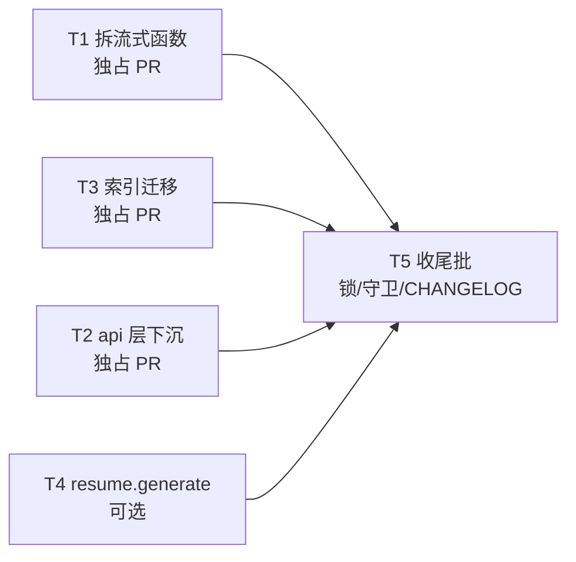

# ResumeForge 技术债核实与治理计划

> **历史文档（2026-11-14 施工记录）**：批次已交付，本文只作验收判据与施工记录；数字与实测值都是 2026-11-14 的快照，引用时带上日期。

> 第一批 T1–T5 已交付（d85ee8ad）；第二批 §8 的主要批次也已合入（T3 金标 94bad1a2、T6 132513d2、T8 七个拆分批、T9 855b172d）。
> **本文保留为施工记录与验收判据**，不再当作待办清单；数字与实测值都是 2026-11-14 的快照，引用时带上日期。

> **用途**：交给执行 agent 的施工单。文中每条结论都附了可复现的测量命令与当前实测值。
> **核实基准**：`HEAD = 4adc6ae6`（2026-11-14 13:41），工作树干净（0 条未提交改动）。
> **审计基准**：线上审计页 `code-audit` 的 `assessment.json`，定格在 `cba83862`（2026-11-10 19:19）。
> 两者之间有一次大重构 `62edf920 refactor: 收口分层与前端目录架构债`（2026-11-12 22:39，1548 文件），**它已经关掉了 9 条债务里的 3 条**。
> **结论速览**：9 条中 **3 条已关闭**（D1/D3/D5）、**1 条性质判错**（D8）、**2 条证据或归因有偏差**（D4/D7）、**3 条属实但严重性需重估**（D2/D6/D9）。真正还要动手的是 5 个任务（见 §3，全部要做）：T1/T3 是真债，T2/T4 是结构与可读性，T5 是收尾。

---

## 0. 判定口径

| 判定 | 含义 |
|---|---|
| ✅ 已关闭 | 审计描述的现象在当前代码里已不存在，且（多数）有守卫测试钉住 |
| ⚠️ 属实 | 现象存在，数字与当前代码吻合，需要处理 |
| 🔶 部分属实 | 现象存在但规模/严重性被高估，只需收尾或改规范 |
| ❌ 性质误判 | 描述的事实（行数/import 数）对得上，但**归因错了**，按原文修会做错事 |

---

## 1. 逐条核对

### D1 业务层反向依赖接口层的私有函数 —— ✅ 已关闭

| 项 | 内容 |
|---|---|
| 审计原文 | `services/actions` 下 18 处 `from app.api.* import _to_out/_to_detail/_filtered_query` |
| 当前实测 | `services → api` 跨层 import = **0 处**（AST 全量扫描，含函数内延迟 import） |
| 守卫 | `backend/tests/test_import_direction.py` 中 `ALLOW_SERVICES_API = {}`，注释写明"服务层目前零反向依赖"；`pytest tests/test_import_direction.py` → **7 passed** |
| 附带收益 | 审计说的"24 节点跨层大环"也消失了：Tarjan 扫描 `backend/app` 全部模块，**模块级环 = 0**（原 1 个 24 节点环） |
| 残留 | `app/api/assistant_skill_learning.py:55`、`app/api/interview_shared.py:139/164` 仍有 `_to_out/_to_detail` 定义，但**只被 api 层自己用**，不构成反向依赖 |

**处置**：不排任务。如需在面试/评审里引用，用上面的数字。

---

### D2 路由层直接查询 ORM，读路径绕过 services —— 🔶 部分属实

| 项 | 内容 |
|---|---|
| 审计原文 | api→models 84 处；`api/drill.py`、`api/tracker.py` 等在路由内直接 query |
| 当前实测 | api→models **68 个 import / 48 个文件**（原 84）；`SessionLocal` 在 api 层 **0**；`session_engine` 5 处（manual_backups ×2 / settings / skills / stats） |
| **查询构造** | 含 `select(` / `db.query(` / `db.execute(` 的路由函数只剩 **1 个**：`app/api/job_preferences.py:89 record_session_only` |
| 残余规模 | 仍有 **60 个路由函数**在直接操作 Session；按原语计 **183 次调用 / 53 个文件**（`db.get` 68、`db.commit` 61、`db.refresh` 26、`db.rollback` 9、`db.delete` 8、`db.add` 6、`db.flush` 4、`db.execute` 1、`db.query` 0、`select(` 0）。其中 **33 个函数含写操作**、**27 个只读 `db.get`** |
| 审计点名的例子 | `api/tracker.py` 现在**只有 1 处 `db.close()`**，无任何查询；`api/drill.py` 只剩 `db.get`/`db.commit`，无查询构造 |

**判断**：审计的"同一查询语义有两份实现"这条风险**基本已经不存在**（查询构造只剩 1 处）。剩下的是"路由层收尾事务"（`db.get` 做存在性校验 + `db.commit` 提交服务层已完成的工作），这是 FastAPI 的常规 unit-of-work 写法，**不建议**为架构纯洁去改 60 个文件。

真正还值得动的只有 8 个**业务逻辑住在路由里**的函数（合计约 840 行）：

| 文件:行 | 函数 | 行数 | 判断依据 |
|---|---|---|---|
| `app/api/resumes/generate_routes.py:138` | `generate_resume` | 225 | 路由内含生成编排、异常映射、落库 |
| `app/api/assistant_proposals.py:80` | `approve_write_proposal` | 153 | 路由内含审批状态机 |
| `app/api/assistant.py:391` | `send_message` | 100 | 路由内组装上下文 + 建消息 + 起流 |
| `app/api/resumes/generate_routes.py:373` | `start_resume_generation` | 80 | 含任务行创建 + flush + 复用判定 |
| `app/api/drill.py:95` | `create_session` | 79 | 含会话初始化 + 清理 + 落库 |
| `app/api/interview.py:186` | `create_session` | 77 | 同上（两份实现，应共用） |
| `app/api/followups.py:62` | `decide_followups` | 64 | 含批量决策落库 |
| `app/api/job_preferences.py:89` | `record_session_only` | ~60 | 唯一还构造查询的路由（条件 UPDATE 占提案） |

> ⚠️ **`app/api/interview.py` 当前正好 500 行**（预算上限），往这个文件里加任何一行都会让 `test_file_size_budget` 变红。改它之前必须先把 `create_session` 整段移出。

---

### D3 前端简历域拆成 21 个目录 —— ✅ 已关闭

| 项 | 内容 |
|---|---|
| 审计原文 | `components/resume` 单目录 303 文件；另有 3 个 `components/resume-*` 与 17 个 `features/resume-*` |
| 当前实测 | `components/resume*` **0 个**；`features/resume-*` **0 个**；全部并入 `frontend/src/features/resume`，**777 文件 / 20 个子域**（preview 135、layout 118、editor 104、document 65、outline 44、delivery 43、provenance 35、bilingual 31、pagination 26、versions 26…） |
| 附带收益 | `components/` 现在只剩 `common/`（实测）；`62edf920` 同批迁了 1151 个文件、`vite build` 产物 192 文件与旧包逐字节一致（此两项为**提交信息自述**，本轮未复跑构建比对） |

**处置**：不排任务。

---

### D4 三个 >300 行的状态机函数 —— ⚠️ 属实，但只有 1 个是真复杂度

全仓 >300 行的函数仍然只有这 3 个（>150 行的有 23 个）。**但审计把三个都叫"状态机"是错的**：

| 函数 | 行数 | 顶层语句 | 最大嵌套 | 真实性质 |
|---|---|---|---|---|
| `services/assistant/assistant_stream_turns.py:91 _stream_message_events` | **404**（审计时 326，**变大 78 行**） | 13 | **5** | ✅ 真复杂度：async generator，4 个 `except` 分支各自重复 `close_run_trace + budget.record_round + finish_assistant_message + yield` |
| `services/resume/resume_generator.py:111 generate` | 347 | **47** | 2 | 🔶 线性流程，不是状态机。47 条顺序语句（26 个赋值 + 10 个 if + 1 个 for），可读性是"步骤太长"而非"控制流太绕" |
| `services/webform/live_control.py:47 install_live_control_script` | 413 | **6** | **0** | ❌ **不是函数**：6 条语句里 4 条是赋值，主体是一个 f-string 内嵌的 **JS 程序**（含 CSS 字符串数组、事件绑定、拖拽逻辑） |

`live_control.py` 已经在行数预算里**有书面豁免**（`test_file_size_budget._EXEMPTIONS`）：

> `"backend/app/services/webform/live_control.py": Exemption("patch + __file__ + 单一脚本资源", ...)`

理由成立：`_load_face_data_uri` 被测试 patch、`_ASSET_DIR` 与 `__file__` 深度耦合、canary 测试对整段脚本做字符级断言。**动它会把"改写脚本"和"搬资源文件"混在一批，得不偿失。**

**处置**：拆 `_stream_message_events`（T1）与 `generate`（T4）；`live_control` **不动**，只加一行注释说明"行数来自内嵌 JS 载荷，非控制流复杂度"。

---

### D5 actions 域注册样板重复 28 次 —— ✅ 已关闭

| 项 | 内容 |
|---|---|
| 审计原文 | `services/actions/domains/*.py` 中相同的 6 行 lazy import + 循环，改注册协议要动 28 个文件 |
| 当前实测 | 29 个域文件（不含 `__init__.py`）全部是**纯构建器**：模块末尾 `actions()` 返回 `dict[str, ActionSpec]`，**不引用注册表**（RF-10 起 `define_action` / `get_action` 一律不出现在 domains 里，由 `tests/test_action_registry.py` 的 AST 判据守住）；注册统一走 `catalog.ensure_registered()`（幂等、顺序稳定） |

**处置**：不排任务。

---

### D6 async 路由内调用同步 SQLAlchemy —— 🔶 属实，但严重性被显著高估

| 项 | 内容 |
|---|---|
| 审计原文 | 63 个 async 路由中 23 个含同步 `db.get/select/commit` |
| 当前实测 | async 路由 **61 个**，其中 **23 个**含 DB 调用，但 **查询构造 = 0 处**（无 `select(`、无 `db.query(`） |
| 实际构成 | 全部是 `db.get`（主键查，B 树点查）+ `db.commit`（一次 fsync）。其中 5 个是 SSE/流式端点（`assistant.send_message`、`assistant_regenerate_api.regenerate_message`、`interview.submit_answer_stream`、`interview_revise.revise_answer_stream`、`resumes/generate_routes.generate_resume`），**必须保持 async**（要 await LLM / 逐块 yield） |

**判断**：把 23 个路由改同步会打断 LLM/SSE 的 await 链；改线程池又会把 `Session` 跨线程用。**正确做法是定规则 + 加守卫，不是重写。**规则：async 路由**禁止构造查询**（`select/query/execute`），允许 `db.get`（主键）与 `db.commit`（收尾），每处需注释说明。当前`0` 处违规，规则落地即锁死。

**处置**：T5-b（守卫测试，10 行代码）。

---

### D7 索引密度偏低 —— ⚠️ 结论属实，证据口径错误

| 项 | 内容 |
|---|---|
| 审计原文 | 77 表 18 个显式索引，71 个外键，`indexes_per_table = 0.23` |
| 当前实测 | **80 张表**、**114 个 `index=True` 单列索引**、**20 个 `__table_args__` 复合 Index**、**76 个外键列** |
| 口径问题 | 审计只数了 `__table_args__` 里的 `Index(...)`，**漏掉了 114 个 `index=True`**，所以"0.23/表"是假的；真实密度 ≈ 1.7/表 |
| **但仍然有真问题** | 76 个外键列里 **29 个没有前导索引**（判据：该列不是任何索引或唯一约束的**第一列**——SQLite 不会自动为 FK 建索引，复合索引的非前导列对 FK 校验无效）。`app/database.py:56` 显式 `PRAGMA foreign_keys=ON`，且这 29 个 FK **全部带 `ondelete`**（23 个 `SET NULL`、6 个 `CASCADE`）——父行硬删（回收站清空、`purge`）时，SQLite 要逐个子表全表扫才能找到要置空/级联的行 |
| 有明确读路径的 4 列（其中 1 列已被覆盖） | `reminder.track_id`（2 处：`delivery_receipt.py:377`、`submit_confirmation.py:81`）、`knowledge_entry.job_id`（`knowledge_service.py:288`）、`resume_delivery_record.track_id`（`resume_delivery.py:292`）、`resume_review_annotation.share_package_id`（`review_annotations.py:268/339` → 已被唯一约束 `uq_annotation_pkg_external` 的前导列覆盖，**不用补**） |

**判据实测方式**（在我的模型扫描之后又用真实迁移库复核了一遍，修正了 3 个假阳性）：

```bash
# 在临时目录建一个真库（upgrade head），逐表比对前导索引
cd backend && PYTHONUTF8=1 .venv/Scripts/python.exe - <<'EOF'
import tempfile, pathlib
from alembic import command
from app.database import Base, build_engine
from app.database_migrations import build_alembic_config
from sqlalchemy import inspect
eng = build_engine(f"sqlite:///{(pathlib.Path(tempfile.mkdtemp())/'m.db').as_posix()}")
command.upgrade(build_alembic_config(eng), "head")
insp = inspect(eng)
n = 0
for t in Base.metadata.sorted_tables:
    lead = {c for i in insp.get_indexes(t.name) for c in i["column_names"][:1]}
    lead |= {c for u in insp.get_unique_constraints(t.name) for c in u["column_names"][:1]}
    for col in t.columns:
        if col.foreign_keys and col.name not in lead:
            n += 1; print(t.name, col.name)
print("总数", n)
EOF
```

结果 **29**（原先按模型文件粗扫得到 32，其中 3 个是假阳性）：
- `assistant_memory.source_conversation_id` / `source_message_id` —— 迁移 `0015` 已经建了索引，只是模型没写 `index=True`；
- `resume_review_annotation.share_package_id` —— 已被唯一约束 `uq_annotation_pkg_external` 的前导列覆盖。

**完整待补清单（29 列，逐列已核）**：

```
apply_queue_item.resume_id            SET NULL      apply_task_item.resume_id                 SET NULL
application_track.resume_id           SET NULL      drill_session.job_id                      SET NULL
interview_review_record.resume_id     SET NULL      knowledge_entry.job_id                    SET NULL
question_bank_record.resume_id        SET NULL      reminder.track_id                         SET NULL
reminder.resume_id                    SET NULL      resume_block_source.source_revision_id    SET NULL
resume_generate_task.resume_id        SET NULL      resume_delivery_record.track_id           SET NULL
resume_phrase.source_claim_id         SET NULL      resume_phrase.source_resume_id            SET NULL
resume_record.parent_revision_id      SET NULL      resume_review_annotation.document_version_id SET NULL
resume_version.job_id                 SET NULL      resume_version.parent_version_id          SET NULL
resume_variant.job_id                 SET NULL      resume_variant.base_version_id            SET NULL
resume_variant.last_synced_version_id  SET NULL     referral.track_id                         SET NULL
share_package.job_id                  SET NULL      education.profile_id                      CASCADE
experience.profile_id                 CASCADE       campus_experience.profile_id              CASCADE
project.profile_id                    CASCADE       skill.profile_id                          CASCADE
award.profile_id                      CASCADE
```

> 注：`apply_task_item.resume_id` **保留在清单里**。它所在表只有 `job_id` / `status` / `task_id` 三个索引，**没有** `(task_id, resume_id)` 复合索引，`resume_id` 前置无索引。

**另发现一处模型与迁移的索引漂移（真债，顺带在 0020 修掉）**：
- `assistant_conversation_skill.created_at` 在模型里是 `mapped_column(..., index=True)`（`app/models/assistant.py:183`），但迁移 `0005_conversation_skill.py` 只建了 `conversation_id` / `skill_id` 两个索引 → **模型元数据说有、真库没有**。
- 影响：走 `alembic upgrade` 的库没有这个索引，走 `Base.metadata.create_all` 的库有 → 两套 schema。当前 demo/截图库已强制走 alembic，所以只是"元数据说谎"，但会误导后续统计（我第一版数到的 114 个 `index=True` 里就多算了它）。
- 处理：在 0020 里补 `create_index("ix_assistant_conversation_skill_created_at", ...)`，与模型对齐（而不是删模型的 `index=True`——按 `created_at` 排序取会话技能是真实存在的用法）。

**处置**：T3（一条迁移补 29 + 1 个索引）。

---

### D8 契约层引用 ORM 实体 —— ❌ 性质误判

| 项 | 内容 |
|---|---|
| 审计原文 | `schemas→models` 13 处，"ORM 字段变更会泄漏到 API 响应；DTO 与 Entity 边界模糊" |
| 当前实测 | **13 条 import 语句 / 11 个文件 / 约 29 个符号**（`app/schemas/{apply/base,claim,drill,followup,interview,interview_experience,job,referral,reminder,share_package,tracker}.py`） |
| 实际 import 的符号 | `JOB_STATUSES`、`FOLLOWUP_DECISIONS`、`CLAIM_CATEGORIES`、`INTERVIEW_TYPES`、`REMINDER_KINDS`、`SHARE_PERMISSIONS`、`REFERRAL_STATUSES`、`FAILURE_CATEGORIES`、`STATUSES`/`CHANNELS`/`SOURCES`、`has_placeholder`、`placeholder_hit`… |
| 关键事实 | **没有任何 ORM 实体类被 import**，不存在"DTO 继承 Entity"，也不存在"ORM 加字段泄漏到响应" |

真实问题是另一件事：**领域词表住在 `models/` 层，导致契约层被迫依赖实现层**（分层方向上是 `schemas → models`）。这属于"常量放错了家"，不是"契约与实体耦合"。

**处置**：T5-c（可选，收益低，建议单独一批或直接放弃）。**不要**为了让 `grep` 归零而复制一份枚举。

---

### D9 传递依赖未锁定 —— ⚠️ 属实

| 项 | 内容 |
|---|---|
| 当前实测 | `backend/requirements.txt` **18 条顶层 `==`**；无 `uv.lock`、无 `requirements.lock`、无 pip-compile 产物 |
| CI 现状 | `.github/workflows/ci.yml:57` → `pip install -r requirements-dev.txt`（无锁安装） |
| ⚠️ 涟漪风险 | `scripts/Build-PythonRuntime.ps1` 会把 `backend/requirements.txt` 的 **SHA-256 写进运行时清单**，`Build-Desktop.ps1` 也校验它；历史上（1.0.1）有一次因为改 requirements 导致"打包器拿到的运行时与清单对不上"。所以**不要直接改 `requirements.txt` 的内容** |
| 另一个约束 | `numpy` / `tokenizers` 明确**不进** `requirements.txt`（由 rag-assets Release 提供，见 ci.yml:1372） |

**处置**：T5-a（新增独立锁文件，不改现有 pin），并明确"CI 里先用锁装一遍做一致性校验"即可，不要替换现有安装链路。

---

### 审计之外顺带核实到的

| 项 | 状态 |
|---|---|
| 静默 `except: pass` | 实测 **11 处**（审计说 4 处）。逐条看过，**每一处都有 `# noqa: BLE001 - 原因` 注释**（`page_reader.py:178`、`live_multi.py:184`、`job_match_background.py:142/144` 等）。审计点名的 `export/docx_document_parts.py:211` 文件已拆分为 `docx_document_*.py`，路径失效 |
| 提交规范 | 1147 条提交中 91 条非 Conventional，占 **7.9%**（审计说 8%），全部是早期提交，**数字三年不会变**，无法追溯修复 |
| 路由重复 | AST 按"每个文件里的多个 `APIRouter(prefix=…)` 分别取前缀"统计：**533 个路由装饰器 / 533 条唯一 `method+path` / 重复 0 条**。（`api/apply.py` 里有 `router=/api/apply` 与 `collect_router=/api/collect` 两个前缀，粗扫会把它们误判成重复） |
| 调试输出 | `backend/app` 里 `print(` **0 处**；前端 `console.log` 8 处，其中 3 处是测试里的 `DEBUG-3` 残留（见下表），另 5 处是 `cjkRatchet` / `breakpointGuard` 守卫的刻意诊断输出 |
| CHANGELOG 结构 | `Unreleased` 区间（`CHANGELOG.md:5–158`）里 `### Fixed` 出现 **2 次**（43、135 行），`Added`/`Changed`/`Security` 各 1 次；另有一个非 Keep-a-Changelog 的日期式小节 `### 2026-11-14 修复批次（38 项清单）`（第 7 行）压在 `### Added` 之上。**比我第一版写的"Changed ×4 / Fixed ×2 / Added ×2"要轻**——那是我把整份文件（含已发布版本）一起数了，属于误读。真债但**不在审计页里**，见 T5-d |

---

## 1.10 审计页没提、这轮核对新发现的候选债务

按"值不值得动"排序，都给了判据：**N1/N2 顺手做掉**（分钟级），**N3 由 T2 自然缓解**，N4/N5 只登记、不动代码。

| 编号 | 项 | 证据 | 判定 | 建议 |
|---|---|---|---|---|
| N1 | 测试里的调试残留 | `frontend/src/features/jobs/JobMatchBatchPanel.test.tsx:162/163/165` 三行 `console.log("DEBUG-3 …")` | 真残留（会污染 CI 输出、且断言无关） | **顺手删**（T5-e） |
| N2 | 文档路径失真 2 处 | `docs/maintenance.md:27` 写 `src/components/ 组件（跨模块交互原语在 common/）`，实际 `components/` 只剩 `common/`；`docs/system_design.md` 顶部"2.0 已复核"提示里写 `components/navigation/navigationConfig.ts`，实际在 `features/shell/navigationConfig.ts` | 真失真（连"更正提示"本身也过期了） | **顺手改**（T5-e） |
| N3 | api 层整体贴线 | 6 个文件在 480–500：`api/interview.py` 500、`api/apply.py` 493、`api/assistant.py` 490、`api/resumes/export_routes.py` 483、`api/settings.py` 482、`api/resumes/generate_routes.py` 482。全仓 `≥470` 的 `.py` 有 68 个、`.ts/.tsx/.css` 有 54 个 | 结构性摩擦：任何新端点都得先拆文件 | **不改**；T2 移出 8 个函数会自然缓解 `interview/assistant/generate_routes` 三个 |
| N4 | `services/` 顶层平铺 167 个模块 | `ls app/services/*.py \| wc -l` = 167（另有 23 个子包）；可聚类的簇：`docx_*` 14、`assistant_*` 12、`ats_*` 8、`ai_*` 7、`job_*` 7，另有 39 个独占前缀 | 观察项，**不是缺陷**：命名已带域前缀，检索可用 | **不动**。搬模块会打断大量 `monkeypatch` 落点与 import 字符串，风险远大于收益 |
| N5 | 一个挂起的 TODO | `frontend/src/features/resume/preview/ResumeDetailPreview.fillSources.test.tsx:220`：`TODO(v2 补位, 2026-10-30): …「从资料填入」入口未接线`。**实测：该用例是 `it(...)` 且通过**（`npx vitest run src/features/resume/preview/ResumeDetailPreview.fillSources.test.tsx` → 3 passed），入口已在 `features/resume/editor/ResumeWorkbenchV2EditorColumn.tsx:48` 接线，`ProfileFillMenu.tsx` 即该菜单 | TODO 已过期（不是功能缺口） | **删注释、保留断言**（T5-e） |

> 另外核实通过、不必担心的：`git ls-files` 里 **0 个 `.pyc` / 0 个 `.old`**（`runtime/`、`deliverables/` 全部未跟踪，属本地产物）；行数豁免全部挂在 `2027-06-30`，**无过期豁免**；`docs/system_design.md` 这类历史设计文档明确标了"不是现状"，其中的旧路径不算债（但 N2 那两处是"现状文档 + 更正提示"，性质不同）。

---

## 2. 结论矩阵

| 编号 | 审计条目 | 审计严重度 | 判定 | 现状数字 | 处置 |
|---|---|---|---|---|---|
| D1 | 业务层反向依赖接口层 | high | ✅ 已关闭 | 0 处 + 守卫 | 不排 |
| D2 | 路由层直接查 ORM | high | 🔶 部分属实 | 查询构造 1 处；183 次原语调用 / 53 文件 | T2（只改 8 个函数） |
| D3 | 前端简历域 21 目录 | high | ✅ 已关闭 | 1 目录 / 20 子域 | 不排 |
| D4 | 三个 >300 行状态机 | medium | ⚠️ 属实（1/3 是真债） | 404 / 347 / 413(JS) | T1 + T4 |
| D5 | actions 注册样板 ×28 | low | ✅ 已关闭 | 声明式 registry | 不排 |
| D6 | async 路由同步 DB | medium | 🔶 部分属实 | 23 路由，查询构造 0 | T5-b（守卫） |
| D7 | 索引密度低 | medium | ⚠️ 属实（口径错） | 29 FK 无前导索引 + 1 处漂移 | T3 |
| D8 | 契约层引用 ORM 实体 | medium | ❌ 性质误判 | 13 个常量/函数 | T5-c（可选） |
| D9 | 传递依赖未锁定 | low | ⚠️ 属实 | 18 pin / 0 lock | T5-a |

> 另有 §1.10 的 5 条新发现：**N1/N2 并入 T5-e 顺手做掉**，N3 由 T2 自然缓解，**N4/N5 只登记、不动代码**。

---

## 3. 施工任务

### 排序原则

按 **"出错代价 × 改动面"** 排，不照抄审计的 rank：

1. **T1 先做**——它是唯一"会越拖越贵"的（404 行还在长），且改动只落在一个模块内，好回滚。
2. **T3 次之**——独立迁移，与代码改动零重叠，可以先合并。
3. **T2 单独立批**——它动 api 层 7 个文件，和 T4 的文件不重叠，但和"任何 api 行为改动"都容易冲突，必须独占一个 PR。
4. **T4 排在 T2 之后**（已确认要做）——它动 `services/resume/`，与 T2 的 api 层不重叠；风险集中在 PDF 金标指纹，必须单独一批才能判断红点归属。
5. **T5 最后**——都是小收尾，可并成一批。

**提交约定**：每批（T1 / T3 / T2 / T4 / T5）各一个 commit，**不推送**，留在本地由人审。提交信息用 `refactor:` / `chore:` / `fix:` 前缀，正文写清"改了什么 + 验收结论"。回滚按批 `git revert <hash>`（不是 `reset --hard`）。



---

### T1 · 拆 `_stream_message_events`（P0，真债）

**目标**：主函数从 404 行降到 **≤80 行**；4 个 `except` 分支的重复序列收敛成 1 处。

**文件**
- 改：`backend/app/services/assistant/assistant_stream_turns.py`（当前 494 行，**距 500 预算只剩 6 行**）
- 新增：`backend/app/services/assistant/assistant_stream_run.py`（承载状态对象 + 收尾函数，估计 150~220 行）

**现状结构（AST 实测的行号，可直接当切分线）**

| 区间 | 行数 | 内容 | 拆到哪 |
|---|---|---|---|
| 107–139 | 33 | 局部状态初始化（parts / metadata / model_context / assistant_context / reasoning_parts / numberer / budget / trace / override_token） | `StreamRun` 数据类 + `_open_stream_run()` |
| 140–190 | 51 | 装配 messages、上下文分桶、token 估算 | 同上 |
| 191–383 | 193 | `while True:` 轮循环（工具调用、SSE yield、预算判定） | `_run_rounds(run, ...)` |
| 384–423 | 40 | 收尾：来源映射落库、空回复判定、usage 汇总 | `_finish_success(run)` |
| 424–485 | 62 | **4 个 except**：`OperationCancelled` / `asyncio.CancelledError` / `LLMError` / `Exception`，每个都重复 `close_run_trace → budget.record_round → finish_assistant_message → yield` | `_finalize_run(run, status, *, error_event=None)` **一个函数** |
| 486–494 | 9 | `finally`：reset override、`provider.request_budget = None`、`close_run_trace`、`cancel_pending` | 留在主函数 |

**步骤**
1. 先补测试基线：确认现有用例覆盖"正常结束 / 预算耗尽 / 用户取消 / LLMError / 内部异常"五条路径的 SSE 事件序列。找到现有测试文件（`grep -rln "_stream_message_events\|assistant_stream" backend/tests`），把每条路径的 `yield` 序列固化成断言。**没有基线不许动手。**
2. 建 `assistant_stream_run.py`，放 `@dataclass StreamRun`（字段即上表 107–139 的 9 个局部变量 + `user_message_id`/`assistant_message_id`/`conversation_id`/`factory`）。
3. 搬 191–383 到 `_run_rounds(run)`，**先纯搬迁**：不改任何一行逻辑，只把 `parts`→`run.parts` 等改引用（用 `sed` 类批量替换后逐行核对）。
4. 搬 4 个 except 到 `_finalize_run`：注意差异只有 3 处——`status` 字符串（`error`/`cancelled`）、`error` 文案（固定脱敏文案，别动）、是否 `raise`（`CancelledError` 要 re-raise）。用参数区分，**不要**用 4 个 if 分支还原复杂度。
5. 主函数只剩：`run = _open_stream_run(...)` → `try: async for ev in _run_rounds(run): yield ev` → 4 个 `except` 各一行 `async for ev in _finalize_run(run, ...): yield ev`。
6. 保留 `# noqa: BLE001` 与其后的中文理由注释（`test_detail_copy`/注释审计会看）。

**验收**
```bash
cd backend
PYTHONUTF8=1 .venv/Scripts/python.exe -m pytest -q tests -k "assistant"     # 全绿
PYTHONUTF8=1 .venv/Scripts/python.exe -m pytest -q tests/test_file_size_budget.py
python -c "import ast;src=open('app/services/assistant/assistant_stream_turns.py',encoding='utf-8').read();print([(n.end_lineno-n.lineno+1) for n in ast.walk(ast.parse(src)) if getattr(n,'name','')=='_stream_message_events'])"
```
最后一条期望输出 `[<=80]`（即 `[78]` 之类）。

**反证**（必须做）
- 把 `_finalize_run` 里的 `budget.record_round(run.provider)` 删掉 → 至少一个"预算耗尽"用例必须变红，且失败信息指向 usage 断言。
- 复原后 `sha256sum` 与改前一致，复跑仍绿。

**风险 / 回滚**
- 风险：SSE 事件顺序、取消路径的 `cancel_pending` 幂等性、`finally` 里的 override 复位。
- 回滚：改动前把 2 个文件复制到仓库外快照目录（`mkdir -p <snap>/T1 && cp --parents ...`），**禁止** `git checkout --`（会连带回滚他人改动）。

---

### T2 · api 层 8 个函数下沉（P1，改动面中等）

**目标**：把 D2 表里 8 个"业务逻辑住在路由"的函数移进 services；同时把"查询构造 1 处"清零。

**文件清单（改 8 个路由 / 新增 5 个服务模块 / 复用 2 个已有模块）**

> ⚠️ 这一带的既有模块普遍贴着 500 行上限：`services/resume/resume_generate_runner.py` **498**、`services/assistant/memory.py` **500**、`assistant_stream_turns.py` **494**。**不要往它们里面加**——下面标"新建"的一律新建文件。

| 路由 | 落点 | 方式 |
|---|---|---|
| `api/resumes/generate_routes.py:138 generate_resume` | `services/resume/generation_entry.py` | 新建（原文件 482 行，移出后可降到 ~257） |
| `api/resumes/generate_routes.py:373 start_resume_generation` | `services/resume/generation_task_start.py` | 新建 |
| `api/assistant_proposals.py:80 approve_write_proposal` | `services/assistant/proposal_approval.py` | 新建 |
| `api/assistant.py:391 send_message` | `services/assistant/message_dispatch.py` | 新建 |
| `api/drill.py:95 create_session` | `services/drill/session_open.py` | 新建（`services/drill/` 现在没有业务编排层） |
| `api/interview.py:186 create_session` | `services/interview/session_open.py` | 新建；**先比对 drill 版**，语义相同则只写一份、两边调用 |
| `api/followups.py:62 decide_followups` | `services/followup_sweep.py`（398 行） | **复用**：+64 行 = 462，仍在预算内 |
| `api/job_preferences.py:89 record_session_only` | `services/job_preference_service.py`（426 行） | **复用**：+60 行 = 486，贴线但合法；若超则拆出 `job_preference_proposals.py` |

**注意**
- `api/interview.py` 正好 500 行：**先移出 `create_session`**（77 行），文件自然降到 423，再谈别的。
- `api/resumes/generate_routes.py` 482 行，移出 225 行后约 260 行，安全。
- 服务层函数签名统一 `(db: Session, ...) -> 领域对象`，**返回 ORM 对象或 dataclass，不返回 pydantic 响应**（响应组装留在路由）。
- 事务边界仍留在路由：服务函数内部**不要** `commit()`，让路由 `db.commit()` 收尾（保持现有 61 处 `db.commit(` 的语义一致）。
- 错误语义：服务抛 `AppError`/领域异常，路由映射 HTTP 状态码。`backend detail` 只写原因，"请"由前端 `errorGuidance` 给（`test_detail_copy.py` 会扫）。

**保留不动的（写进规范）**
- 33 个 ≤20 行的 batch delete / rename / favorite 路由（服务调用 + `db.commit()` 收尾）。
- 27 个只读 `db.get` 的存在性校验。

**新增守卫**：`backend/tests/test_api_layer_rules.py`
- 断言 1：`app/api/**` 的路由函数体内**不得出现** `select(` / `db.query(` / `db.execute(`。
- 断言 2（可选，先只报不拦）：路由函数体行数 > 60 时列出清单。
- 反证：在 `api/stats.py` 里临时写一个 `select(1)`，断言 1 必须精确变红。

**验收**
```bash
cd backend
PYTHONUTF8=1 .venv/Scripts/python.exe -m pytest -q tests -k "resume_generation or assist or interview or drill or followup or job_preference"
PYTHONUTF8=1 .venv/Scripts/python.exe -m ruff check .
grep -rnE "select\(|db\.query\(|db\.execute\(" app/api/ --include=*.py   # 期望 0 行
```

---

### T3 · 迁移 0020：补 29 个外键索引 + 1 个漂移索引（P0，独立迁移）

**目标**：D7 清单里 29 个 FK 列 + `assistant_conversation_skill.created_at` 漂移项，共 30 个索引一次补齐。

**文件**
- 改（16 个模型文件）：`models/{apply,profile,tracker,resume,versions,reminder,referral,phrase,provenance,share_package,drill,knowledge_entry,interview_review_record,question_bank_record,resume_delivery,review_annotation}.py`（对应 FK 列加 `index=True`）
- 新增：`backend/migrations/versions/0020_fk_indexes.py`（`down_revision = "0019_conversation_memory_off"`）

**步骤**
1. 模型层：在每个 FK 列的 `Column(...)`/`mapped_column(...)` 上加 `index=True`（**不要**动 `ondelete`、`nullable`、类型）；`assistant_conversation_skill.created_at` 已经有 `index=True`，不用改模型，只补迁移。
2. 迁移：`op.create_index("ix_<table>_<col>", "<table>", ["<col>"])`，`downgrade` 逐条 `op.drop_index`。照 `migrations/versions/0002_assistant_write_proposal.py:70` 的写法；`created_at` 那条索引名固定为 `ix_assistant_conversation_skill_created_at`（与 SQLAlchemy 自动命名一致）。
3. 表不存在时跳过（迁移会跑在"只有部分业务表"的库上）——照 0019 的 `_has_table` 守卫。
4. 索引命名统一 `ix_<table>_<col>`，与现有 114 个 `index=True` 自动生成的命名保持一致（否则降级后重建会对不上）。

**验收**
```
cd backend
PYTHONUTF8=1 .venv/Scripts/python.exe -m pytest -q tests/test_baseline_schema.py tests/test_epoch_gate_matrix.py tests/test_migration_0019_conversation_memory_off.py

# 双向跑：必须指向临时目录，别在真库上试降级（RF_DATA_DIR 决定库位置）
$env:RF_DATA_DIR = "$env:TEMP\rf-0020-check"
.venv/Scripts/python.exe -m alembic upgrade head
.venv/Scripts/python.exe -m alembic downgrade -1
.venv/Scripts/python.exe -m alembic upgrade head

# 生效佐证（任选一列；库在上面那个临时目录里）
.venv/Scripts/python.exe -c "import os,sqlite3;db=os.path.join(os.environ['RF_DATA_DIR'],'resume_forge.db');print(sqlite3.connect(db).execute('explain query plan select * from reminder where track_id=1').fetchall())"
```
最后一行的输出必须出现 `USING INDEX ix_reminder_track_id`。

> ⚠️ 测试里**禁止**写死 `"0019_..."` 字面量，只能用 `migration_refs.head_revision()`。守卫：`grep -rnE '"[0-9]{4}_[a-z0-9_]+"' backend/tests --include=*.py`（只应命中 `migration_refs.py`）。

**顺带加一条守卫（T3-b，约 30 行）**：`backend/tests/test_model_migration_index_parity.py`
- 在临时目录 `alembic upgrade head` 建库，逐表比对"模型声明的索引/唯一约束"与"真库的索引/唯一约束"，任何一侧多出条目即失败。
- 当前会精确命中 `assistant_conversation_skill.created_at` 这一条（正是本次要修的漂移）；修完后转绿，此后任何"模型加了 `index=True` 却忘了写迁移"都会被拦住。
- 反证：把 0020 里某条 `create_index` 注释掉，用例必须精确变红并点名该列。

**风险**：30 个索引会让首次建库稍慢、写放大略增（SQLite 单用户、数据量千级，可忽略）。回滚 = `downgrade -1`。

---

### T4 · 拆 `resume_generator.generate`（P1，已确认要做）

**目标**：347 行 → 主函数 ≤60 行；`ResumeGenerator.generate(...)` 的签名、返回值、PDF 产物一律不变。
**文件**：`backend/app/services/resume/resume_generator.py`（**正好 500 行**，`PROMPTS_DIR` + `class ResumeGenerator`，`generate` 是它的方法）。**不能在原文件里加私有方法**（一加就 >500），必须新建 `resume_generator_steps.py` 放接收 `GenerationContext` 的模块级函数。
**步骤**
1. 先跑一遍 PDF 金标：`pytest -q tests -k "export_golden"`，确认基线绿且 `tests/fixtures/export_golden/manifest.json` 未变。
2. 建 `@dataclass GenerationContext`，字段 = `generate` 里 26 个 `Assign` 产出的中间量（profile / job / options / 渲染参数 / 分块结果 / 用量）。
3. 按 5 条 `Expr` 注释段切："取数与校验 → 组块 → 排版参数 → 渲染 → 后处理"，各做成 `_step_xxx(ctx)` 纯函数放新文件，`generate` 只留"建 ctx → 顺序调用 → 返回"。
4. `PROMPTS_DIR` 按 `__file__` 上溯三级推导 `app/prompts`（实测 `backend/app/prompts`）：新模块**必须与 `resume_generator.py` 同目录**（`services/resume/`），否则层级一变就指错；`ResumeGenerator` 的其它方法不动。
**验收**：`pytest -q tests -k "resume_generate or export_golden"`；**金标 manifest 的 sha256 必须一字不变**；`python -c` 量 `generate` 行数 ≤60。
**反证**：故意把某一步的顺序调换（例如先渲染后组块），金标用例必须变红；复原后复绿。

---

### T5 · 收尾批（P2，五条可并一批）

#### T5-a 依赖锁定（已确认：用 Docker 生成）
- 新增 `backend/requirements.lock.txt`，**不改 `requirements.txt` 一个字符**（否则运行时清单 SHA-256 变，见 D9）。
- 生成（PowerShell，在 `backend/` 下；用 **3.11**——CI 矩阵的最低版本；用完整镜像而非 slim，避免缺编译器）：

```powershell
docker run --rm -v "${PWD}:/w" -w /w python:3.11 bash -lc "pip install -q pip-tools==7.5.1 && pip-compile --generate-hashes --resolver=backtracking --output-file=requirements.lock.txt requirements-dev.txt"
```

- 为什么是 Docker 不是 WSL：Docker 用的是**真 Linux + 固定 CPython 3.11**，与 CI 同构；WSL 的发行版 Python 版本随发行版走（Ubuntu 24.04 是 3.12），还得自己建 venv，反而更容易漂。
- CI 校验（不新增 job，塞进既有 backend 矩阵）：在 3.11 / 3.12 / 3.13 三个版本上各跑一次 `pip install --require-hashes -r requirements.lock.txt`，把"锁漏了某版本专属依赖"当场暴露。安装链路其余部分不变。
- 验收：`pip-audit --requirement backend/requirements.lock.txt` 通过；`Build-PythonRuntime.ps1` 相关 Pester 用例仍绿（该脚本只认 `requirements.txt`，不应受影响）。

#### T5-b async 路由守卫
- 新增 `backend/tests/test_async_routes_no_blocking_db.py`：AST 扫 `app/api/**` 的 `async def` 路由，函数体内出现 `select(`/`db.query(`/`db.execute(` 即失败（当前 0 处，落地即锁死）。
- 反证：临时在 `api/stats.py` 一个 async 路由里加 `db.execute(...)`，必须精确变红。

#### T5-c 领域常量搬家（可选，收益低）
- 把 `models/*.py` 里的状态元组（`JOB_STATUSES`、`CLAIM_CATEGORIES`、`REMINDER_KINDS`、`SHARE_PERMISSIONS` 等）搬到 `app/schemas/constants.py` 或 `app/domain/constants.py`，`models` 与 `schemas` 都从那里 import。
- **只搬常量，不改值、不改名**。`models/__init__.py` 的 re-export 保留，避免下游断。
- 若时间紧：**放弃**。这条不影响任何运行时行为。

#### T5-d CHANGELOG 结构整理
- `CHANGELOG.md` 的 `Unreleased` 区间（当前 5–158 行）里 `### Fixed` 有 2 节（43、135 行），合并成 1 节，条目按时间倒序并入，**不删任何一条**（用户可见的发布说明）。
- 另外把 `### 2026-11-14 修复批次（38 项清单）` 这个日期式小节收进 `### Fixed`（它是同批内容的一部分），保持 Keep-a-Changelog 的五类结构。
- 验收：`python - <<'PY'` 统计 Unreleased 区间内 `### Added/Fixed/Changed/Security/Removed` 各 ≤1（脚本见 §1 的统计方式）。

#### T5-e 新发现的两条小债 + 一条过期 TODO（半小时内可完成）
- **N1**：删掉 `frontend/src/features/jobs/JobMatchBatchPanel.test.tsx:162/163/165` 三行 `console.log("DEBUG-3 …")`。删完跑 `npm test -- JobMatchBatchPanel`，断言不变（它们本来就不参与断言）。
- **N2**：改 2 处文档路径 —— `docs/maintenance.md:27` 的 `src/components/` 目录树行（现在只剩 `common/`，把描述改成"`src/components/common/` 跨模块交互原语；其余按领域在 `src/features/<domain>/`"）；`docs/system_design.md` 顶部提示里的 `components/navigation/navigationConfig.ts` → `features/shell/navigationConfig.ts`。
- **N5**：删掉 `ResumeDetailPreview.fillSources.test.tsx:220` 那段 `TODO(v2 补位…)` 注释，`it(...)` 与断言原样保留（实测已接线且通过，不需要补任何实现）。
- 验收：`grep -rn "src/components/" docs/maintenance.md` 只剩一行且描述正确；`grep -n "navigationConfig" docs/system_design.md` 指向新路径；`grep -rn "DEBUG-3\|TODO(v2 补位" frontend/src` 为 0 行；该测试文件仍 3 passed。

#### T5-f 只登记不动（写进交接说明，不排工期）
- **N3**：api 层 6 个文件在 480–500 行，属结构性摩擦，T2 + T4 之后自然缓解。
- **N4**：`services/` 167 个平铺模块，不建议搬。

---

## 4. 明确不要做的事

| 别做 | 原因 |
|---|---|
| ❌ 把 `live_control.py` 的 413 行拆成多个 Python 函数 | 它是内嵌 JS 载荷，顶层语句 6 条、嵌套 0；且已有书面豁免（patch 落点 + `__file__` 耦合 + canary 整脚本断言）。拆了会让 canary 失效 |
| ❌ 把 23 个 async 路由改成 `def` | 它们要 `await` LLM/SSE；改同步会断流。其中 5 个是流式端点 |
| ❌ 为"架构纯洁"改 60 个 `db.get` / `db.commit` | 查询构造只剩 1 处，剩下的是 unit-of-work 收尾，是 FastAPI 常规写法。改 60 个文件换来零行为收益 |
| ❌ 为消除 `schemas→models` 而复制一份枚举 | 那 13 条 import / 约 29 个符号全是常量与纯函数，不是实体；复制会立刻产生"两处真源"（本仓库明令禁止）。要动只能"搬"，不能"抄" |
| ❌ 用 `git checkout -- ` / `git stash` 回滚 | 会连带回滚他人未提交改动。只允许仓库外快照 + 按文件覆盖 |
| ❌ 改 `requirements.txt` 的内容来"锁版本" | 运行时清单里记着它的 SHA-256，改了会让打包链路对不上（1.0.1 踩过） |
| ❌ 全量 `ruff format .` | 594 个文件不合格式，会造出巨大无关 diff。只格式化新增/改动的 `.py` |
| ❌ 在测试里写死 `"0019_..."` 这类 revision 字面量 | 守卫会红；只能用 `migration_refs.head_revision()` |

---

## 5. 硬约束与验证口径

### 5.1 行数预算（最容易踩）
- 单文件 **500 行**（含 `.css` 与测试），`backend/tests/test_file_size_budget.py` 硬闸门，计量方式是**物理行数（含空行与注释）**。
- 当前贴线文件：`api/interview.py` **500**、`services/resume/resume_generator.py` **500**、`services/assistant/assistant_stream_turns.py` **494**、`services/webform/live_control.py` **518（已豁免）**。
- 拆文件时：`autouse` 夹具是模块级的要跟着走；被 `monkeypatch` 的符号必须留在原模块命名空间，否则用例静默失去约束力。

### 5.2 分层守卫
- `backend/tests/test_import_direction.py` 已覆盖：`services→api`、`models/schemas→services/api`、`api` 跨模块。新增跨层 import 会直接红。
- 白名单在文件内 `ALLOW_*` 表，每条要带理由；`ALLOW_SERVICES_API` 当前为空——**不要往里加条目**。

### 5.3 验证命令（分批跑，别一次性全量）

```powershell
# 后端（在 backend/ 下）
$env:PYTHONUTF8 = "1"
.venv\Scripts\python.exe -m pytest -q <相关文件>          # 1. 先跑改动相关
.venv\Scripts\python.exe -m ruff check .                  # 2. 秒级
.venv\Scripts\python.exe -m pytest -n 4 --cov=app --cov-config=..\pyproject.toml   # 3. 全量（沙箱用 -n 4）

# 覆盖率必须串行单独跑
.venv\Scripts\python.exe -m coverage run --rcfile=..\pyproject.toml -m pytest -q
.venv\Scripts\python.exe -m coverage combine --keep
.venv\Scripts\python.exe -m coverage report --rcfile=..\pyproject.toml --fail-under=80
```

```powershell
# 前端：本计划不动前端代码
# 若 T5-d 只改根目录 CHANGELOG，前端五件套可跳过；一旦碰了 frontend/src 就必须全跑
cd frontend
npm run format:check; npm run lint; npm run typecheck; npm test; npm run build
```

**判绿三样缺一不可**：汇总行 `failed = 0`、前端还要看 `Errors` 行、覆盖率报告真的打印且 ≥80%。只看退出码会误判（沙箱的批量删除守卫会让 worker 半路 `SystemExit`，用例全过但覆盖率没跑）。

### 5.4 文档同步
- 行为/公共 API/配置变化 → `CHANGELOG.md` `Unreleased`。
- 分层规则（T2、T5-b 落地后）→ `docs/architecture.md` 增一节"路由层允许与禁止"，并在 `docs/PROJECT_MAP.md` 补新服务模块。
- 不新增独立文档文件（本文件除外）。

---

## 6. 交付自检清单

执行 agent 完工后逐条回答，缺一项就算没交付：

- [ ] `_stream_message_events` ≤80 行（给出 AST 实测行数）
- [ ] 4 个 except 分支已收敛，SSE 事件序列断言仍绿
- [ ] `grep -rn "select(\|db\.query(\|db\.execute(" app/api/` → 0 行
- [ ] `pytest tests/test_api_layer_rules.py`（新）与 `test_import_direction.py` 均绿
- [ ] 迁移 0020 可 `upgrade head` / `downgrade -1` / 再 `upgrade head`，`explain query plan` 命中索引
- [ ] `test_model_migration_index_parity.py`（新）绿；且它的反证做过（注释掉一条 `create_index` 会精确变红）
- [ ] 行数预算守卫绿；无新增 `_EXEMPTIONS` 条目（若有，必须带到期日）
- [ ] 全量 pytest `failed = 0` + 覆盖率 ≥80% 且报告有打印
- [ ] `ruff check .` 0 error；`pyright` 无新增 error
- [ ] `CHANGELOG.md` 已补条目，且 Unreleased 下每类小节各 1 个
- [ ] `JobMatchBatchPanel.test.tsx` 里 3 行 `DEBUG-3` 已删，该测试文件仍绿
- [ ] `fillSources.test.tsx:220` 的过期 TODO 已删，该文件仍 3 passed（入口本就已接线）
- [ ] T4 之后 `generate` ≤60 行，且 `export_golden/manifest.json` 的 sha256 与改前一致
- [ ] `docs/maintenance.md` 与 `docs/system_design.md` 的 2 处旧路径已更正
- [ ] 没有改 `backend/requirements.txt` 的内容（T5-a 只新增锁文件）
- [ ] 每批已各自 commit（T1/T3/T2/T4/T5 共 5 个）、**未 push**，并给出 `git log --oneline -5` 与 `git status --porcelain`
- [ ] `requirements.lock.txt` 在 3.11 / 3.12 / 3.13 三个版本上都能 `pip install --require-hashes` 通过

---

## 7. 一页速查

| 任务 | 优先级 | 独占 PR | 改动文件 | 主要风险 | 可跳过 |
|---|---|---|---|---|---|
| T1 拆流式函数 | P0 | 是 | 2（1 改 1 新增） | SSE 顺序 / 取消路径 | 否 |
| T3 索引迁移 0020 | P0 | 是 | 16 + 1 迁移 + 1 守卫 | 降级重建对不上命名 | 否 |
| T2 api 下沉 8 函数 | P1 | 是 | 8 路由改 + 5 新建 + 2 复用 + 1 守卫 | `interview.py` 贴 500 行上限 | 否（但可拆两批） |
| T5 收尾五条 | P2 | 可与 T5 合并 | 5~8 | 锁文件的跨平台 marker | a/c 可跳过 |
| T4 拆 generate | P1 | 是 | 2（1 改 1 新增） | PDF 金标指纹必须一字不变 | 否 |

---

## 8. 第二批：清空剩余债务 + 桌面语言批 2（2026-11-14 追加）

> 第一批（T1/T3/T2/T4/T5）已交付，HEAD `d85ee8ad`，5 个 commit 未推送。本节记录**第二批的范围与验收判据**：把审计页 9 条债 + 审计页没提的债一起清零，并叠加桌面端语言一致性的第二批。各批次的合入状态见文首状态行。

### 8.0 起点与已定的四个决策

| 项 | 决定 |
|---|---|
| 工作区现状 | 批 1（首启语言）9 个 modified + `systemLocale.ts` 未跟踪，**先单独提交**再开工 |
| 贴线文件 | **全拆**：未豁免且 ≥480 行的 85 个文件全部拆到 480 以下 |
| D9 传递依赖 | **改用 uv 通用锁**（`--universal`，一份锁带环境 marker，三平台都能 `--require-hashes`） |
| `live_control.py` | **纯搬迁拆开**（JS 载荷搬到同目录模块），并撤销那条行数预算豁免 |

### 8.1 任务总表（按此顺序执行）

| 编号 | 任务 | 关闭的债 | 依赖 | 主要风险 |
|---|---|---|---|---|
| T0 | 提交批 1 + 本计划文档 | — | 无 | 漏 `git add` 未跟踪文件 |
| T1 | 领域词表下沉 `app/vocabulary/` | D8 | T0 | 循环 import、re-export 漏符号 |
| T2 | uv 通用锁 + CI 三平台校验 | D9 | T0 | 依赖版本整体漂移、marker 写法 |
| T3 | `generate` 生成金标 | D4 残留 | T0 | 内容里含时间/随机 id |
| T4 | `live_control` 纯搬迁 | D4 剩余 | T0 | canary 整脚本断言、`__file__` 层级 |
| T5 | 壳层文案双语（A） | — | T0 | 8 文件 72 条、IPC 竞态 |
| T6 | 便携链快捷方式双语（B） | — | T5 | BOM 丢失 |
| T7 | AppImage 产物改名（C） | — | T0 | 边车 glob 静默失效 |
| T8 | 85 个贴线文件拆分 | N3 | T1–T7 | **最大面**：monkeypatch / cjkRatchet / CSS 顺序 |
| T9 | 小债收口 + CHANGELOG/文档终稿 | pyright 3 条、revision 字面量、9 处 pragma | T8 | 覆盖率口径 |
| T10 | 终验 | — | 全部 | 前端全量 16–19 分钟，勿并发 |

### 8.2 T0 · 落定批 1

- 确认 `frontend/src/test/systemLocale.ts` 已 `git add`（**它不是已跟踪文件，漏加会让 859 个前端用例 `Cannot find module` 全红**）。
- 一个 commit：`feat(i18n): 首启语言跟随系统 + 桌面双语化（批 1）`，正文列 9 个改动文件与验证结论。
- 同批把本文件加进仓库，标题下补状态横幅：`> 第一批 T1–T5 已交付（d85ee8ad）；第二批见 §8`。
- 验收：`git status --porcelain` 只剩后续任务产生的改动；`git log --oneline -6` 可见该 commit。

### 8.3 T1 · 领域词表下沉（D8）

- 新增 `backend/app/vocabulary/`（只允许标准库），按域拆 `{claim,apply,drill,followup,interview,interview_experience,job,referral,reminder,share_package,tracker}.py`。
- 搬迁对象：`app/models/*.py` 里的状态元组与纯函数（`JOB_STATUSES`、`CLAIM_CATEGORIES`、`REMINDER_KINDS`、`SHARE_PERMISSIONS`、`REFERRAL_STATUSES`、`FAILURE_CATEGORIES`、`STATUSES`/`CHANNELS`/`SOURCES`、`has_placeholder`、`placeholder_hit` 等，共 13 条 import / 约 29 个符号 / 11 个文件）。
- `models` 侧**保留 re-export**（逐个显式导入并在 `__all__` 里保留原名；`import *` 会丢 `__all__`），`schemas` 改从 `vocabulary` 取。
- `test_import_direction.py` 新增规则 `schemas-no-models`，`ALLOW_SCHEMAS_MODELS: dict = {}`（空表即存证）；另加断言：`vocabulary` 不得 import 任何 `app.*`。
- 验收：`pytest tests/test_import_direction.py tests/test_claims.py tests/test_profile_editor_schema.py -q`；`grep -rn "from \.*models" app/schemas` → 0；全量 pytest 绿。

### 8.4 T2 · uv 通用锁（D9）

- 生成：`uv pip compile --universal --python-version 3.11 --generate-hashes -o requirements.lock.txt requirements-dev.txt`（在 `backend/` 下；`uv` 用独立方式安装，**不写进 requirements-dev**，它只是生成工具）。
- 锁必须带环境 marker，且同时含 `uvloop`/`httptools`（Linux）与 `colorama`/`pywin32`（Windows）。
- CI：把现有锁步骤的 `if: runner.os == 'Linux'` **去掉**，让 ubuntu 3.11 / ubuntu 3.13 / windows 3.12 三格都跑 `pip install --require-hashes -r requirements.lock.txt`——这是"通用锁真的通用"的唯一证明。
- 若 backend 矩阵没有 macOS，回报里写明 macOS 未在 CI 覆盖。
- 验收：三平台/三版本安装全绿；`pip-audit --requirement backend/requirements.lock.txt` 通过；`requirements.txt` 一个字节没改。

### 8.5 T3 · `generate` 生成金标（补 D4 残留）

- 背景：`tests/test_export_golden.py` 与 `fixtures/export_golden/manifest.json` 已在 `a3350710` 删除，且它只测 `export_pipeline`、**不经过 `generate`**；上一批只能用语义指纹旁证。
- 新增 `backend/tests/test_resume_generate_golden.py`：用 FakeProvider 跑两条路径（定向岗位 / 通用简历），对生成内容做**规范化 JSON**（剔除时间戳、随机 id、绝对路径）后取 sha256，存 `tests/fixtures/generate_golden/manifest.json`（缺失即生成、存在即比对）。
- 禁止对 PDF 字节做金标（跨平台字体差异会假红）。
- 验收：新增用例绿；反证（改一步的内容拼接）→ 精确红；`pytest -k "resume_generate or generate_golden"` 全绿。

### 8.6 T4 · `live_control` 纯搬迁

- 新增 `backend/app/services/webform/live_control_script.py`：只放 `render_live_control_script(avatar_literal: str, enabled: bool) -> str` 与那 ~400 行 JS f-string。
- `live_control.py` 保留 `_ASSET_DIR`、`_load_face_data_uri`（被 patch）、`apply_copy`、`install_live_control_script`（≤15 行，调用新模块）。
- 新模块必须与 `live_control.py` **同目录**（`__file__` 推导不受影响，也不引入跨级 import）。
- 撤销 `test_file_size_budget._EXEMPTIONS` 里 `live_control.py` 那条（拆完应 <200 行；不撤会变成幽灵豁免而变红）。
- 验收：`pytest -k "webform and (live or canary)"`；对同一入参跑一次 `sha256`，返回的脚本文本与拆分前逐字节一致。
- 反证：改掉 JS 里一个字符 → canary 必须红。

### 8.7 T5 · 壳层文案双语（子任务 A，72 条 / 8 文件）

按 `.workbuddy/handoff/batch2-shell-locale-prompt.md` §2 执行，补充三条**实测修正**：

1. `desktop/lib/shell-locale.js` 的 `resolveShellLocale` 必须与 `frontend/src/i18n/localeStore.ts::detectPreferredLocale` **同一规则**（`zh*`→zh，其余含 C locale→en），两边各写一条同值断言，防止两套规则漂移。
2. 前端不要直接碰 `window.desktopShell`：`frontend/src/features/desktop/desktopShellBridge.ts` 已有 `DesktopShellBridge` 类型与取桥辅助；在该接口上加 `setLocale?: (locale: "zh" | "en") => void`，`I18nProvider` 通过既有桥调用（浏览器下自然 no-op）。
3. 窗口标题：`desktop/main.js:126/146` 的 `title: "简历通"` 改 `"ResumeForge"`；`frontend/index.html:11` 静态 `<title>` 改中性/英文。运行时双语交给已有的 `RouteAccessibility.tsx:17`，不要重复实现。

验收：`node --test "scripts/test-*.js"`（基线 267 条）+ 前端相关用例；新增 `shell-locale` 单测覆盖「空串 + LANG=zh_CN」「LANG=C」「zh-TW」「en-US」四例。

### 8.8 T6 · 便携链快捷方式双语（子任务 B）

- `scripts/Create-DesktopShortcut.ps1`：`$shortcutPath` 按 `CurrentUICulture` 二选一；`-Remove` 两个名字都试；`-IfMissing` 语义不变。
- **保住 UTF-8 BOM**：改完 `od -An -tx1 -N3` 必须是 `ef bb bf`（PowerShell 5.1 读无 BOM 文件会按 ANSI 解码，中文会乱）。
- 补测试：断言两种语言下的文件名（现有测试没钉这一条）。

### 8.9 T7 · AppImage 产物改名（子任务 C）

- `desktop/electron-builder.yml:194`：`ResumeForge-${version}-linux-${arch}.${ext}` → `ResumeForge-${version}-${arch}.${ext}`（**行号是 194，不是 175；175 是 `synopsis`**）。
- `scripts/build-desktop-linux.sh:209` 的 glob 同批改（不改会静默丢 `.sha256` 边车，只打 WARNING）。
- `README.md:183` / `README.zh-CN.md:181` 改成 `ResumeForge-<version>-x86_64.AppImage`（原来的 `x64` 本来就是错的）。
- 全仓 grep 残留（排除 CHANGELOG 历史与 node_modules）；`Test-Build-Release.ps1` 复跑。
- 官网 `D:\ResumeForge-official` 可能直链文件地址——本仓库验证不了，**回报里标"待人工确认"**。

### 8.10 T8 · 85 个贴线文件拆分（最大面）

**范围脚本（以它的输出为准，不要手抄）**：

```python
# 在仓库根执行；输出 = 未豁免且 >=480 行的文件
import os
exempt = {
 "backend/app/services/webform/engine/scripts.py",
 "backend/app/services/webform/live.py",
 "backend/app/services/webform/engine/core.py",
 "backend/app/services/apply/task_runner.py",
 "backend/app/services/llm/anthropic.py",
 "frontend/src/pages/WebFormPage.tsx",
 "backend/tests/test_webform_live.py",
}
for root, exts in (("backend/app", {".py"}), ("frontend/src", {".ts", ".tsx", ".css"})):
    for dp, dn, fn in os.walk(root):
        if "__pycache__" in dp or "node_modules" in dp: continue
        for f in fn:
            if os.path.splitext(f)[1] not in exts: continue
            p = os.path.join(dp, f).replace(os.sep, "/")
            if p in exempt: continue
            n = sum(1 for _ in open(p, "rb"))
            if n >= 480: print(n, p)
```

（`live_control.py` 在 T4 拆完后应已 <480，自动从清单消失；若仍出现，说明 T4 没拆干净。）

**拆分协议（逐条遵守）**

1. **纯搬迁**：只抽内聚单元到新文件，不改一行逻辑、不改断言、不顺手格式化整文件。
2. **新文件 ≤400 行**（留余量，别拆成两个 499）。
3. **monkeypatch / 夹具**：被 `monkeypatch.setattr("模块.符号", …)` 打桩的符号必须留在原模块并 re-export；`autouse` 夹具是模块级的，拆文件要跟着走。改完 grep 该符号的全部 patch 路径。
4. **前端 CJK 棘轮（必踩）**：`cjkRatchet` 只数"用户可见的中文字符串行"（注释不算），`total=192` 只降不升，且**新文件默认预算 0**。若拆出的新文件带 CJK 字符串，必须同步把 `frontend/src/i18n/i18nBaseline.json` 的 `files` 键预算从旧文件**等量迁到**新文件（`total` 不变），否则守卫红。
5. **CSS**：只能在 `frontend/src/styles/` 下**平铺**（`antdOverrideGuard` 非递归 readdir，子目录看不见），聚合文件用 `@import`，层叠顺序逐字节保持；`features/*.css` 拆片要沿用现有聚合入口。
6. **i18n 消息文件**：按 section 拆并保持 key 顺序（`i18nBaseline` 有键序断言）。
7. **每 8–12 个文件一批**，每批一个 commit；每批先跑该批每个文件对应的测试（后端同目录 `tests/test_<名>.py`，前端同置 `*.test.tsx`），再跑 `test_file_size_budget.py`。
8. **不许新增豁免**；拆不动的必须给书面理由 + 到期日，并在回报里单列。

**验收**：`pytest tests/test_file_size_budget.py` 绿且 `_EXEMPTIONS` 条数不增加；全量 pytest 用例数 ≥ 拆前；前端 `npx vitest run` 文件数 ≥859、用例数 ≥6527；`npx tsc --noEmit` 0；`cjkRatchet` 绿。

### 8.11 T9 · 小债收口

| 项 | 处理 |
|---|---|
| pyright `actions/__init__.py:61`：`Permission` 在 `__all__` 但不在模块命名空间 | 加 `TYPE_CHECKING` 导入（`__getattr__` 已能解析，纯静态可见性） |
| pyright `llm/embeddings_local.py:89/90`：`onnxruntime`/`tokenizers` 未安装 | 这两行加 `# pyright: ignore[reportMissingImports]` 并注明"由 rag-assets 运行时提供"，让 pyright 归零 |
| `tests/test_manifest_revision.py:18` 的 `"0075_profile_section_job_filter"` | 搬进 `tests/migration_refs.py`（如 `LEGACY_0075_REVISION`，注释说明它是 pre-2.0 历史链）并从原处 import |
| 上一批新增的 9 处 `# pragma: no cover` | 逐条判断：能覆盖的补用例，真不可达的保留并确认注释写清理由 |

**CHANGELOG**：由本任务统一收口（**单写者**），把 T1–T8 的条目按 `Added/Changed/Fixed/Security` 各一节并入 `Unreleased`，不新增第五节。
**文档**：`architecture.md` 补 `vocabulary` 层与"壳层语言跟随应用内语言"；`PROJECT_MAP.md` 补 vocabulary 与新服务模块；`maintenance.md` 若因拆分产生新目录约定再补。

### 8.12 验证矩阵（T10）

```text
# 后端（在 backend/ 下）
ruff check .
pytest -n 4 -q                      # 判绿：failed = 0
pyright app                         # 目标 0 error / 0 warning
pip check
# 覆盖率（串行，必须单独跑）
coverage run --rcfile=..\pyproject.toml -m pytest -q
coverage combine --keep
coverage report --rcfile=..\pyproject.toml --fail-under=80

# 迁移双向（临时 RF_DATA_DIR，别碰真库）

# 前端（在 frontend/ 下）
npx vitest run --reporter=dot        # 16–19 分钟，期间勿并发跑第二个 vitest
npx tsc --noEmit
npx prettier --check <改动文件>
npx eslint <改动文件>

# 桌面壳（在 desktop/ 下）
node --test "scripts/test-*.js"
```

**判绿三样**：`failed = 0`、无 `Errors`/`Unhandled Errors` 段、前端收集文件数与磁盘一致；覆盖率报告真的打印且 ≥80%。

**提交**：每个任务一个 commit（T8 按批），**不 push**；结束时给 `git log --oneline`、`git diff --stat 起点..HEAD`、每条反证的记录（改坏点 / 红点 / sha256 前后）。
